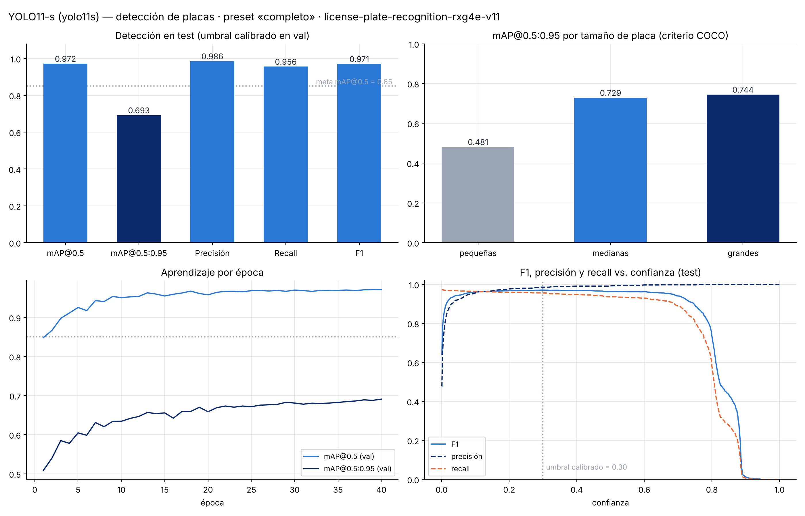
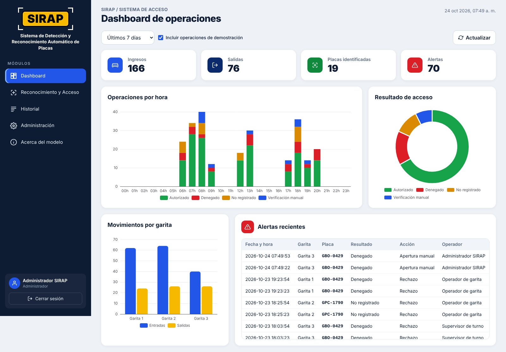
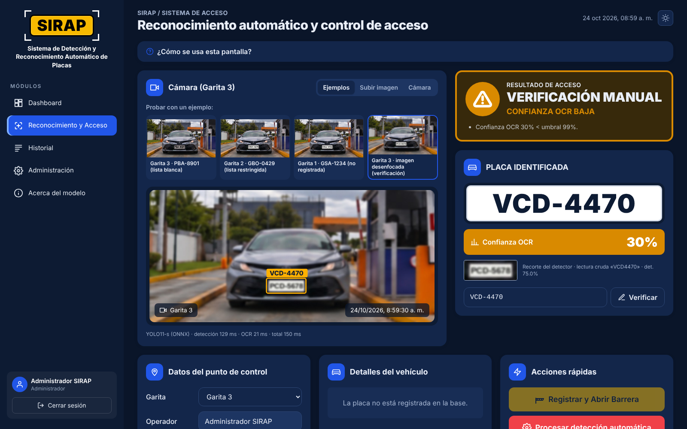
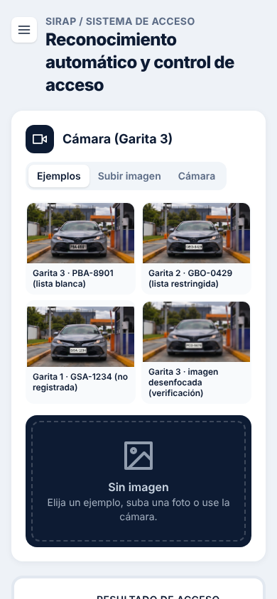

<div align="center">

# SIRAP
### Sistema de Detección y Reconocimiento Automático de Placas · versión del producto 1.0 · FastAPI + Vue 3


**SIRAP** reconoce la placa del vehículo que llega a una garita, la busca en el registro CSV y propone una
decisión de acceso (autorizado, denegado, no registrado o verificación manual). El operador inicia el registro y solicita la apertura desde SIRAP. El servidor vuelve a validar la autorización: solo permite la apertura automática si el acceso está autorizado; la apertura manual de contingencia requiere un motivo. La aplicación ejecuta la orden solicitada y, en la demostración, la barrera es simulada. La versión 1.0 de **SIRAP** ofrece el sistema como una
aplicación web profesional: **API REST en FastAPI** con autenticación por usuario y **frontend en Vue 3**.

[**Aplicación en vivo**](https://eduardoceballos-sirap.hf.space) · [Manual de usuario](docs/manual_usuario.md) ·
[Documentación de la API](https://eduardoceballos-sirap.hf.space/docs) · [Notebook de backend](notebooks/SIRAP_backend.ipynb)


</div>

---

## Versiones del proyecto

- **Versión del producto SIRAP:** 1.0.
- **API:** 2.0.0, identificador técnico expuesto por FastAPI/OpenAPI y el endpoint de salud.
- **Frontend:** 2.0.0 es la versión del paquete npm en `frontend/package.json`; no es la versión del producto.
- **Tag de GitHub `v2.0`:** identifica el corte del repositorio publicado con la arquitectura FastAPI + Vue 3 (release titulada «SIRAP 2.0 – FastAPI + Vue 3»). Es un identificador técnico e histórico del código; el producto SIRAP continúa en la versión 1.0.

## Tabla de contenidos

1. [Problema](#1-problema)
2. [Dataset](#2-dataset)
3. [Metodología](#3-metodología)
4. [Resultados](#4-resultados)
5. [Instalación y uso](#5-instalación-y-uso)
6. [Interfaz de usuario](#6-interfaz-de-usuario)
7. [Estructura del proyecto](#7-estructura-del-proyecto)
8. [Consideraciones éticas](#8-consideraciones-éticas)
9. [Autores](#9-autores-y-contribuciones)
10. [Licencia](#10-licencia)
11. [Agradecimientos y referencias](#11-agradecimientos-y-referencias)
12. [Videos](#12-videos)

## 1. Problema

En urbanizaciones, edificios, empresas, plantas y estacionamientos el control vehicular de la garita es manual: el
guardia lee la placa, la busca en una lista y la anota. Eso produce **colas**, **errores de transcripción**,
**listas desactualizadas** y un historial difícil de auditar.

**SIRAP** automatiza el flujo: **captura → detección de la placa (IA) → lectura (OCR) → consulta en la base
(CSV locales) → evaluación de listas blancas y restringidas → registro y apertura controlada**.

- **Por qué importa:** menos espera, menos errores, seguridad basada en listas vigentes y trazabilidad completa.
- **Usuarios:** operadores de garita (deciden y registran), supervisores (auditan) y administradores (gestionan
  vehículos, listas, garitas y usuarios).

## 2. Dataset

| Dataset | Uso | Tamaño | Licencia / fuente |
|---|---|---|---|
| [License Plate Recognition v11](https://universe.roboflow.com/roboflow-universe-projects/license-plate-recognition-rxg4e) (Roboflow Universe) | Entrenar y evaluar el detector | 10 125 imágenes (7 057 / 2 048 / 1 020), 1 clase, 10 637 placas | CC BY 4.0 |
| [SAVH Guayaquil ANPR Plate Images](https://zenodo.org/records/21120307) | Evaluar el OCR con placas **ecuatorianas** reales | 739 recortes (472 legibles; 399 legibles únicas) | Zenodo; el registro no muestra licencia para este archivo específico |
| Video e imágenes de la garita | Pipeline de video y prueba punta a punta | 1 video de 10 min (18 115 cuadros) | Propio, con autorización escrita; **no se publica** |

Detalles, EDA y decisiones de preprocesamiento: [`docs/analisis_datos.md`](docs/analisis_datos.md) y
[`data/README.md`](data/README.md).

## 3. Metodología

| Etapa | Elección | Justificación |
|---|---|---|
| Detección | **YOLO11-s** (Ultralytics 8.4.177), 9,41 M parámetros | Una sola clase; rápido; se exporta a ONNX y corre en CPU en la app |
| Seguimiento (video) | OC-SORT | Leer cada vehículo una sola vez, con su mejor recorte |
| OCR | **fast-plate-ocr** `cct-s-v2-global-model` (5 MB) | Hecho para placas, 16 ms por recorte en CPU, 93,7 % de EMR en placas reales de Guayaquil |
| Normalización | Formato `XXX-0000`, correcciones letra/dígito por posición (máx. 2) | Validada con placas reales de Guayaquil |
| Decisión | Listas blanca/restringida + umbrales + «¿quiso decir…?» | Nunca decide a ciegas: lo dudoso va a verificación manual |
| Datos | CSV persistentes en GitHub privado (caché local temporal) | Vehículos, autorizaciones, detecciones, garitas, usuarios e historial |

**Preprocesamiento:** copia local del dataset, `data.yaml` con rutas absolutas, *letterbox* a 640 px, aumentos por
defecto de Ultralytics; recorte con margen antes del OCR.
**Entrenamiento:** `yolo11s.pt` (COCO) → 40 épocas, imgsz 640, batch 16 (nbs 64), paciencia 10, semilla 0, AdamW.
**Optimización:** los umbrales se calibraron en *val* (detector: precisión ≥ 95 %; OCR: estudio de confianza en SAVH); la inferencia de video se comparó a 640 y 1280 px. Los 24 *trials* de Optuna seleccionaron hiperparámetros según mAP@0.5:0.95 en *val*; `lr0` explicó el 62 % de la variación. El *test* se reservó para la comparación final del modelo base y el optimizado (1.020 imágenes, 1.085 placas): mAP@0.5:0.95 pasó de 0,693 a 0,704 (+0,011) y mAP@0.5 de 0,97223 a 0,97284 (+0,00061; redondeado a tres decimales: 0,972 y 0,973). Se mantiene el modelo entregado — ver [`notebooks/04_optimizacion.ipynb`](notebooks/04_optimizacion.ipynb) y [`docs/optimizacion.md`](docs/optimizacion.md).
**Validación de calidad pendiente (30/10/2026):** las 69 referencias SAVH sugeridas requieren confirmación visual; la comparación multisemilla del detector ya se completó y se documenta más abajo. Se prepararon los ejecutables `scripts/auditar_savh.py` y `scripts/validar_multisemilla_yolo11.py`; **las seis corridas multisemilla ya están registradas; la revisión humana de las 69 etiquetas SAVH sigue pendiente**. Procedimiento y condiciones de cierre: [`docs/validacion_savh_multisemilla.md`](docs/validacion_savh_multisemilla.md). El modelo base publicado no cambia.
**Métricas:** mAP@0.5 y mAP@0.5:0.95 (también por tamaño de placa), precisión, recall y F1 al umbral calibrado;
EMR y CER para el OCR; falsos autorizados y tiempo por decisión para el sistema.

Arquitectura completa y diagramas: [`docs/arquitectura.md`](docs/arquitectura.md).

## 4. Resultados

Preset «completo». Para el detector, el conjunto *test* (1.020 imágenes, 1.085 placas) no se usó para seleccionar hiperparámetros: los 24 ensayos se compararon en *val* y *test* se reservó para la evaluación final (`results/metrics/`).

| Componente | Métrica | Resultado | Meta |
|---|---|---|---|
| Detector YOLO11-s | mAP@0.5 | **0,972** | ≥ 0,85 ✅ |
| | mAP@0.5:0.95 | 0,693 | — |
| | Precisión / Recall / F1 (umbral 0,30) | 0,986 / 0,956 / 0,971 | — |
| | mAP@0.5:0.95 placas pequeñas / medianas / grandes | 0,481 / 0,729 / 0,744 | — |
| | Latencia (lote 1, FP16, GPU L4) | 23,3 ms (43 FPS) | — |
| Detector con hiperparámetros optimizados (Optuna, 24 *trials*) | mAP@0.5 / mAP@0.5:0.95 *test* | 0,973 / 0,704 (+0,001 / +0,011; una semilla): se mantiene el entregado | — |
| OCR (SAVH Guayaquil, 399 legibles) | EMR / CER sin filtrar por confianza | **93,7 %** / 0,010 | EMR ≥ 80 % ✅ |
| OCR (SAVH, evaluación offline al umbral 0,94) | Cobertura / EMR entre aceptadas | 363/399 (91,0 %) / 349/363 (96,1 %) | — |
| OCR afinado con placas ecuatorianas (*test* separado por placa, n=86) | EMR original / afinado | 94,2 % / 94,2 % (McNemar *p* = 1,0): se mantiene el original | — |
| Regla de decisión (SAVH, lista simulada) | Falsos autorizados / rechazos indebidos | 0 de 202 / 1 de 197 | — |
| Sistema (video de la garita) | Tiempo por decisión (detección + OCR) | 99 ms | ≤ 1 s ✅ |
| Sistema | EMR punta a punta en video | pendiente: faltan etiquetas de placa para los videos de prueba | ≥ 80 % |

La aplicación usa **94 % como umbral operativo de confianza OCR**. Se eligió considerando los recursos de procesamiento limitados del hosting documentado de Hugging Face (2 vCPU y sin GPU dedicada): al aceptar antes una lectura estable, la interfaz puede terminar el análisis de video sin procesar cuadros adicionales. El umbral no acelera cada inferencia; el ahorro potencial proviene de analizar menos cuadros. También busca reducir verificaciones manuales. En videos y cámaras, la interfaz confirma la lectura cuando la misma placa alcanza al menos 94 % en dos cuadros muestreados, separados por 1 segundo; si la confianza es menor o las lecturas no coinciden, solicita validación manual al terminar el video. En una imagen estática se evalúa el cuadro disponible. Al superar el umbral, el servidor solo declara la placa autorizada si tiene una autorización vigente en la lista blanca y no está restringida; la apertura sigue requiriendo que el operador solicite la acción.

**Comparación con un *baseline*.** En el mismo split de validación, YOLO11-s pasó de mAP@0.5 = 0,848 después de
la época 1 a 0,971 en la época 40 (+0,123). En el *test* separado, el modelo final obtuvo 0,972; no se compara
ese valor con la primera época porque corresponden a splits distintos. En el OCR, el *baseline* es el mismo
fast-plate-ocr sin la normalización ecuatoriana: solo con limpieza de texto logra 93,5 % de EMR en SAVH y con
`normalize_plate` 93,7 %, con todas las lecturas en formato válido; afinarlo con placas ecuatorianas no lo mejoró
(94,2 % frente a 94,2 % en un *test* separado por placa, McNemar *p* = 1,0).



**Dónde funciona bien y dónde no:** muy bien con placas medianas y grandes de frente y de día; peor con placas
pequeñas (lejanas), de noche o deterioradas. Por eso el video se analiza a 1280 px y las lecturas dudosas van a
verificación manual.

## 5. Instalación y uso

**Requisitos:** Python 3.11+, Node.js 20.19+ (solo para compilar el frontend), 2 GB de RAM; GPU solo para entrenar
(Colab). Alternativa sin instalar nada: Docker.

```bash
git clone https://github.com/eduardoceballos666/SIRAP_2.git
cd SIRAP_2
python -m venv .venv && source .venv/bin/activate      # Windows: .venv\Scripts\activate
pip install -r requirements.txt
cp .env.example .env                                   # defina SIRAP_JWT_SECRET (cadena larga y aleatoria)

cd frontend && npm ci && npm run build && cd ..        # compila la interfaz Vue en frontend/dist
uvicorn api.main:app --port 8000                       # abre http://localhost:8000 (API + interfaz)
```

Usuarios de demostración: `operador`, `supervisor` y `admin`; la contraseña actual para los tres perfiles es `sirap2026`. Puede cambiarse en el despliegue mediante el secreto `SIRAP_DEMO_PASSWORD`.

| Tarea | Comando |
|---|---|
| Desarrollo con recarga en caliente | `uvicorn api.main:app --reload` y, en otra terminal, `cd frontend && npm run dev` (http://localhost:5173) |
| Docker (API + interfaz) | `docker build -t sirap:1.0 . && docker run -p 7860:7860 -e SIRAP_JWT_SECRET=... sirap:1.0` → http://localhost:7860 |
| Documentación interactiva de la API | http://localhost:8000/docs (Swagger) |
| Pruebas (unitarias, integración y API) | `pip install -r requirements-dev.txt && pytest` |
| Pruebas del frontend Vue | `cd frontend && npm ci && npm test` |
| Integración continua | GitHub Actions ejecuta `pytest`, `npm test` y la compilación de Vue en cada push y pull request |
| Exportar los pesos entrenados a ONNX | `python -m src.train --export-only models/best_model.pt` |
| Reentrenar (no hace falta) | `ROBOFLOW_API_KEY=... python -m src.train --roboflow --force` |
| Evaluar el detector en *test* | `python -m src.evaluate detector --data <data.yaml>` |

**Configuración:** parámetros en [`config/config.yaml`](config/config.yaml); secretos en variables de entorno
(plantillas [`.env.example`](.env.example) y [`api/.env.example`](api/.env.example)): `SIRAP_JWT_SECRET`,
`SIRAP_DEMO_PASSWORD`, `SIRAP_DATA_GITHUB_TOKEN` y, si se conecta una barrera física, `BARRERA_URL` y `BARRERA_TOKEN`.
**Almacenamiento persistente principal:** todos los CSV operativos residen en el repositorio PRIVADO
[`SIRAP_datos_privados`](https://github.com/eduardoceballos666/SIRAP_datos_privados), en
`data/processed/`. Son siete CSV: `vehiculos`, `autorizaciones`, `operaciones`,
`usuarios`, `garitas`, `credenciales` (hashes) y `detecciones`. La misma identidad
`SIRAP_DATA_GITHUB_TOKEN` se usa para todo. Hugging Face usa copias de trabajo temporales,
no datos propios: al arrancar recupera GitHub; cada lectura obtiene la versión remota más
reciente y cada escritura se confirma contra el SHA previo para impedir sobrescrituras
concurrentes. En Docker `SIRAP_GITHUB_REQUIRED=1` impide iniciar sin GitHub o sin alguno
de los seis CSV históricos. La exportación enriquecida usa
`data/processed/detecciones.csv` en el MISMO repositorio privado.
**No borrar ni reinicializar estos archivos:** se preservó un respaldo de los seis CSV
anteriores a la migración en la rama privada
`respaldo-pre-migracion-2026-10-30`.
Véase [procedimiento de continuidad y recuperación](data/README.md).

**Ejemplo de uso de la API:**

```bash
TOKEN=$(curl -s -X POST localhost:8000/api/auth/login -H 'Content-Type: application/json' \
        -d '{"usuario":"operador","password":"sirap2026"}' | python -c "import sys,json;print(json.load(sys.stdin)['access_token'])")
curl -s -X POST localhost:8000/api/recognize -H "Authorization: Bearer $TOKEN" \
     -F file=@data/samples/garita3_PBA-8901.jpg
# {"recognition": {"plate": "PBA-8901", "ocr_confidence": 0.9999, ...}, "decision": {"resultado": "AUTORIZADO", ...}}
```

**Desde Python:**

```python
from src.model import ALPRPipeline
from src.storage import CsvStore
from src.access_control import decide_access
from src.data_processing import load_image

pipeline, store = ALPRPipeline.from_config(), CsvStore.from_environment()
rec = pipeline.recognize(load_image(open("data/samples/garita3_PBA-8901.jpg", "rb").read()))
print(rec.plate, f"{rec.ocr_confidence:.2%}")                       # PBA-8901 99.99%
print(decide_access(rec.plate, rec.ocr_confidence, store).titulo)   # ACCESO AUTORIZADO
```

## 6. Interfaz de usuario

**Aplicación web:** SIRAP usa una API en FastAPI y un frontend en Vue 3 (Vite, Pinia, Vue Router, Tailwind CSS y ECharts). Está desplegada en Hugging Face Spaces mediante Docker. Consulte la [aplicación en vivo](https://eduardoceballos-sirap.hf.space), la captura del [dashboard](docs/img/vue_dashboard.png) y la [guía de usuario](docs/manual_usuario.md).

| Módulo | Qué hace |
|---|---|
| **Inicio de sesión** | Usuario y contraseña; cada operación queda firmada por el usuario y su rol (operador, supervisor, administrador) |
| **Reconocimiento y Acceso** | Botones «Probar con un ejemplo», subir foto o cámara → caja de la placa sobre la imagen, placa, confianza OCR, recorte, resultado de acceso y datos del vehículo; registrar y abrir, reprocesar, apertura manual con motivo, registrar rechazo; corrección manual de la placa; **lecturas de la sesión** para comparar y exportar a CSV; ayuda «¿Cómo se usa esta pantalla?» |
| **Dashboard** | Ingresos, salidas, placas identificadas y alertas; gráficos interactivos (ECharts) por hora, resultado y garita |
| **Historial** | Filtros por fecha, placa, garita, resultado y movimiento; exportación CSV (supervisor y administrador) |

> **Exportación de resultados:** el botón **Exportar CSV** descarga las operaciones del Historial que coinciden con los filtros aplicados. Está disponible para Supervisor y Administrador.
| **Administración** | Vehículos, listas blanca/restringida con vigencia, propietarios, garitas, usuarios con contraseña; datos de demostración |
| **Acerca del modelo** | Funcionamiento, métricas, entrenamiento, optimización y **limitaciones y advertencias** |

La API consulta el servicio público del SRI para completar marca/modelo/año; también consulta EcuadorLegalOnline y
puede recibir el nombre público asociado a la placa, aunque el panel actual no lo muestra. Ninguna consulta interviene
en la decisión de acceso. La exportación enriquecida guarda eventos en
`data/processed/detecciones.csv` del repositorio privado de datos mediante el mismo token
que utiliza el historial; nunca publica registros en SIRAP_2.

**Requisitos de la interfaz cubiertos:** validación de entradas (tipo, tamaño y resolución de imagen en el servidor;
formato de placa), indicador de carga, mensajes de error comprensibles (sin trazas técnicas), confianza OCR y de
detección, visualizaciones (caja sobre la imagen, recorte, gráficos), ejemplos precargados, diseño adaptable a
celular, **tema claro/oscuro** (botón sol/luna), historial y comparación de las lecturas de la sesión y exportación CSV.

| Reconocimiento (anotado en el manual) | Dashboard | Tema oscuro | Celular |
|---|---|---|---|
|  |  |  |  |

### 6.1 API REST

Documentación interactiva (Swagger) en [`/docs`](https://eduardoceballos-sirap.hf.space/docs).

| Endpoint | Rol | Uso |
|---|---|---|
| `POST /api/auth/login` · `GET /api/auth/me` | — | Inicio de sesión (JWT con rol, 12 h) |
| `POST /api/recognize` | todos | Imagen → placa, confianza, caja, recorte y decisión (no registra) |
| `POST /api/plates/verify` | todos | Verificar una placa escrita o corregida a mano |
| `POST /api/plates/register` | todos los perfiles autenticados | Crear un camión NUEVO tras confirmar visualmente la placa; la autorización en lista blanca requiere marcarla expresamente. Registra el usuario autorizador y no sobrescribe placas existentes o restringidas. |
| `POST /api/plates/vehicle-data` · `GET /api/plates/vehicle-data/{request_id}` | todos | Consulta asíncrona al SRI y EcuadorLegalOnline; entrega datos complementarios de la placa, sin cambiar la decisión de acceso |
| `POST /api/operations` | todos | Recalcula la autorización y persiste una solicitud identificada por UUID antes de abrir; después guarda el estado de barrera. Bloquea aperturas si falla el CSV y evita repetir una operación con el mismo UUID. La apertura manual requiere motivo. |
| `GET /api/operations` · `/api/operations/export.csv` | todos · supervisor/admin | Historial filtrado y exportación CSV |
| `GET /api/dashboard` | todos | Indicadores y datos de los gráficos |
| `GET /api/admin/{table}` | todos los usuarios autenticados | Consultar las tablas de vehículos, propietarios, autorizaciones, garitas y usuarios |
| `POST/PUT/DELETE /api/admin/...` | administrador | Crear o modificar vehículos, autorizaciones, garitas, usuarios y datos de demostración |
| `GET /api/system` · `/api/model/info` · `/api/samples` | todos | Estado, métricas del modelo e imágenes de ejemplo |

**Política de registro en Reconocimiento:** Operador, Supervisor y Administrador pueden crear y autorizar una placa nueva si la verifican visualmente y marcan explícitamente la autorización. Sin aprobación, permanece registrada sin permiso. Si la placa ya existe, el endpoint rechaza la modificación para proteger su registro y cualquier restricción. En cambio, la gestión de datos existentes y listas desde Administración sigue reservada al Administrador.

**Trazabilidad de apertura:** `operaciones.csv` guarda `operacion_id`, `estado_barrera` y `actualizado_en`. Las aperturas registran primero `SOLICITADA`, y después `CONFIRMADA`, `FALLIDA` o `INDETERMINADA` según la respuesta. Si falla el guardado inicial, no se abre. Si falla el guardado final, se conserva la solicitud y es necesaria conciliación manual; no debe repetirse automáticamente la orden. El modo físico requiere respaldo CSV privado configurado; la barrera actual es simulada.

La API permite que cualquier usuario autenticado, incluido el Operador, consulte las tablas de Administración mediante `GET /api/admin/{table}`. La pantalla y la ruta de Administración en la interfaz están disponibles solo para Supervisor y Administrador. Consultar las tablas por API no concede permisos de modificación: las operaciones de escritura requieren el rol Administrador.

### 6.2 Despliegue

El workflow [`.github/workflows/deploy-hf-space.yml`](.github/workflows/deploy-hf-space.yml) publica en el Space
`eduardoceballos/sirap` cuando un push a `main` modifica alguna ruta incluida en sus filtros, o cuando se inicia
manualmente desde *Actions → Run workflow*. No cualquier cambio en `main` inicia un despliegue: cambios solo en
documentación, notebooks o pruebas no coinciden con esos filtros. Los cambios relevantes incluyen `api/**`,
`src/**`, `frontend/**`, `config/**`, `data/**`, `models/**`, `results/metrics/**`, `requirements.txt`,
`Dockerfile`, `deploy/huggingface/**` y el propio workflow. Hugging Face construye el [`Dockerfile`](Dockerfile)
(frontend compilado + API, puerto 7860). Configuración en GitHub → *Settings → Secrets and variables → Actions*:

| Nombre | Tipo | Valor |
|---|---|---|
| `HF_TOKEN` | Secret (obligatorio) | Token de Hugging Face con permiso **Write** |
| `SIRAP_JWT_SECRET` | Secret (recomendado) | Cadena larga y aleatoria para firmar las sesiones |
| `SIRAP_DEMO_PASSWORD` | Secret (opcional) | Define la contraseña común de las cuentas de demostración; el despliegue actual usa `sirap2026` |
| `SIRAP_DATA_GITHUB_TOKEN` | Secret (obligatorio) | Token fine-grained con Contents: Read and write únicamente en `SIRAP_datos_privados`; Actions comprueba los seis CSV históricos y lo guarda en el Space para que GitHub sea la fuente principal. |
| `HF_SPACE` | Variable (opcional) | Otro Space, p. ej. `usuario/sirap` |

**Despliegue actual:** SIRAP se aloja como una Space Docker en [Hugging Face Spaces](https://huggingface.co/spaces/eduardoceballos/SIRAP), en el puerto 7860. Hugging Face indica que ejecutar Spaces Docker requiere un plan de pago; el costo del hardware depende del recurso seleccionado ([detalle de hardware](https://huggingface.co/docs/hub/spaces-overview#hardware-resources)). La infraestructura de demostración documentada usa 2 vCPU y no tiene GPU dedicada. La API ocupa aproximadamente 410 MB de RAM con los modelos cargados. El despliegue automático requiere los secretos `HF_TOKEN` y `SIRAP_DATA_GITHUB_TOKEN`; también se recomienda configurar `SIRAP_JWT_SECRET`.

> **Estado:** prototipo funcional. La barrera es **simulada** y la base de demostración contiene **datos ficticios**.
> Los CSV se leen y escriben directamente en GitHub privado. El disco del Space es solo temporal.
> El despliegue no debe sustituir los CSV históricos; rama privada de recuperación:
> `respaldo-pre-migracion-2026-10-30`.
> Para operar en una garita real faltan una cámara IP integrada y el controlador físico de la barrera.

## 7. Estructura del proyecto

```
SIRAP_2/
├── .github/workflows/       # Despliegue en Hugging Face Spaces
├── api/                     # API REST con FastAPI
├── app/                     # Interfaz alternativa con Streamlit
├── config/                  # Configuración sin secretos
├── data/
│   ├── processed/           # Datos CSV de ejecución
│   ├── raw/
│   └── samples/             # Imágenes de ejemplo
├── deploy/huggingface/      # Publicación del Space
├── docs/
│   ├── img/                 # Capturas e imágenes
│   └── ...                  # Manual y documentación técnica
├── frontend/                # Interfaz Vue 3
├── models/                  # Modelos y pesos
├── notebooks/               # Análisis, entrenamiento y evaluación; incluye SIRAP_backend.ipynb
├── results/                 # Figuras, métricas e informes
├── src/                     # Modelo, OCR, decisiones y almacenamiento
├── tests/                   # Pruebas
├── Videos_Imagenes_Prueba/  # Recursos para probar el software
├── app.py                   # Lanzador compatible de app/app.py
├── Dockerfile
├── LICENSE
├── manual_usuario.pdf
├── README.md
├── requirements.txt
└── requirements-dev.txt
```

## 8. Consideraciones éticas

Resumen de [`docs/consideraciones_eticas.md`](docs/consideraciones_eticas.md):

- **Privacidad:** una placa identifica indirectamente a una persona. No se guardan imágenes; datos mínimos de
  propietarios; demo con datos ficticios; secretos fuera del código; marco de la LOPDP de Ecuador (letrero
  informativo, plazo de conservación, derechos de los titulares).
- **Sesgos:** detector entrenado con placas de otros países; OCR validado solo en Guayaquil; peor desempeño con
  placas pequeñas (mAP 0,481), nocturnas o deterioradas.
- **Mitigación:** umbrales calibrados, verificación manual de todo lo dudoso, corrección manual, la barrera nunca se
  abre sola, apertura de contingencia con motivo y auditoría de solo inserción.
- **Responsabilidad:** cada operación queda asociada al usuario autenticado y su rol; el servidor vuelve a calcular la
  decisión antes de registrar, de modo que la interfaz no puede forzar una apertura automática.
- **Uso indebido:** no usar para vigilancia masiva, seguimiento de personas, multas o decisiones sin operador.

## 9. Autores y contribuciones

| Integrante | Rol |
|---|---|
| **Eduardo Alejandro Ceballos Jijón** | Modelado y entrenamiento de YOLO11-s y OCR (fast-plate-ocr).  Desarrollo de la intefaz web Vue 3|
| **Christian Xavier Valle Maridueña** | Datos (SAVH Guayaquil e imágenes de la garita) y desarrollo de la interfaz web Vue 3 |

*Maestría en Inteligencia Artificial — Proyecto Integrador en IA (MIAR0545), 2026.*

## 10. Licencia

Código bajo licencia [MIT](LICENSE). Los pesos entrenados con Ultralytics están sujetos a su licencia AGPL-3.0;
el dataset de Roboflow es CC BY 4.0; OpenCV 4.x se distribuye bajo Apache 2.0. Consulta [THIRD_PARTY_NOTICES.md](THIRD_PARTY_NOTICES.md) para atribuciones y condiciones adicionales. Las atribuciones y condiciones de los demás componentes y recursos se detallan en [THIRD_PARTY_NOTICES.md](THIRD_PARTY_NOTICES.md).

## 11. Agradecimientos y referencias

### Agradecimientos

A **Gladys María Villegas Rugel**, por la dirección y asesoría académica; a la empresa que autorizó la toma de imágenes en su garita y a los docentes del programa. Los autores y sus contribuciones se presentan en la [sección 9](#9-autores-y-contribuciones).

### Componentes de software

SIRAP integra componentes de terceros para detección, OCR, procesamiento de imágenes y datos, seguimiento de video, API, interfaz web y consultas de información pública:

- **Detección y OCR:** [Ultralytics YOLO11](https://docs.ultralytics.com/models/yolo11/) y [fast-plate-ocr](https://github.com/ankandrew/fast-plate-ocr).
- **Entrenamiento e inferencia:** [PyTorch](https://pytorch.org/) se utiliza en el entorno de entrenamiento; la aplicación desplegada ejecuta el modelo exportado mediante [ONNX Runtime](https://onnxruntime.ai/).
- **Imágenes y datos:** [OpenCV](https://github.com/opencv/opencv) (`opencv-python-headless` 4.12.0.88; Apache 2.0) se usa para redimensionar imágenes y codificar JPEG; la detección la realiza YOLO11. [Pillow](https://python-pillow.org/), [NumPy](https://numpy.org/) y [Pandas](https://pandas.pydata.org/) complementan el procesamiento.
- **Seguimiento de video:** [OC-SORT](https://github.com/noahcao/OC_SORT), [Roboflow Trackers](https://github.com/roboflow/trackers) y [Roboflow Supervision](https://github.com/roboflow/supervision).
- **API y servidor:** [FastAPI](https://fastapi.tiangolo.com/) y [Uvicorn](https://www.uvicorn.org/).
- **Interfaz web:** [Vue 3](https://vuejs.org/), [Vite](https://vite.dev/), [Pinia](https://pinia.vuejs.org/), [Vue Router](https://router.vuejs.org/), [Apache ECharts](https://echarts.apache.org/), [Vue ECharts](https://github.com/ecomfe/vue-echarts) y [Tailwind CSS](https://tailwindcss.com/).
- **Consulta de información pública:** [Playwright](https://playwright.dev/) y [Chromium](https://www.chromium.org/).

Las marcas, derechos y licencias de los componentes de terceros pertenecen a sus respectivos titulares. La licencia MIT del código de SIRAP, la licencia aplicable a los pesos de Ultralytics y la licencia del dataset de Roboflow se indican en la [sección 10](#10-licencia).

### Datos y recursos del proyecto

- [Roboflow Universe — License Plate Recognition](https://universe.roboflow.com/roboflow-universe-projects/license-plate-recognition-rxg4e) (dataset utilizado para entrenar y evaluar el detector; licencia CC BY 4.0).
- [SAVH Guayaquil ANPR Plate Images Dataset — Zenodo](https://zenodo.org/records/21120307) (el registro no muestra una licencia para este archivo específico).
- **Código fuente:** [GitHub — eduardoceballos666/SIRAP_2](https://github.com/eduardoceballos666/SIRAP_2).
- **Plataforma de despliegue:** [Hugging Face Spaces — eduardoceballos/SIRAP](https://huggingface.co/spaces/eduardoceballos/SIRAP).
- **Aplicación en vivo:** [eduardoceballos-sirap.hf.space](https://eduardoceballos-sirap.hf.space).

## 12. Videos

- 🎬 **Video pitch (5 min):** _pendiente de grabación y publicación_
- 🎤 **Video de respuestas a las preguntas:** _pendiente de grabación y publicación_


### Actualización: validación multisemilla (30/10/2026)

Las seis corridas (base y optimizada, semillas 0, 1 y 2) se completaron. El mAP50:95 mejoró en los tres pares: **+0,3743 puntos porcentuales en promedio** (desviación estándar muestral **0,3153 pp**); el recall medio cambió aproximadamente **+0,3017 pp**. Es evidencia descriptiva de tres semillas, no significación estadística ni una evaluación punta a punta. Se conserva el modelo publicado y sigue pendiente verificar visualmente las 69 etiquetas SAVH. [Detalle y limitaciones](docs/validacion_savh_multisemilla.md) · [Métricas CSV](results/metrics/validacion_multisemilla_comparacion.csv).


### Estado de revisión SAVH (30/10/2026; provisional)

Se localizaron y examinaron de forma asistida las 69 imágenes SAVH representativas: 67 sugerencias visualmente compatibles y 2 grupos que siguen ambiguos (7 y 52). **La columna de confirmación humana continúa vacía**; las otras 330 etiquetas de cámara tampoco se consideran confirmadas por una persona, aunque luego se cotejaron con OCR y se inspeccionaron sus 18 desacuerdos. Tras excluir 2 imágenes únicas ambiguas, se recalculó con las salidas OCR cacheadas un **EMR offline de 373/397 = 93,95 %** (frente al histórico de 374/399 = 93,73 %); con un umbral offline del 94 % hubo **14 errores entre 362 lecturas aceptadas**. El cambio en EMR es consecuencia de la exclusión de casos, **no una mejora del OCR**. No se validó el funcionamiento punta a punta en video ni la regla de dos cuadros. Se mantuvieron sin cambios el modelo y el despliegue de Hugging Face. [Auditoría y pendientes](docs/validacion_savh_multisemilla.md) · [Resumen provisional](results/metrics/ocr_savh_revision_asistida_397.json).


### Auditoría adicional de etiquetas de cámara (30/10/2026)

El cotejo entre **330 etiquetas de cámara** y las predicciones OCR guardadas de SAVH identificó **18 discrepancias**, además de 312 coincidencias que **no equivalen a confirmaciones visuales**. La revisión asistida de los 18 recortes sugiere provisionalmente OCR en 14, cámara en 3 y deja 1 incierto; ninguna lectura ha recibido aprobación humana. La hoja de revisión incluye una nueva pestaña **Auditoria camara OCR**, con los 330 casos y los 18 discrepantes ordenados primero. El EMR de 373/397 (**93,95 %**) sigue siendo **provisional** y no debe corregirse escogiendo como referencia las propias predicciones del OCR. Las 69 sugerencias anteriores también siguen sin aprobación humana. Los archivos con placas y fotografías están en Drive privado, no en GitHub. [Detalle y protocolo de cierre](docs/validacion_savh_multisemilla.md) · [Resumen agregado](results/metrics/ocr_savh_revision_asistida_397.json). No se modifica ningún modelo publicado.
