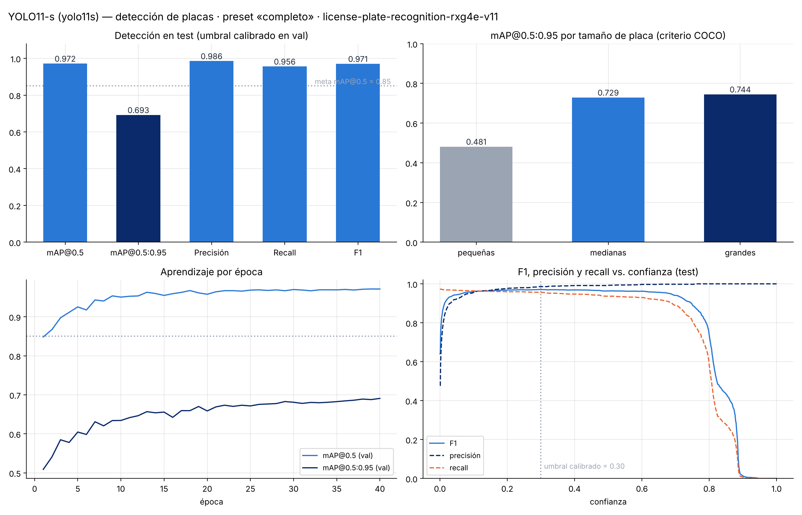

<div align="center">

# SIRAP
### Sistema de Detección y Reconocimiento Automático de Placas

**Aplicación web para apoyar el control de acceso vehicular en garitas.**

[Aplicación en vivo](https://eduardoceballos-sirap.hf.space) · [Manual de usuario](docs/manual_usuario.md) · [API interactiva](https://eduardoceballos-sirap.hf.space/docs) · [Notebook principal](notebooks/SIRAP_backend.ipynb)


**Interfaz disponible en español e inglés.**


</div>

## Contenido

1. [Estado del proyecto](#estado-del-proyecto)
2. [Plataformas de acceso](#plataformas-de-acceso)
3. [Qué hace SIRAP](#qué-hace-sirap)
4. [Interfaz y módulos](#interfaz-y-módulos)
5. [Roles](#roles)
6. [API REST](#api-rest)
7. [Arquitectura y tecnología](#arquitectura-y-tecnología)
8. [Datos y recursos](#datos-y-recursos)
9. [Modelo y resultados](#modelo-y-resultados)
10. [Instalación local](#instalación-local)
11. [Notebook y reproducibilidad](#notebook-y-reproducibilidad)
12. [Privacidad, seguridad y uso responsable](#privacidad-seguridad-y-uso-responsable)
13. [Estructura del repositorio](#estructura-del-repositorio)
14. [Documentación del proyecto](#documentación-del-proyecto)
15. [Autores](#autores)
16. [Licencia y atribuciones](#licencia-y-atribuciones)
17. [Agradecimientos y recursos](#agradecimientos-y-recursos)
18. [Videos de entrega](#videos-de-entrega)

## Estado del proyecto

| Dato | Estado |
|---|---|
| Versión del producto | SIRAP 1.0 |
| Fecha de terminación de la aplicación | **30 de octubre de 2026** |
| API | FastAPI; identificador técnico 2.0.0 |
| Interfaz web | Vue 3; el paquete npm usa el identificador técnico 2.0.0 |
| Despliegue | Hugging Face Spaces con Docker |
| Barrera | Simulada; la aplicación no acciona una barrera física |

El tag de GitHub v2.0 identifica una versión técnica del repositorio con arquitectura FastAPI y Vue 3. No representa la versión del producto, que es SIRAP 1.0.

## Plataformas de acceso

SIRAP se publica en dos lugares con propósitos distintos:

| Plataforma | Contenido |
|---|---|
| [GitHub: SIRAP_2](https://github.com/eduardoceballos666/SIRAP_2) | Código fuente, notebooks, modelos, datos de evaluación, métricas, documentación, manual y configuración de despliegue |
| [Hugging Face Space: SIRAP](https://huggingface.co/spaces/eduardoceballos/SIRAP) | Aplicación web desplegada para probar la interfaz |
| [Abrir SIRAP](https://eduardoceballos-sirap.hf.space) | Acceso directo a la aplicación |
| [Documentación interactiva de la API](https://eduardoceballos-sirap.hf.space/docs) | Esquema Swagger de la API FastAPI |

### Uso de la aplicación desplegada

1. Abre SIRAP desde el Space o el enlace directo.
2. En el inicio de sesión, elige Español o English. El selector también está en el menú y conserva la preferencia en el navegador.
3. Inicia sesión con una cuenta habilitada. La pantalla del Space muestra las cuentas de demostración operador, supervisor y admin. La contraseña se configura mediante SIRAP_DEMO_PASSWORD; si el secreto no está definido, la API usa el valor predeterminado configurado en api/settings.py. En el Space público, configura explícitamente un valor propio.
4. En Reconocimiento y Acceso, usa un ejemplo, una imagen, un video o una cámara disponible. Revisa la placa, la confianza, el recorte y la decisión.
5. Confirma la información antes de registrar una operación o solicitar la apertura. Las lecturas inciertas requieren revisión humana; la barrera del Space es simulada.
6. Consulta las operaciones en Historial. Supervisor y Administrador pueden exportar los resultados filtrados a CSV.

El Space se construye con Docker y sirve la API y la interfaz Vue. El hardware de demostración documentado es CPU, sin GPU dedicada; por eso las mediciones de GPU del notebook no representan la latencia del Space. El almacenamiento local del Space es temporal: los registros operativos persistentes se guardan en el repositorio privado configurado para la aplicación. La configuración de despliegue, secretos y flujo de publicación está en [Despliegue](#variables-y-despliegue) y en el workflow [deploy-hf-space.yml](.github/workflows/deploy-hf-space.yml).

## Qué hace SIRAP

SIRAP ayuda al operador a revisar el ingreso de un vehículo mediante el flujo:

**Captura de imagen o video → detección de placa → lectura OCR → consulta de autorización → decisión → registro de la operación.**

El sistema consulta listas de autorización y restricción, muestra la confianza y los datos disponibles, y pide revisión humana cuando la lectura es dudosa. El servidor vuelve a comprobar la autorización al registrar una operación. La aplicación propone y registra una solicitud de apertura; en la demostración, la barrera es simulada.

### Interfaz y módulos

La aplicación ofrece Español e English desde el selector de idioma de la pantalla de inicio de sesión y del menú. La preferencia se conserva en el navegador.

| Módulo | Funciones |
|---|---|
| Inicio de sesión | Acceso autenticado y operaciones vinculadas al usuario y su rol |
| Reconocimiento y Acceso | Probar un ejemplo, cargar una imagen o usar la cámara; ver placa, recorte, caja, confianza OCR y decisión; corregir o verificar una lectura; registrar el resultado y solicitar apertura; apertura manual con motivo; lecturas de la sesión y exportación |
| Dashboard | Indicadores de entradas, salidas, placas y alertas, con gráficos por hora, resultado y garita |
| Historial | Consulta filtrada de operaciones y exportación CSV para Supervisor y Administrador |
| Administración | Gestión de vehículos, autorizaciones, restricciones, garitas, usuarios y datos de demostración |
| Acerca del modelo | Explicación del modelo, resultados, entrenamiento y limitaciones |

Capturas: [Reconocimiento](docs/img/vue_reconocimiento.png), [Dashboard](docs/img/vue_dashboard.png), [Verificación](docs/img/vue_verificacion.png) y [vista móvil](docs/img/vue_movil.png).

La interfaz es adaptable a celular y ofrece tema claro y oscuro. Valida el tipo, el tamaño y la resolución de las imágenes, muestra estados de carga y mensajes de error comprensibles, y permite comparar las lecturas obtenidas durante la sesión.

### Roles

- **Operador:** reconoce placas, verifica o corrige lecturas y registra operaciones. Los perfiles autenticados pueden proponer el registro de una placa nueva; autorizarla requiere una confirmación explícita.
- **Supervisor:** consulta el historial y exporta sus resultados.
- **Administrador:** gestiona los registros y la configuración desde Administración.

Los cambios a registros existentes y la administración de listas están restringidos al Administrador. La lectura de tablas administrativas mediante la API y la pantalla de Administración están disponibles para Supervisor y Administrador.

### API REST

La API publica documentación interactiva en [Swagger](https://eduardoceballos-sirap.hf.space/docs). Los principales endpoints son:

| Endpoint | Acceso | Función |
|---|---|---|
| POST /api/auth/login · GET /api/auth/me | Público / autenticado | Inicio de sesión JWT y consulta de identidad |
| POST /api/recognize | Todos los perfiles autenticados | Analizar imagen y devolver placa, confianza, recorte y decisión sin registrar |
| POST /api/plates/verify | Todos los perfiles autenticados | Verificar una placa escrita o corregida |
| POST /api/plates/register | Todos los perfiles autenticados | Proponer el registro de un vehículo nuevo; autorización explícita |
| POST /api/operations | Todos los perfiles autenticados | Revalidar la decisión, registrar la solicitud y el estado de barrera |
| GET /api/operations · /api/operations/export.csv | Historial / Supervisor y Administrador | Consultar y exportar operaciones |
| GET /api/dashboard | Todos los perfiles autenticados | Indicadores y datos de los gráficos |
| GET /api/admin/{table} | Supervisor y Administrador | Consultar tablas administrativas |
| POST/PUT/DELETE /api/admin/... | Administrador | Crear y modificar registros administrativos |
| GET /api/system · /api/model/info · /api/samples | Usuarios autenticados | Estado, información del modelo y ejemplos |

La solicitud de apertura se guarda primero como pendiente; después se registra si fue confirmada, falló o quedó indeterminada. Si falla el guardado inicial, la API no envía la orden. Una falla al guardar el estado final requiere conciliación manual y no debe provocar un reintento automático. La barrera desplegada es simulada.


## Arquitectura y tecnología

| Componente | Tecnología y función |
|---|---|
| API | FastAPI y Uvicorn; autenticación JWT y endpoints REST |
| Interfaz | Vue 3, Vite, Pinia, Vue Router, Tailwind CSS y ECharts |
| Detección | YOLO11-s; ejecución en la aplicación mediante ONNX Runtime |
| OCR | fast-plate-ocr, modelo cct-s-v2-global-model |
| Seguimiento en video | OC-SORT y componentes de seguimiento de Roboflow |
| Procesamiento | OpenCV, Pillow, NumPy y Pandas |
| Persistencia operativa | CSV en el repositorio privado SIRAP_datos_privados; el disco de Hugging Face es temporal |
| Despliegue | Imagen Docker publicada en Hugging Face Spaces |

La aplicación consulta servicios públicos para obtener datos complementarios del vehículo. Esos datos no participan en la decisión de acceso. Los eventos enriquecidos se escriben en el repositorio privado de datos, no en este repositorio público.

## Datos y recursos

| Recurso | Uso y estado |
|---|---|
| [License Plate Recognition v11](https://universe.roboflow.com/roboflow-universe-projects/license-plate-recognition-rxg4e) | Dataset de detección con 10.125 imágenes: 7.057 de entrenamiento, 2.048 de validación y 1.020 de prueba; licencia CC BY 4.0 |
| [SAVH Guayaquil ANPR Plate Images](https://zenodo.org/records/21120307) | Recortes de placas ecuatorianas para revisar OCR. El registro consultado no muestra una licencia para el archivo específico usado; revisar sus condiciones antes de redistribuirlo |
| Imágenes de garita | 21 imágenes y ground_truth.csv incluidos en garita/ para la evaluación por imagen 7.3 |
| Video video_camiones.mp4 | Video fuente publicado como asset del Release [datos-garita-v1](https://github.com/eduardoceballos666/SIRAP_2/releases/tag/datos-garita-v1); tamaño aproximado 459,3 MB |
| Lista de placas para el notebook | data/authorized_plates.csv está versionada en este repositorio y se usa como dato de demostración/evaluación; no contiene credenciales |
| Datos operativos de la aplicación | Vehículos, autorizaciones, operaciones, usuarios, garitas, hashes de credenciales y detecciones enriquecidas se almacenan en el repositorio privado |

La lista de placas de demostración/evaluación [`data/authorized_plates.csv`](data/authorized_plates.csv) y la **referencia final del video** [`blind_eval/video_ground_truth.csv`](blind_eval/video_ground_truth.csv) están publicadas intencionalmente como artefactos del proyecto. La referencia tiene las columnas `plate_gt,frame_start,frame_end` y 20 pasadas con intervalos inclusivos sobre el video completo; es el archivo que usa la sección 7.2. Los CSV provisionales de `blind_eval/` son históricos. No se deben añadir credenciales, datos operativos privados ni nuevas predicciones identificables sin revisión. Los secretos de despliegue se configuran como variables de entorno o secretos del proveedor.

Más detalles: [análisis de datos](docs/analisis_datos.md), [descripción de los datos](data/README.md) y [consideraciones éticas](docs/consideraciones_eticas.md).

## Modelo y resultados

El detector se entrenó con YOLO11-s durante 40 épocas y se exportó para la aplicación. En video se usa OC-SORT para asociar detecciones de un mismo vehículo y seleccionar lecturas. El umbral de detección se calibró con el conjunto de validación. En modo continuo de video o cámara, la interfaz espera que la misma placa alcance al menos 94 % de confianza OCR en dos cuadros aceptados dentro de 7,5 segundos antes de mostrar y registrar la decisión. Esto ayuda a evitar basarla en una sola lectura.

### Intervalos de Wilson

En el holdout ciego SAVH de 57 imágenes, el OCR base obtuvo 42 aciertos exactos (73,7 %; IC Wilson 95 %: 61,0–83,4 %) y el OCR afinado 35 (61,4 %; IC: 48,4–72,9 %). La cobertura fue 56/57 (98,2 %; IC: 90,7–99,7 %) para ambos; cobertura significa que hubo una salida OCR, no que la lectura fuera correcta. Estos intervalos corresponden a ese holdout y son distintos del EMR de 399 recortes de la evaluación SAVH en el notebook principal. Describen incertidumbre de las proporciones bajo supuestos binomiales, sin corregir selección ni calidad de etiquetas. No se informa IC para la proporción de video 18/30, porque las lecturas no son necesariamente unidades independientes y existen casos sin referencia.

Consulta la [explicación del IC de Wilson](docs/ic_wilson.md), el [notebook reproducible](notebooks/Evaluacion_IC_Wilson.ipynb) y el [JSON de métricas](results/metrics/ocr_savh_wilson.json).

### Entrenamiento YOLO11

La corrida de referencia usa el preset vigente `TRAINING_PRESET = "completo"`: 40 de 40 épocas, `train_fraction = 1`, `val_fraction = 1`, lote 16 e imágenes de 640 px. Su mejor mAP@0.5:0.95 de validación fue **0,69082** en la época 40. El resumen registra aproximadamente **0,70 horas** de entrenamiento y **6,90 GB** de memoria GPU máxima.

- Historial completo por época: [entrenamiento_yolo11_results.csv](results/metrics/entrenamiento_yolo11_results.csv).
- Resumen de la corrida completa: [entrenamiento_yolo11_completo.json](results/metrics/entrenamiento_yolo11_completo.json).
- Historial y resumen de la corrida rápida: [CSV](results/metrics/entrenamiento_yolo11_rapido_results.csv) · [JSON](results/metrics/entrenamiento_yolo11_rapido.json).

El CSV permite comparar por época las pérdidas de entrenamiento y validación, además de precisión, recall y mAP. Esa comparación ayuda a evaluar posible sobreajuste; un puntaje final aislado no demuestra su ausencia. La corrida rápida duró 15 épocas y usó solo 30 % del entrenamiento y 25 % de la validación, por lo que es una ejecución reducida y sus métricas no son directamente comparables con las de la corrida completa. El mAP de **0,69082** corresponde a la validación durante entrenamiento; la tabla siguiente informa métricas del conjunto de prueba, que es una evaluación distinta.

### Resultados publicados

| Evaluación | Resultado | Alcance |
|---|---|---|
| Detector YOLO11-s | mAP@0.5 **0,972**; mAP@0.5:0.95 **0,693**; precisión **0,986**; recall **0,956**; F1 **0,971** | Conjunto de prueba: 1.020 imágenes y 1.085 placas |
| Detector por tamaño | mAP@0.5:0.95: pequeñas **0,481**, medianas **0,729**, grandes **0,744** | Las placas pequeñas y lejanas son más difíciles |
| Velocidad del detector | Promedio **23,3 ms** por imagen (aprox. 43 FPS) | GPU NVIDIA L4, lote 1, FP16; no es una medición del hosting de producción |
| OCR en SAVH | EMR **93,7 %**, CER **0,010** | Resultado offline en 399 recortes legibles; 69 referencias se marcaron como sugerencias sin confirmar |
| Garita, evaluación por imagen 7.3 | Informe: EMR **8/21 (38,1 %)** y 37,69 ms; salida guardada del notebook: **9/21 (42,9 %)** y 1,400674 s | Corridas distintas; no combinarlas. La salida del notebook no conserva fecha ni ID de corrida. |
| Video de garita, evaluación 7.2 | Reejecución más reciente: EMR **18/30 (60 %)**; recall de placas únicas **16/17 (94,12 %)**; **2/30** falsas autorizaciones observadas entre lecturas clasificables | 51 lecturas: 30 con referencia y 21 sin clasificar. La tasa integral del video no es estimable. La referencia contiene 20 pasadas (17 placas únicas) y excluye dos pasadas dudosas. La corrida guardada anterior se documenta por separado. [Informe de métricas](results/metrics/video_e2e_intervalos_final.md) |

Los archivos agregados y las figuras pequeñas están en [métricas](results/metrics/) y [figuras](results/figures/). El resumen detallado de la [evaluación por imágenes de garita](results/metrics/garita_imagenes_e2e_20261101.md), la [corrida final de video 7.2](results/metrics/video_e2e_intervalos_final.md) y el informe histórico de la [evaluación puntual de video](results/metrics/video_e2e_puntos_provisionales_20261101.md) describen sus resultados y límites. La referencia final del video y su cotejo se documentan en [`blind_eval/video_ground_truth_review.md`](blind_eval/video_ground_truth_review.md).



### Validaciones complementarias

- Se compararon el modelo base y una configuración seleccionada por Optuna en el conjunto de prueba reservado: mAP@0.5:0.95 pasó de 0,693 a 0,704 y mAP@0.5 de 0,97223 a 0,97284 en esa comparación de una semilla. El modelo entregado se mantiene.
- El estudio multisemilla del detector comparó tres pares de corridas. La mejora media descriptiva de mAP@0.5:0.95 fue de 0,3743 puntos porcentuales, con desviación estándar muestral de 0,3153 puntos; no es una prueba de significación estadística.
- El afinamiento OCR con placas ecuatorianas no mejoró la exactitud en el conjunto de prueba separado por placa: EMR de 94,2 % antes y después (86 placas; McNemar p = 1,0), por lo que se conserva el OCR original.
- En una muestra de cinco clips se aplicó la regla de dos cuadros: hubo 3/5 coincidencias exactas y dos confirmaciones incorrectas. La prueba no comparó con una alternativa de un solo cuadro, así que no mide por separado cuánto mejora la regla; tampoco sustituye la evaluación integral del video operativo.
- En la validación offline SAVH al umbral 0,94 se aceptaron 363 de 399 lecturas; 349/363 fueron exactas. La muestra incluye 69 referencias sugeridas sin confirmar y no es una evaluación ciega independiente.

### Límites de evaluación

- El rendimiento puede bajar con placas pequeñas, lejanas, nocturnas, deterioradas, con reflejos o de provincias poco representadas.

## Instalación local

### Requisitos

- Python 3.11 o superior.
- Node.js 20.19 o superior para compilar o desarrollar la interfaz.
- Docker es una alternativa para construir y ejecutar el conjunto.
- GPU recomendada para entrenar; no es necesaria para usar el servicio con los modelos disponibles.

### Ejecución

```bash
git clone https://github.com/eduardoceballos666/SIRAP_2.git
cd SIRAP_2

python -m venv .venv
source .venv/bin/activate                 # Windows: .venv\Scripts\activate
pip install -r requirements.txt

cp .env.example .env
# Configure SIRAP_JWT_SECRET y las variables necesarias en .env

cd frontend
npm ci
npm run build
cd ..

uvicorn api.main:app --port 8000
```

La aplicación y la API estarán disponibles en http://localhost:8000; Swagger, en http://localhost:8000/docs.

Para desarrollo de la interfaz, ejecuta npm run dev dentro de frontend/ y uvicorn api.main:app --reload en otra terminal.

### Variables y despliegue

Los secretos se configuran fuera del código. Según el modo de ejecución, pueden incluir:

- SIRAP_JWT_SECRET para firmar sesiones.
- SIRAP_DEMO_PASSWORD para las cuentas de demostración.
- SIRAP_DATA_GITHUB_TOKEN para leer y escribir en el repositorio privado de datos.
- HF_TOKEN para el despliegue automático en Hugging Face.
- ROBOFLOW_API_KEY para descargar el dataset de Roboflow desde el notebook.
- BARRERA_URL y BARRERA_TOKEN solo para una integración futura con un controlador compatible.

El workflow [deploy-hf-space.yml](.github/workflows/deploy-hf-space.yml) publica los cambios de la aplicación en Hugging Face Spaces cuando se modifican las rutas configuradas o se inicia manualmente. El token de Roboflow se requiere para descargar ese dataset; no está incrustado en el notebook.

En producción, los CSV operativos se leen y actualizan desde el repositorio privado SIRAP_datos_privados. Hugging Face usa copias temporales y no debe usarse como almacenamiento persistente. El respaldo y la recuperación de esos datos se describen en [data/README.md](data/README.md).

## Notebook y reproducibilidad

El notebook principal [notebooks/SIRAP_backend.ipynb](notebooks/SIRAP_backend.ipynb) contiene preparación de entorno, análisis de datos, preprocesamiento, entrenamiento, calibración, evaluación del detector y OCR, análisis de video y evaluación de las imágenes de garita.

1. Abre el notebook desde GitHub en Google Colab y ejecuta la sección 0; clona el repositorio y prepara el entorno sin montar Google Drive.
2. Para descargar el dataset de Roboflow, guarda ROBOFLOW_API_KEY en Secrets de Colab. Si se usa una fuente local, coloca el ZIP en data/raw/dataset_placas_yolo.zip y configura DATASET_SOURCE = local.
3. La sección 0 descarga video_camiones.mp4 desde el Release datos-garita-v1 a artifacts/video_camiones.mp4 y comprueba su integridad. El video fuente se usa por defecto; el video de muestra es opcional.
4. Ejecuta en el mismo runtime las secciones previas requeridas por el pipeline. La sección 0 usa el checkpoint y los umbrales versionados cuando inicia una sesión nueva; no necesitas reentrenar para evaluar. Si vas a entrenar, selecciona `TRAINING_PRESET = "completo"`; después de reentrenar, vuelve a correr la calibración antes de evaluar. Los historiales por época y sus resúmenes están versionados en [resultados de entrenamiento](#entrenamiento-yolo11).
5. La evaluación 7.3 usa las 21 imágenes y garita/ground_truth.csv versionadas en el repositorio.
6. Las salidas nuevas se escriben en el espacio temporal de Colab. Descarga desde Colab los videos anotados u otros resultados grandes que quieras conservar.

El notebook no incrusta el video fuente ni publica automáticamente los videos anotados. El workflow [deploy-hf-space.yml](.github/workflows/deploy-hf-space.yml) también sincroniza `notebooks/SIRAP_backend.ipynb` con el Space cuando el notebook cambia en `main`. El [README de artefactos](artifacts/README.md) describe los medios grandes y cómo se distribuyen. La guía del resto de notebooks está en [notebooks/README.md](notebooks/README.md).

## Privacidad, seguridad y uso responsable

- Una placa puede identificar indirectamente a una persona y revelar patrones de movimiento.
- La aplicación de demostración usa datos ficticios; los datos operativos residen en un repositorio privado.
- Las contraseñas se almacenan como hashes en el sistema de datos; los tokens y claves deben guardarse en secretos, no en archivos públicos.
- Las lecturas inciertas requieren revisión humana. La aplicación registra el usuario y el resultado de las operaciones.
- La apertura manual de contingencia exige un motivo. La barrera de esta demostración es simulada y el sistema no reemplaza la supervisión del operador.
- El detector y el OCR tienen sesgos por región, condiciones de captura y tamaño de placa. Revise [consideraciones éticas y limitaciones](docs/consideraciones_eticas.md) antes de usar los resultados.

## Estructura del repositorio

```text
SIRAP_2/
├── .github/workflows/       # Automatización y despliegue
├── api/                     # API FastAPI
├── app/ y frontend/         # Interfaz web
├── blind_eval/              # Referencia final del video (video_ground_truth.csv) y su revisión
├── config/                  # Configuración sin secretos
├── data/                    # Ejemplos, listas y documentación de datos
├── docs/                    # Manual, arquitectura, análisis y capturas
├── garita/                  # 21 imágenes y referencia ground_truth.csv
├── models/                  # Modelo entrenado y exportación ONNX
├── notebooks/               # Análisis, entrenamiento y evaluación
├── results/                 # Métricas, informes y figuras compactas
├── src/                     # Modelo, OCR, decisiones y persistencia
├── tests/                   # Pruebas automatizadas
├── artifacts/               # Instrucciones para recursos pesados
├── Dockerfile
├── LICENSE
├── manual_usuario.pdf
└── README.md
```

## Documentación del proyecto

- [Manual de usuario](docs/manual_usuario.md) y [manual en PDF](manual_usuario.pdf).
- [Arquitectura](docs/arquitectura.md).
- [Análisis de datos](docs/analisis_datos.md).
- [Optimización del detector](docs/optimizacion.md).
- [Validación SAVH y multisemilla](docs/validacion_savh_multisemilla.md).
- [Consideraciones éticas](docs/consideraciones_eticas.md).
- [Documentación de datos y recuperación](data/README.md).
- [Notebooks y guía de ejecución](notebooks/README.md).
- [Intervalo de confianza de Wilson](docs/ic_wilson.md).
- [Artefactos pesados](artifacts/README.md).

## Autores

| Integrante | Contribuciones |
|---|---|
| Eduardo Alejandro Ceballos Jijón | Modelado y entrenamiento de YOLO11-s y OCR; desarrollo de la interfaz Vue 3 |
| Christian Xavier Valle Maridueña | Datos SAVH y de garita; desarrollo de la interfaz Vue 3 |

Dirección y asesoría académica: Gladys María Villegas Rugel.

## Licencia y atribuciones

El código de SIRAP se distribuye bajo [MIT](LICENSE). Los pesos entrenados con Ultralytics están sujetos a AGPL-3.0. El dataset de Roboflow utiliza CC BY 4.0. Los demás componentes y recursos conservan sus licencias y condiciones originales; consulte [THIRD_PARTY_NOTICES.md](THIRD_PARTY_NOTICES.md).

## Agradecimientos y recursos

Gracias a Gladys María Villegas Rugel por la asesoría académica, a la empresa que autorizó la toma de imágenes de garita y a los docentes del programa.

- [Aplicación desplegada](https://eduardoceballos-sirap.hf.space)
- [Repositorio GitHub](https://github.com/eduardoceballos666/SIRAP_2)
- [Space de Hugging Face](https://huggingface.co/spaces/eduardoceballos/SIRAP)

## Videos de entrega

- [Video pitch del proyecto (máximo 5 minutos)](https://www.youtube.com/watch?v=DBaeSUo64xE)
- [Video de respuestas a las preguntas](https://youtu.be/TUrEQ9sEwYM)
