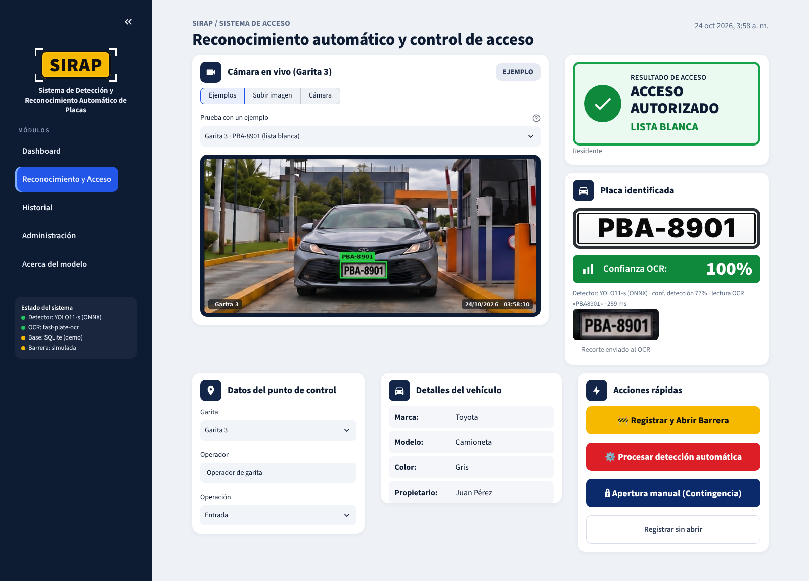
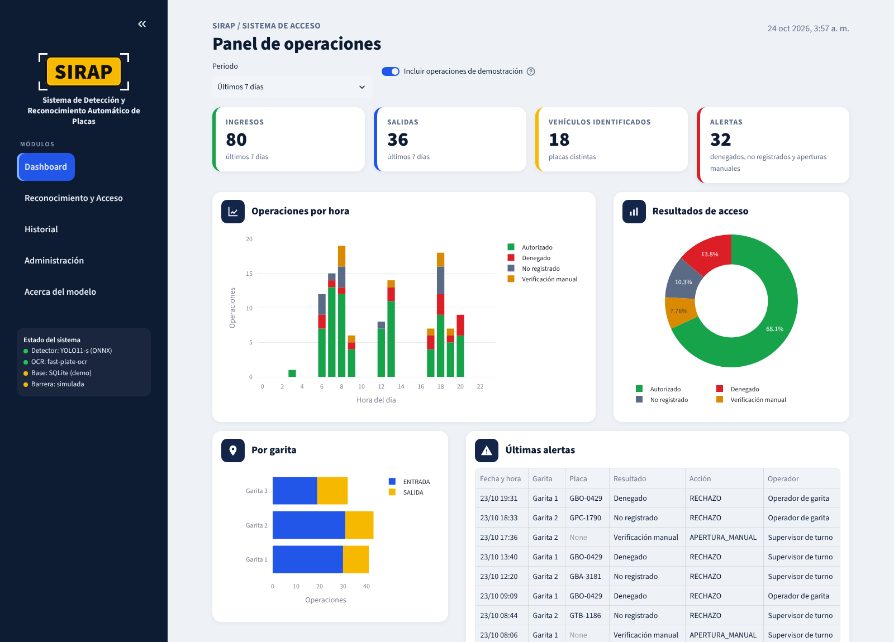
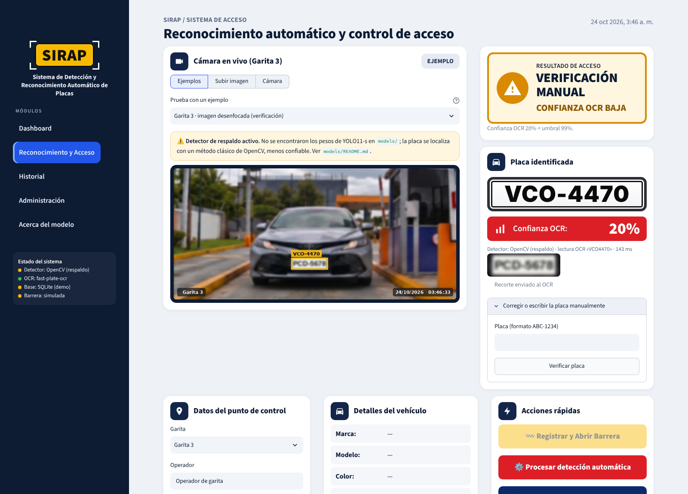
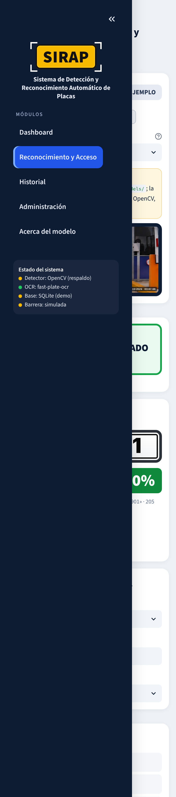

<div align="center">

# 🚧 SIRAP
### Sistema de Detección y Reconocimiento Automático de Placas


**SIRAP** reconoce la placa del vehículo que llega a una garita, la busca en la base de datos y propone una
decisión de acceso (autorizado, denegado, no registrado o verificación manual). El operador confirma, la operación
queda registrada y la barrera se abre solo cuando corresponde.

[**Aplicación en vivo (Streamlit)**](https://sirapapp.streamlit.app/) · [Versión FastAPI + Vue](#6b-versión-web-fastapi--vue-3) · [Manual de usuario](docs/manual_usuario.md) ·
[Notebook de backend](notebooks/SIRAP_backend.ipynb)



</div>

---

## Tabla de contenidos

1. [Problema](#1-problema)
2. [Dataset](#2-dataset)
3. [Metodología](#3-metodología)
4. [Resultados](#4-resultados)
5. [Instalación y uso](#5-instalación-y-uso)
6. [Interfaz de usuario](#6-interfaz-de-usuario) · [6b. FastAPI + Vue 3](#6b-versión-web-fastapi--vue-3)
7. [Estructura del proyecto](#7-estructura-del-proyecto)
8. [Consideraciones éticas](#8-consideraciones-éticas)
9. [Autores](#9-autores-y-contribuciones)
10. [Licencia](#10-licencia)
11. [Agradecimientos y referencias](#11-agradecimientos-y-referencias)
12. [Videos](#12-videos)

## 1. Problema

En urbanizaciones, edificios, empresas, plantas y estacionamientos el control vehicular de la garita es manual: el
guardia lee la placa, la busca en una lista y la anota. Eso produce **colas**, **errores de transcripción**,
**listas desactualizadas** y un historial difícil de auditar.

**SIRAP** automatiza el flujo: **captura → detección de la placa (IA) → lectura (OCR) → consulta en la base
(PostgreSQL) → evaluación de listas blancas y restringidas → registro y apertura controlada**.

- **Por qué importa:** menos espera, menos errores, seguridad basada en listas vigentes y trazabilidad completa.
- **Usuarios:** operadores de garita (deciden y registran), supervisores (auditan) y administradores (gestionan
  vehículos, listas, garitas y usuarios).

## 2. Dataset

| Dataset | Uso | Tamaño | Licencia / fuente |
|---|---|---|---|
| [License Plate Recognition v11](https://universe.roboflow.com/roboflow-universe-projects/license-plate-recognition-rxg4e) (Roboflow Universe) | Entrenar y evaluar el detector | 10 125 imágenes (7 057 / 2 048 / 1 020), 1 clase, 10 637 placas | CC BY 4.0 |
| SAVH Guayaquil ANPR Plate Images | Evaluar el OCR con placas **ecuatorianas** reales | 739 recortes (472 legibles; 399 legibles únicas) | Zenodo (público) |
| Video e imágenes de la garita | Pipeline de video y prueba punta a punta | 1 video de 10 min (18 115 cuadros) | Propio, con autorización escrita; **no se publica** |

Detalles, EDA y decisiones de preprocesamiento: [`docs/analisis_datos.md`](docs/analisis_datos.md) y
[`data/README.md`](data/README.md).

## 3. Metodología

| Etapa | Elección | Justificación |
|---|---|---|
| Detección | **YOLO11-s** (Ultralytics 8.4.177), 9,41 M parámetros | Una sola clase; rápido; se exporta a ONNX y corre en CPU en la app |
| Seguimiento (video) | OC-SORT | Leer cada vehículo una sola vez, con su mejor recorte |
| OCR | **fast-plate-ocr** `cct-s-v2-global-model` (5 MB) | Hecho para placas, 16 ms por recorte en CPU, mismo acierto que GLM-OCR en SAVH |
| Normalización | Formato `XXX-0000`, correcciones letra/dígito por posición (máx. 2) | Validada con placas reales de Guayaquil |
| Decisión | Listas blanca/restringida + umbrales + «¿quiso decir…?» | Nunca decide a ciegas: lo dudoso va a verificación manual |
| Datos | PostgreSQL (producción) / SQLite (demo) | Vehículos, propietarios, listas, garitas, usuarios e historial |

**Preprocesamiento:** copia local del dataset, `data.yaml` con rutas absolutas, *letterbox* a 640 px, aumentos por
defecto de Ultralytics; recorte con margen antes del OCR.
**Entrenamiento:** `yolo11s.pt` (COCO) → 40 épocas, imgsz 640, batch 16 (nbs 64), paciencia 10, semilla 0, AdamW.
**Optimización:** calibración de umbrales en *val* (detector: precisión ≥ 95 %; OCR: estudio de confianza en SAVH),
resolución de inferencia en video (640 → 1280 px) y estudio de sensibilidad de hiperparámetros (Optuna + fANOVA +
PDP) en [`notebooks/04_optimizacion.ipynb`](notebooks/04_optimizacion.ipynb) — ver
[`docs/optimizacion.md`](docs/optimizacion.md).
**Métricas:** mAP@0.5 y mAP@0.5:0.95 (también por tamaño de placa), precisión, recall y F1 al umbral calibrado;
EMR y CER para el OCR; falsos autorizados y tiempo por decisión para el sistema.

Arquitectura completa y diagramas: [`docs/arquitectura.md`](docs/arquitectura.md).

## 4. Resultados

Preset «completo», split *test* nunca visto en el entrenamiento (salidas del notebook, `results/metrics/`).

| Componente | Métrica | Resultado | Meta |
|---|---|---|---|
| Detector YOLO11-s | mAP@0.5 | **0,972** | ≥ 0,85 ✅ |
| | mAP@0.5:0.95 | 0,693 | — |
| | Precisión / Recall / F1 (umbral 0,30) | 0,986 / 0,956 / 0,971 | — |
| | mAP@0.5:0.95 placas pequeñas / medianas / grandes | 0,481 / 0,729 / 0,744 | — |
| | Latencia (lote 1, FP16, GPU L4) | 22,2 ms (45 FPS) | — |
| OCR (SAVH Guayaquil, 399 legibles) | EMR / CER | **93,7 %** / 0,010 | EMR ≥ 80 % ✅ |
| OCR afinado con placas ecuatorianas (*test* separado por placa, n=86) | EMR original / afinado | 94,2 % / 94,2 % (McNemar *p* = 1,0): se mantiene el original | — |
| Regla de decisión (SAVH, lista simulada) | Falsos autorizados / rechazos indebidos | 0 de 202 / 1 de 197 | — |
| Sistema (video de la garita) | Tiempo por decisión (detección + OCR) | 90 ms | ≤ 1 s ✅ |
| Sistema | EMR punta a punta | pendiente (requiere referencia anotada del video) | ≥ 80 % |

**Comparación con un *baseline*.** El primer entrenamiento (época 1, equivalente a usar el modelo apenas
adaptado) logra mAP@0.5 = 0,848 en *val*; el modelo final llega a 0,971 (+0,12). En el OCR, el *baseline* de
versiones anteriores (GLM-OCR, ≈0,9 B parámetros) obtenía 93,0 % de EMR en las mismas placas frente a 93,7 % de
fast-plate-ocr, con una diferencia no significativa (McNemar *p* = 0,71) pero ≈30 veces más rápido y sin GPU.


**Dónde funciona bien y dónde no:** muy bien con placas medianas y grandes de frente y de día; peor con placas
pequeñas (lejanas), de noche o deterioradas. Por eso el video se analiza a 1280 px y las lecturas dudosas van a
verificación manual.

## 5. Instalación y uso

**Requisitos:** Python 3.11+, 2 GB de RAM; GPU solo para entrenar (Colab).

```bash
git clone https://github.com/eduardoceballos666/SIRAP_2.git
cd SIRAP_2
python -m venv .venv && source .venv/bin/activate      # Windows: .venv\Scripts\activate
pip install -r requirements.txt
streamlit run app.py                                    # abre http://localhost:8501
```

| Tarea | Comando |
|---|---|
| Pruebas unitarias | `pip install pytest && pytest` |
| Exportar los pesos entrenados a ONNX | `pip install -r requirements-dev.txt && python -m src.train --export-only models/best_model.pt` |
| Reentrenar (no hace falta) | `ROBOFLOW_API_KEY=... python -m src.train --roboflow --force` |
| Evaluar el detector en *test* | `python -m src.evaluate detector --data <data.yaml>` |
| Evaluar punta a punta | `python -m src.evaluate e2e --csv <image_path,plate_gt>.csv` |

**Configuración:** parámetros en [`config/config.yaml`](config/config.yaml); secretos (`PG_DSN`, `SIRAP_ADMIN_PIN`,
`BARRERA_URL`, `BARRERA_TOKEN`, `ROBOFLOW_API_KEY`) en variables de entorno o en los *Secrets* de Streamlit
(plantilla en [`.env.example`](.env.example)). Sin `PG_DSN`, la app crea una base SQLite de demostración.
Para PostgreSQL: `psql "$PG_DSN" -f sql/schema_postgres.sql`.

**Ejemplo de uso desde Python:**

```python
from src.model import ALPRPipeline
from src.database import Database
from src.access_control import decide_access
from src.data_processing import load_image

pipeline, db = ALPRPipeline.from_config(), Database.from_environment()
rec = pipeline.recognize(load_image(open("data/samples/garita3_PBA-8901.jpg", "rb").read()))
print(rec.plate, f"{rec.ocr_confidence:.2%}")                       # PBA-8901 99.99%
print(decide_access(rec.plate, rec.ocr_confidence, db).titulo)      # ACCESO AUTORIZADO
```

## 6. Interfaz de usuario

App en **Streamlit + CSS** siguiendo la guía de diseño [`docs/img/SIRAP_Dashboard.png`](docs/img/SIRAP_Dashboard.png).
Desplegada en **https://sirapapp.streamlit.app/**.

| Módulo | Qué hace |
|---|---|
| **Reconocimiento y Acceso** | Imagen (ejemplos, archivo o cámara) → placa, confianza OCR, resultado de acceso, datos del vehículo; acciones: registrar y abrir, reprocesar, apertura manual con motivo, registrar rechazo; corrección manual de la placa |
| **Dashboard** | Ingresos, salidas, vehículos identificados y alertas; gráficos interactivos (Plotly) por hora, resultado y garita |
| **Historial** | Filtros por fecha, placa, garita, resultado y movimiento; exportación CSV |
| **Administración** | Vehículos, listas blanca/restringida con vigencia, propietarios, garitas, usuarios; datos de demostración |
| **Acerca del modelo** | Funcionamiento, métricas frente a metas, gráficos y limitaciones |

Incluye validación de entradas (formato, tamaño y resolución de imagen; formato de placa), indicador de carga,
mensajes de error comprensibles, ejemplos precargados, diseño adaptable a celular y registro de cada operación.

| Dashboard | Verificación manual | Celular |
|---|---|---|
|  |  |  |

> **Estado:** prototipo funcional. La barrera es **simulada** y la base pública contiene **datos ficticios**. Para
> operar en una garita real faltan: conectar la cámara IP, PostgreSQL, el controlador de la barrera y autenticación
> por usuario.

## 6b. Versión web: FastAPI + Vue 3

Además de la app de Streamlit (que se mantiene igual), SIRAP_2 incluye una versión con **backend REST en FastAPI**
y **frontend en Vue 3** (Vite, Pinia, Vue Router, Tailwind CSS). Ambas usan el mismo backend de `src/`
(YOLO11-s + fast-plate-ocr + regla de decisión + base de datos).

```bash
pip install -r api/requirements.txt
cp api/.env.example .env                    # defina SIRAP_JWT_SECRET
uvicorn api.main:app --reload               # API en http://localhost:8000 · documentación en /docs

cd frontend && npm install && npm run dev   # interfaz en http://localhost:5173
# o bien: npm run build → FastAPI sirve la interfaz compilada en http://localhost:8000
```

Con Docker (API + interfaz en una sola imagen): `docker build -t sirap . && docker run -p 7860:7860 -e SIRAP_JWT_SECRET=... sirap`
y abrir http://localhost:7860.

**Publicación en Hugging Face Spaces (gratis, 2 vCPU y 16 GB de RAM).** El workflow
[`.github/workflows/deploy-hf-space.yml`](.github/workflows/deploy-hf-space.yml) sube la app al Space
`eduardoceballos/sirap` en cada push a `main` (o a mano desde *Actions → Run workflow*); Hugging Face construye el
`Dockerfile`. Configuración, una sola vez, en GitHub → *Settings → Secrets and variables → Actions*:

| Nombre | Tipo | Valor |
|---|---|---|
| `HF_TOKEN` | Secret (obligatorio) | Token de Hugging Face con permiso **Write** (huggingface.co/settings/tokens) |
| `SIRAP_JWT_SECRET` | Secret (recomendado) | Cadena larga y aleatoria para firmar las sesiones |
| `SIRAP_DEMO_PASSWORD` | Secret (opcional) | Contraseña de los usuarios de demostración |
| `HF_SPACE` | Variable (opcional) | Otro Space, p. ej. `usuario/sirap` |

La API usa ≈410 MB de RAM con los modelos cargados, por eso no se recomienda el plan gratuito de Render (512 MB).

| Endpoint | Rol | Uso |
|---|---|---|
| `POST /api/auth/login` · `GET /api/auth/me` | — | Inicio de sesión (JWT con rol) |
| `POST /api/recognize` | todos | Imagen → placa, confianza, caja, recorte y decisión (no registra) |
| `POST /api/plates/verify` | todos | Verificar una placa escrita o corregida a mano |
| `POST /api/operations` | todos | Registrar la operación; el servidor recalcula la decisión, solo abre automáticamente si está AUTORIZADO y exige motivo en la apertura manual |
| `GET /api/operations` · `/api/operations/export.csv` | todos · supervisor/admin | Historial filtrado y exportación CSV |
| `GET /api/dashboard` | todos | Indicadores y datos de los gráficos |
| `GET/POST/DELETE /api/admin/...` | admin (lectura: supervisor) | Vehículos, listas, garitas, usuarios, datos de demostración |
| `GET /api/system` · `/api/model/info` · `/api/samples` | todos | Estado, métricas del modelo e imágenes de ejemplo |

Usuarios de demostración: `operador`, `supervisor` y `admin`, con la contraseña definida en `SIRAP_DEMO_PASSWORD`
(se guarda como hash PBKDF2 en la tabla `api_credenciales`, separada de la que usa Streamlit).

| Reconocimiento | Dashboard | Celular |
|---|---|---|
|  |  |  |

## 7. Estructura del proyecto

```
SIRAP_2/
├── api/                    # API REST FastAPI: main.py, routers/, seguridad JWT, esquemas Pydantic
├── frontend/               # interfaz Vue 3 + Vite + Pinia + Vue Router + Tailwind CSS
├── Dockerfile              # imagen con API + frontend compilado
├── deploy/huggingface/     # publicación automática en Hugging Face Spaces
├── app.py                  # punto de entrada para Streamlit Cloud (ejecuta app/app.py)
├── app/                    # interfaz: app.py (módulos), ui.py (componentes), assets/style.css
├── src/                    # backend: data_processing, model, access_control, database, train, evaluate, utils
├── notebooks/              # SIRAP_backend.ipynb (completo) y 01–05 (EDA, preprocesamiento, modelado, optimización, evaluación)
├── models/                 # pesos de YOLO11-s (best_model.pt / .onnx) y ficha del modelo
├── data/                   # samples/ (ejemplos de la app), raw/, processed/ y descripción de los datos
├── sql/                    # esquemas PostgreSQL/SQLite y datos de demostración
├── config/config.yaml      # parámetros (sin secretos)
├── docs/                   # planificación, EDA, arquitectura, optimización, ética, manual e imágenes
├── results/                # figures/, metrics/ (JSON/CSV del notebook), reports/
├── tests/                  # pruebas unitarias e integración (pytest)
├── requirements.txt        # dependencias de la app (Streamlit Cloud)
└── requirements-dev.txt    # entrenamiento, notebooks y pruebas
```

## 8. Consideraciones éticas

Resumen de [`docs/consideraciones_eticas.md`](docs/consideraciones_eticas.md):

- **Privacidad:** una placa identifica indirectamente a una persona. No se guardan imágenes; datos mínimos de
  propietarios; demo con datos ficticios; secretos fuera del código; marco de la LOPDP de Ecuador (letrero
  informativo, plazo de conservación, derechos de los titulares).
- **Sesgos:** detector entrenado con placas de otros países; OCR validado solo en Guayaquil; peor desempeño con
  placas pequeñas (mAP 0,481), nocturnas o deterioradas.
- **Mitigación:** umbrales calibrados, verificación manual de todo lo dudoso, corrección manual, la barrera nunca se
  abre sola, apertura de contingencia con motivo y auditoría de solo inserción.
- **Uso indebido:** no usar para vigilancia masiva, seguimiento de personas, multas o decisiones sin operador.

## 9. Autores y contribuciones

| Integrante | Rol |
|---|---|
| **Eduardo Alejandro Ceballos Jijón** | Modelado y entrenamiento de YOLO11-s, OCR (fast-plate-ocr) y base de datos PostgreSQL |
| **Christian Xavier Valle Maridueña** | Datos (SAVH Guayaquil e imágenes de la garita) y aplicación Streamlit |

*Maestría en Inteligencia Artificial — Proyecto Integrador en IA (MIAR0545), 2026.*

## 10. Licencia

Código bajo licencia [MIT](LICENSE). Los pesos entrenados con Ultralytics están sujetos a su licencia AGPL-3.0;
el dataset de Roboflow es CC BY 4.0.

## 11. Agradecimientos y referencias

- Ultralytics YOLO11 — https://docs.ultralytics.com/models/yolo11/
- fast-plate-ocr — https://github.com/ankandrew/fast-plate-ocr
- OC-SORT / `trackers` y `supervision` de Roboflow — https://github.com/roboflow/trackers
- Roboflow Universe, *License Plate Recognition* — https://universe.roboflow.com/roboflow-universe-projects/license-plate-recognition-rxg4e
- SAVH Guayaquil ANPR Plate Images Dataset — Zenodo
- Streamlit — https://streamlit.io/ · Plotly — https://plotly.com/python/
- A la empresa que autorizó la toma de imágenes en su garita, y a los docentes del programa.

## 12. Videos

- 🎬 **Video pitch (5 min):** _enlace pendiente_
- 🎤 **Video de respuestas a las preguntas:** _enlace pendiente_
