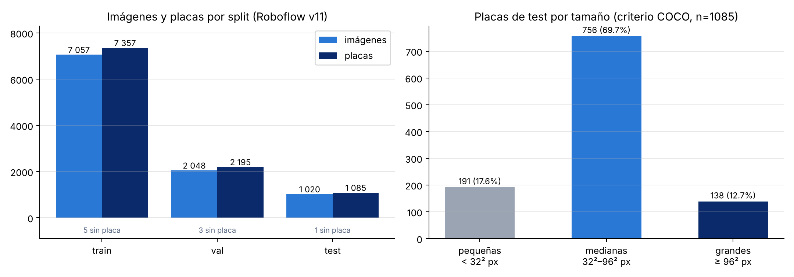
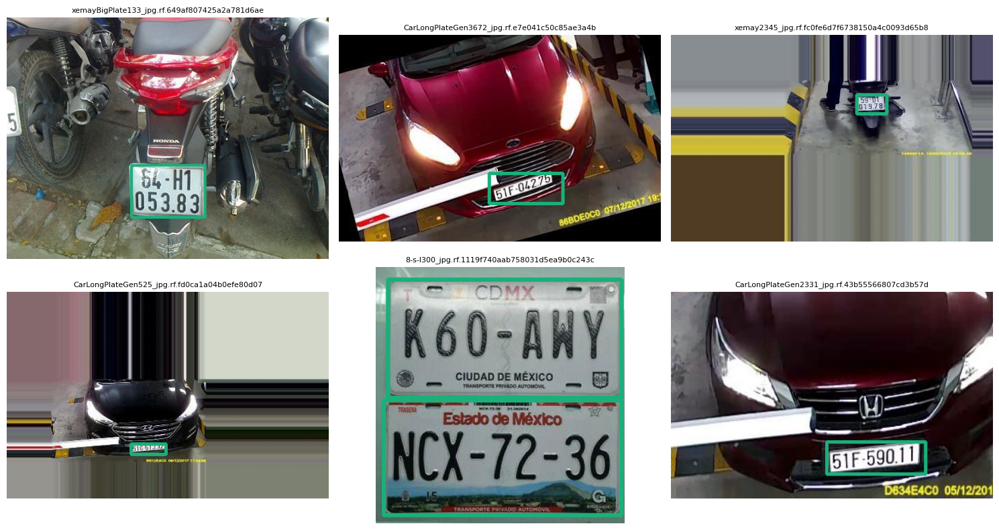
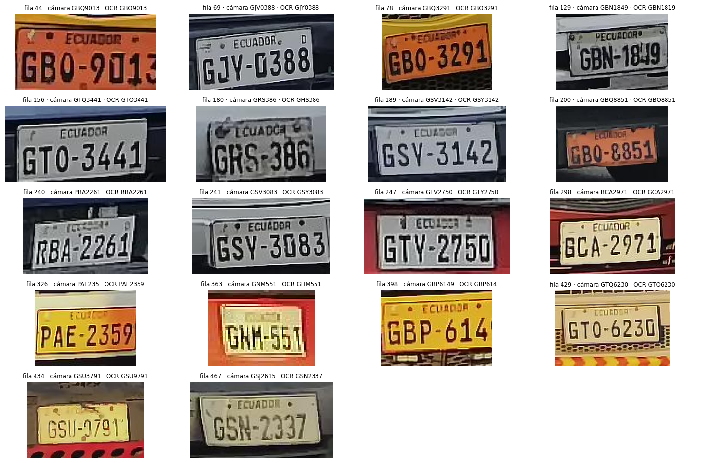
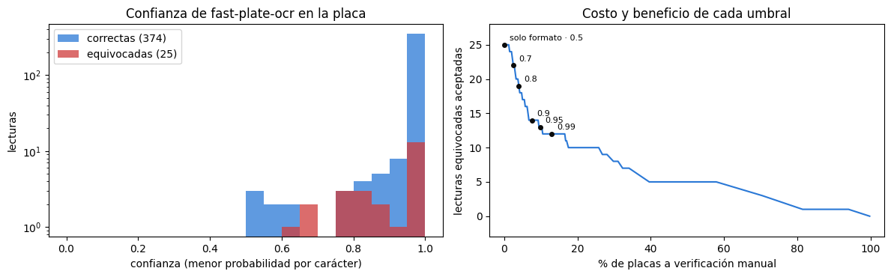

# Análisis exploratorio de datos – SIRAP

SIRAP usa dos tipos de datos con propósitos distintos: un dataset **de detección** (¿dónde está la placa?) y uno
**de lectura** (¿qué dice la placa?). El análisis completo está en `notebooks/01_exploracion.ipynb` (sección 1 del
notebook de backend) y sus gráficos en `results/figures/`.

> Todas las cifras salen de las salidas del notebook (`dataset_resumen.json`, sección 1, y sección 5 para SAVH);
> las figuras están en `results/figures/`.

---

## 1. Dataset de detección – License Plate Recognition v11 (Roboflow Universe)

| Característica | Valor |
|---|---|
| Fuente | `roboflow-universe-projects/license-plate-recognition-rxg4e`, versión 11 |
| Licencia | CC BY 4.0 |
| Imágenes | 10 125 (7 057 *train* · 2 048 *val* · 1 020 *test*) |
| Clases | 1 (`License_Plate`) |
| Formato | YOLO: `class cx cy w h` normalizados |
| Origen de las imágenes | Mixto (varios países, autos y camiones, calle y estacionamientos) |

### 1.1 Composición por split

La partición 70 / 20 / 10 (aprox.) viene del dataset y se respeta para que los resultados sean comparables. El
notebook cuenta, por split, imágenes, placas e imágenes **sin** placa (negativos), y guarda el resumen en
`resultados/dataset_resumen.json` (copia en `results/metrics/dataset_resumen.json`).

| Split | Imágenes | Placas | Placas por imagen | Imágenes sin placa |
|---|---|---|---|---|
| train | 7 057 | 7 357 | 1,04 | 5 |
| val | 2 048 | 2 195 | 1,07 | 3 |
| test | 1 020 | 1 085 | 1,06 | 1 |

Casi todas las imágenes tienen exactamente una placa y solo 9 de 10 125 son negativos (0,09 %): el dataset casi no
enseña qué **no** es una placa, por lo que conviene vigilar falsos positivos en escenas con letreros.

### 1.2 Tamaño de las placas (criterio COCO)

| Tamaño en *test* | Criterio | Placas | % |
|---|---|---|---|
| Pequeñas | área < 32² px | 191 | 17,6 % |
| Medianas | 32² ≤ área < 96² px | 756 | 69,7 % |
| Grandes | área ≥ 96² px | 138 | 12,7 % |
| **Total** | | **1 085** | 100 % |

**Hallazgo.** Casi una de cada cinco placas de *test* es pequeña. Son las más difíciles para cualquier detector
y, en la garita, corresponden a vehículos lejos de la cámara. Por eso:

- el mAP se desglosa por tamaño (sección 3 del notebook);
- en el video de la garita el detector analiza cada cuadro a **1280 px** (la resolución de la cámara): a 640 px,
  el tamaño de entrenamiento, no detectaba las placas más chicas;
- el OCR solo lee placas que ocupan al menos 0,2 % del cuadro (`OCR_PLATE_AREA_RATIO`); las de camiones
  detenidos en el video real miden 0,3–0,5 %.

**Efecto medido en el modelo** (sección 3 del notebook): el mAP@0.5:0.95 de YOLO11-s en *test* es 0,481 en
placas pequeñas, 0,729 en medianas y 0,744 en grandes. La dificultad de las placas pequeñas predicha por el EDA se
confirma.

### 1.3 Ejemplos con sus etiquetas

Seis imágenes de *train* elegidas al azar con semilla fija, con las cajas de referencia dibujadas, para
comprobar que las etiquetas están bien alineadas.

Los ejemplos muestran que el dataset incluye autos y **motos** (placas de dos filas), cámaras de estacionamiento con
sobreimpresión de fecha y escenas de distinto encuadre: variedad útil para generalizar, pero distinta de las placas
ecuatorianas de una fila.

### 1.4 Patrones, sesgos y valores atípicos

- **Desbalance geográfico:** el dataset no es ecuatoriano. Las placas tienen formatos, colores y tipografías de
  otros países. Se compensa evaluando el OCR con placas reales de Guayaquil (sección 2) y con imágenes de la garita.
- **Una sola clase:** no hay desbalance entre clases; el desbalance relevante es de **tamaño** (sección 1.2).
- **Negativos:** las imágenes sin placa ayudan a reducir falsos positivos (letreros, rejillas).
- **Atípicos:** cajas muy pequeñas o placas parcialmente tapadas; se conservan porque representan casos reales
  (el *early stopping* y la calibración del umbral en *val* controlan el sobreajuste a ellos).

## 2. Dataset de lectura – SAVH Guayaquil (Zenodo)

| Característica | Valor |
|---|---|
| Fuente | SAVH Guayaquil ANPR Plate Images Dataset (público en Zenodo) |
| Imágenes totales | 2 000 |
| Subconjunto usado | 739 recortes de placa con la lectura de la cámara (`ground_truth.csv`) |
| Legibles / no legibles | 472 / 267 |
| Imágenes únicas | 666 (73 copias idénticas); 399 legibles únicas |
| Referencia | 330 conservan la lectura de la cámara (formato válido); 69 corregidas en la hoja «Revisión placas SAVH (142 legibles)», aún sin confirmar |

### 2.1 Calidad de la referencia

La lectura de la cámara de SAVH **no es una verdad absoluta**: confunde caracteres parecidos (por ejemplo
`GB01825` cuando la placa es `GBO-1825`). Versiones anteriores del notebook aceptaban patrones de 2 letras + 4 o 5
dígitos que en realidad eran estos errores, y la normalización «aceptaba» lecturas incorrectas. Con la revisión
manual se confirmó que las 472 placas legibles siguen solo dos formatos:

| Formato | Ejemplo | Normalización |
|---|---|---|
| 3 letras + 4 dígitos (actual) | `GBA1234` | `GBA-1234` |
| 3 letras + 3 dígitos (antigua) | `GMS429` | `GMS-0429` (se antepone un 0) |

### 2.2 Desacuerdos entre la cámara y el OCR, y confianza del OCR

En 18 de las 330 legibles que conservan la lectura de la cámara, fast-plate-ocr lee otra cosa. Al mirar las
imágenes, en varias la razón la tiene el OCR (la cámara escribió `V` donde hay `Y`), así que el EMR medido es
probablemente conservador.

La confianza del OCR (menor probabilidad entre los caracteres) separa lecturas correctas de equivocadas con un
**AUROC de 0,76**; con un umbral de 0,99, el 13 % de las placas va a verificación manual y las lecturas equivocadas
aceptadas bajan de 25 a 12. Ese es el umbral que usa la app.

La primera letra de una placa ecuatoriana indica la provincia (`G` = Guayas), así que en un subconjunto capturado
en Guayaquil se espera que predominen las placas que empiezan con `G` (el gráfico lo cuantifica). El OCR podría rendir distinto con placas de otras
provincias: es una limitación declarada en `consideraciones_eticas.md`.

## 3. Decisiones de preprocesamiento

| Decisión | Motivo |
|---|---|
| Copiar el dataset al disco local de Colab | Leer miles de imágenes desde Drive en cada época es mucho más lento |
| Reescribir `data.yaml` con rutas absolutas | Las rutas relativas de Roboflow (`../train/images`) no siempre se resuelven |
| Mismo split y semilla para todo | Resultados reproducibles |
| Letterbox a 640 px (gris 114) | Mantener la proporción de la placa, como Ultralytics |
| Aumentos por defecto de Ultralytics (mosaic, HSV, flip horizontal…) | Robustez a iluminación y posición. *Nota:* el volteo horizontal no afecta al detector (solo localiza la caja) |
| Recorte con 6 % de margen antes del OCR | Evitar cortar el primer o último carácter |
| Normalización por posición (`0↔O`, `1↔I`, `8↔B`, …) | El formato fija qué posiciones son letras y cuáles dígitos |

## 4. Datos faltantes y desbalance

- **Faltantes:** no hay atributos tabulares; los «faltantes» son imágenes sin placa (negativos válidos) o placas
  ilegibles en SAVH, que se excluyen de la métrica de OCR y se cuentan aparte.
- **Desbalance de tamaño:** se reporta mAP por tamaño en lugar de solo el global.
- **Desbalance geográfico:** se mitiga con la evaluación local (SAVH + garita), no con re-muestreo.
