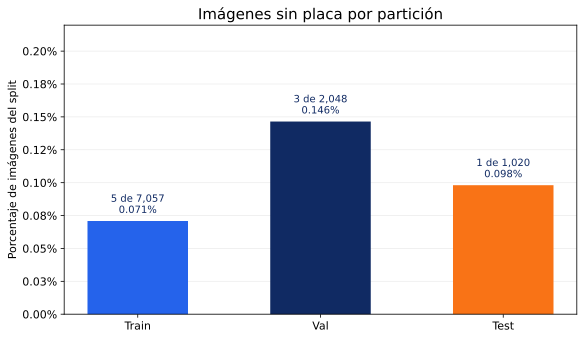
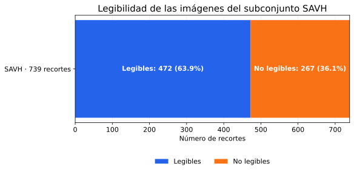
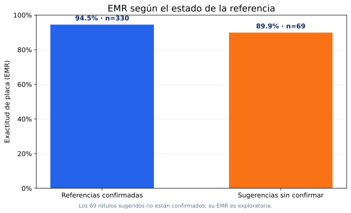

# Análisis exploratorio de datos – SIRAP

SIRAP usa dos tipos de datos con propósitos distintos: un dataset **de detección** (¿dónde está la placa?) y uno
**de lectura** (¿qué dice la placa?). El análisis completo está en `notebooks/01_exploracion.ipynb` (sección 1 del
notebook de backend, «Datos y análisis exploratorio») y sus gráficos en `results/figures/`.

> Todas las cifras salen de las salidas del notebook (`dataset_resumen.json`, sección 1, y secciones 1.3, 2.2 y 5.4 para SAVH);
> las figuras están en `results/figures/`.

---

## 1. Dataset de detección – License Plate Recognition v11 (Roboflow Universe)

| Característica | Valor |
|---|---|
| Fuente | `roboflow-universe-projects/license-plate-recognition-rxg4e`, versión 11 |
| Licencia | CC BY 4.0 |
| Imágenes | 10 125 (7 057 *train* · 2 048 *val* · 1 020 *test*) |
| Clases | 1 (`License_Plate`) |
| Formato | YOLO: `class cx cy w h` normalizados |
| Origen de las imágenes | Mixto (varios países, autos y camiones, calle y estacionamientos) |

### 1.1 Composición por split

La partición 70 / 20 / 10 (aprox.) viene del dataset y se respeta para que los resultados sean comparables. El
notebook cuenta, por split, imágenes, placas e imágenes **sin** placa (negativos), y guarda el resumen en
`resultados/dataset_resumen.json` (copia en `results/metrics/dataset_resumen.json`).

| Split | Imágenes | Placas | Placas por imagen | Imágenes sin placa |
|---|---|---|---|---|
| train | 7 057 | 7 357 | 1,04 | 5 |
| val | 2 048 | 2 195 | 1,07 | 3 |
| test | 1 020 | 1 085 | 1,06 | 1 |

Casi todas las imágenes tienen exactamente una placa y solo 9 de 10 125 son negativos (0,09 %): el dataset casi no
enseña qué **no** es una placa, por lo que conviene vigilar falsos positivos en escenas con letreros.

El primer panel compara imágenes y placas por split; el segundo distribuye las placas de *test* por tamaño. Junto con
las gráficas de imágenes negativas y de legibilidad de SAVH que siguen, y la gráfica de confianza OCR de la sección
2.2, el análisis incluye seis visualizaciones cuantitativas, además de ejemplos visuales de etiquetas.

### 1.2 Tamaño de las placas (criterio COCO)

| Tamaño en *test* | Criterio | Placas | % |
|---|---|---|---|
| Pequeñas | área < 32² px | 191 | 17,6 % |
| Medianas | 32² ≤ área < 96² px | 756 | 69,7 % |
| Grandes | área ≥ 96² px | 138 | 12,7 % |
| **Total** | | **1 085** | 100 % |

**Hallazgo.** Casi una de cada cinco placas de *test* es pequeña. Son las más difíciles para cualquier detector
y, en la garita, corresponden a vehículos lejos de la cámara. Por eso:

- el mAP se desglosa por tamaño (sección 5.1 del notebook);
- en el video de la garita el detector analiza cada cuadro a **1280 px** (la resolución de la cámara): a 640 px,
  el tamaño de entrenamiento, no detectaba las placas más chicas;
- el OCR solo lee placas que ocupan al menos 0,2 % del cuadro (`OCR_PLATE_AREA_RATIO`); las de camiones
  detenidos en el video real miden 0,3–0,5 %.

**Efecto medido en el modelo** (sección 5.1 del notebook): el mAP@0.5:0.95 de YOLO11-s en *test* es 0,481 en
placas pequeñas, 0,729 en medianas y 0,744 en grandes. La dificultad de las placas pequeñas predicha por el EDA se
confirma.

### 1.3 Ejemplos con sus etiquetas

Seis imágenes de *train* elegidas al azar con semilla fija, con las cajas de referencia dibujadas, para
comprobar que las etiquetas están bien alineadas.

Los ejemplos muestran que el dataset incluye autos y **motos** (placas de dos filas), cámaras de estacionamiento con
sobreimpresión de fecha y escenas de distinto encuadre: variedad útil para generalizar, pero distinta de las placas
ecuatorianas de una fila.

### 1.4 Patrones, sesgos y valores atípicos

- **Desbalance geográfico:** el dataset no es ecuatoriano. Las placas tienen formatos, colores y tipografías de
  otros países. Se compensa evaluando el OCR con placas reales de Guayaquil (sección 2) y con imágenes de la garita.
- **Una sola clase:** no hay desbalance entre clases; el desbalance relevante es de **tamaño** (sección 1.2).
- **Negativos:** las imágenes sin placa ayudan a reducir falsos positivos (letreros, rejillas).
- **Atípicos:** cajas muy pequeñas o placas parcialmente tapadas; se conservan porque representan casos reales
  (el *early stopping* y la calibración del umbral en *val* controlan el sobreajuste a ellos).

## 2. Dataset de lectura – SAVH Guayaquil (Zenodo)

| Característica | Valor |
|---|---|
| Fuente | [SAVH Guayaquil ANPR Plate Images Dataset (Zenodo)](https://zenodo.org/records/21120307); el registro no muestra licencia para este archivo específico |
| Imágenes totales | 2 000 |
| Subconjunto usado | 739 recortes de placa con la lectura de la cámara (`ground_truth.csv`) |
| Legibles / no legibles | 472 / 267 |
| Imágenes únicas | 666 (73 copias idénticas); 399 legibles únicas |
| Referencia | 330 conservan la lectura de la cámara (formato válido); 69 sugerencias de revisión aún sin confirmar |

### 2.1 Calidad de la referencia

La lectura de la cámara de SAVH **no es una verdad absoluta**: confunde caracteres parecidos (por ejemplo
`GB01825` cuando la placa es `GBO-1825`). Aceptar patrones de 2 letras + 4 o 5 dígitos, que en realidad son
estos errores, haría que la normalización diera por buenas lecturas incorrectas. Con la revisión
manual se confirmó que las 472 placas legibles siguen solo dos formatos. La comparación de EMR por estado de la
referencia se interpreta con cautela: las 69 sugerencias aún no están confirmadas.

| Formato | Ejemplo | Normalización |
|---|---|---|
| 3 letras + 4 dígitos (actual) | `GBA1234` | `GBA-1234` |
| 3 letras + 3 dígitos (antigua) | `GMS429` | `GMS-0429` (se antepone un 0) |

### 2.2 Confianza del OCR

La confianza del OCR (menor probabilidad entre los caracteres) separa lecturas correctas de equivocadas con un
**AUROC de 0,76**. El umbral que consta en el repositorio, en `config/config.yaml`, es **0,94**. La evaluación offline
SAVH descrita a continuación utiliza **0,94**; **0,99** es otro umbral de estudio offline, no se acredita aquí como configuración operativa del despliegue.
SAVH con predicciones guardadas, 363 de 399 recortes se aceptan (91,0 % de cobertura) y 36 pasan a revisión manual;
entre las aceptadas, 349/363 son exactas (96,1 %) y 14 contienen una lectura equivocada. El EMR sin filtrar por
confianza sigue siendo 374/399 (93,7 %). De las 399 referencias, 330 provienen de lecturas de cámara de formato válido (no necesariamente confirmadas visualmente) y 69 son sugerencias aún no
confirmadas; por ello estos resultados se informan como una evaluación offline y no como rendimiento punta a punta
en video. El umbral configurado en `config/config.yaml` del repositorio es 0,94; esta comparación offline usa predicciones y resultados del estudio y no constituye una nueva medición en producción ni verifica posibles modificaciones por entorno.

La primera letra de una placa ecuatoriana indica la provincia (`G` = Guayas), así que en un subconjunto capturado
en Guayaquil se espera que predominen las placas que empiezan con `G` (el gráfico lo cuantifica). El OCR podría rendir distinto con placas de otras
provincias: es una limitación declarada en `consideraciones_eticas.md`.

## 3. Decisiones de preprocesamiento

| Decisión | Motivo |
|---|---|
| Copiar el dataset al disco local de Colab | Leer miles de imágenes desde Drive en cada época es mucho más lento |
| Reescribir `data.yaml` con rutas absolutas | Las rutas relativas de Roboflow (`../train/images`) no siempre se resuelven |
| Mismo split y semilla para todo | Resultados reproducibles |
| Letterbox a 640 px (gris 114) | Mantener la proporción de la placa, como Ultralytics |
| Aumentos por defecto de Ultralytics (mosaic, HSV, flip horizontal…) | Robustez a iluminación y posición. *Nota:* el volteo horizontal no afecta al detector (solo localiza la caja) |
| Recorte con 6 % de margen antes del OCR | Evitar cortar el primer o último carácter |
| Normalización por posición (`0↔O`, `1↔I`, `8↔B`, …) | El formato fija qué posiciones son letras y cuáles dígitos |

## 4. Datos faltantes y desbalance

- **Faltantes:** no hay atributos tabulares; los «faltantes» son imágenes sin placa (negativos válidos) o placas
  ilegibles en SAVH, que se excluyen de la métrica de OCR y se cuentan aparte.
- **Desbalance de tamaño:** se reporta mAP por tamaño en lugar de solo el global.
- **Desbalance geográfico:** se mitiga con la evaluación local (SAVH + garita), no con re-muestreo.

## 5. Actualización de auditoría asistida SAVH (30/10/2026)

La revisión visual asistida de 69 fotografías representativas identificó 67 sugerencias compatibles con las imágenes y 2 grupos ambiguos (n=7, n=52). **Ninguno se presenta como aprobación humana** y las otras 330 referencias de cámara con formato válido se cotejaron posteriormente con OCR, y se inspeccionaron visualmente las 18 discrepancias (sección 5.1); no hay aprobación humana. Se separaron los casos inciertos para evitar imponer una etiqueta por reglas de formato.

Con 666 salidas OCR guardadas, la muestra histórica de 399 recortes legibles únicos tenía 374 aciertos exactos (**EMR 93,7343 %**). Al excluir las 2 imágenes únicas ambiguas, la evaluación offline quedó en **373 aciertos de 397 (EMR 93,9547 %)**. Con umbral offline de 94 %, hubo 362 recortes aceptados y 14 lecturas equivocadas entre ellas. **La diferencia no demuestra mejora del OCR**, porque el denominador cambia y el modelo no se reentrenó. No es evaluación de video ni confirma la regla de dos cuadros.

La auditoría detallada, sus limitaciones y pendientes están en [validación SAVH](validacion_savh_multisemilla.md) y [métricas provisionales](../results/metrics/ocr_savh_revision_asistida_397.json). El recálculo definitivo requiere aprobación humana de las referencias.

### 5.1 Comprobación cruzada adicional: cámara frente a OCR

Se cruzaron **330 recortes legibles únicos con etiqueta de cámara `camara_formato_valido`** y las predicciones OCR originales: 312 coincidencias y **18 discrepancias**. Se inspeccionaron los 18 recortes; la evaluación visual asistida favorece provisionalmente la lectura OCR en 14, la de cámara en 3 y considera 1 incierto. No hay aprobaciones humanas. Por tanto, llamar «confirmadas» a las 330 referencias de cámara es incorrecto: la validez del formato no equivale a verificación de su contenido.

El EMR previo de 374/399 y el recálculo de 373/397 emplean referencias que todavía necesitan validación independiente. **No calcular un EMR más alto sustituyendo automáticamente la referencia por la lectura OCR:** cambiaría la verdad terreno en favor del modelo evaluado. La lista de 18 discrepancias, tres láminas de recortes y el informe se guardaron en Drive privado, y se añadió una pestaña `Auditoria camara OCR` a la hoja de revisión. Véase [protocolo de cierre](validacion_savh_multisemilla.md).
