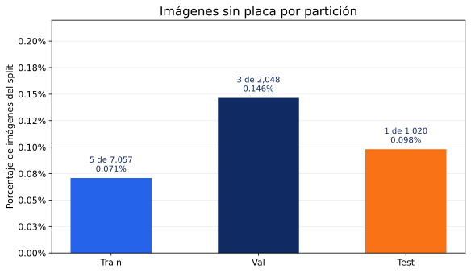
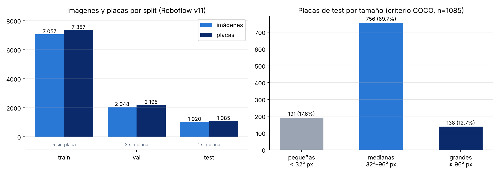
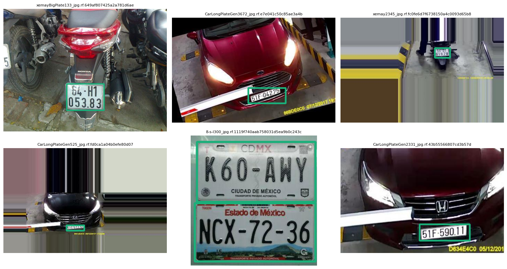
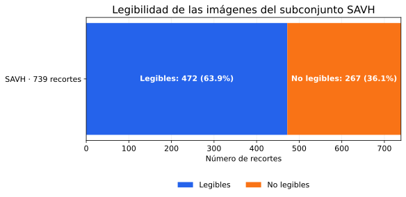
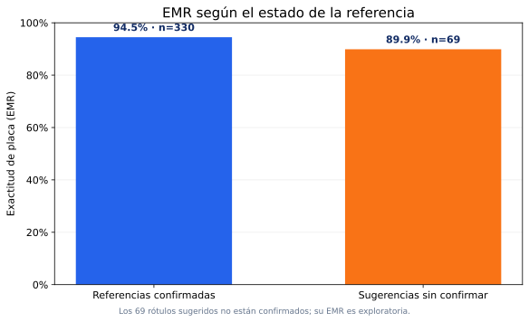
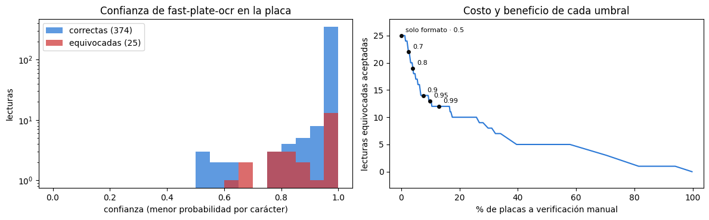

# Análisis exploratorio de datos – SIRAP

## Propósito y alcance

SIRAP trabaja con dos conjuntos de datos que responden a preguntas distintas:

- **Detección:** ¿en qué parte de la imagen está la placa?
- **OCR:** ¿qué caracteres aparecen en la placa?

Este documento describe la composición, calidad, patrones y preparación de ambos conjuntos. Las métricas del detector y del OCR corresponden a protocolos diferentes; no son una sola métrica de desempeño de la aplicación ni una garantía para cada cámara o condición de uso.

El análisis reproducible está en [01_exploracion.ipynb](../notebooks/01_exploracion.ipynb) y en la sección 1 del [notebook de backend](../notebooks/SIRAP_backend.ipynb). Las cifras de composición del detector están resumidas en [dataset_resumen.json](../results/metrics/dataset_resumen.json); las métricas OCR más recientes están en [ocr_savh_aprobaciones_398.json](../results/metrics/ocr_savh_aprobaciones_398.json). Las figuras citadas abajo se conservan en `results/figures/`.

## 1. Datos para detectar placas

### 1.1 Fuente y composición

El detector se desarrolló con la versión 11 del dataset [License Plate Recognition de Roboflow Universe](https://universe.roboflow.com/roboflow-universe-projects/license-plate-recognition-rxg4e), publicado bajo licencia **CC BY 4.0**.

| Característica | Descripción |
|---|---|
| Imágenes | 10.125 |
| Clases | Una: `License_Plate` |
| Etiquetas | Formato YOLO: clase y centro/ancho/alto de la caja normalizados |
| Escenas | Autos y camiones en calles y estacionamientos; varios países y encuadres |
| División | Se conservan los splits originales de entrenamiento, validación y prueba |

| Split | Imágenes | Placas | Placas por imagen | Imágenes sin placa |
|---|---:|---:|---:|---:|
| Entrenamiento | 7.057 | 7.357 | 1,04 | 5 |
| Validación | 2.048 | 2.195 | 1,07 | 3 |
| Prueba | 1.020 | 1.085 | 1,06 | 1 |
| **Total** | **10.125** | **10.637** | **1,05** | **9** |

Solo 9 de 10.125 imágenes (0,09 %) no contienen una placa. Por eso el dataset ofrece pocos ejemplos negativos y conviene vigilar falsos positivos ante letreros, rejillas y formas parecidas a una placa.

La primera figura separa imágenes sin placa por split. La segunda compara la composición de los splits y el tamaño de las placas de prueba.

### 1.2 Tamaño de las placas

Para el análisis se usan las categorías de tamaño COCO calculadas sobre las cajas de referencia.

| Tamaño en prueba | Criterio de área | Placas | Porcentaje |
|---|---:|---:|---:|
| Pequeñas | < 32² px | 191 | 17,6 % |
| Medianas | 32² a < 96² px | 756 | 69,7 % |
| Grandes | ≥ 96² px | 138 | 12,7 % |
| **Total** | | **1.085** | **100 %** |

Casi una de cada cinco placas de prueba es pequeña. En la garita, suelen corresponder a vehículos lejanos. La evaluación del detector confirma la dificultad: el mAP@0.5:0.95 es **0,481** para placas pequeñas, **0,729** para medianas y **0,744** para grandes.

En el video de garita, el detector procesa los cuadros a 1.280 px para conservar detalle de placas pequeñas; el entrenamiento del detector usa 640 px. El OCR filtra recortes cuya placa ocupa menos de 0,2 % del cuadro (`OCR_PLATE_AREA_RATIO`). En el video revisado, las placas de camiones detenidos ocupan aproximadamente 0,3–0,5 % del cuadro.

### 1.3 Inspección visual y patrones

Se revisaron seis imágenes de entrenamiento seleccionadas con una semilla fija y sus cajas de referencia. Los ejemplos incluyen autos, motos con placas de dos filas, sobreimpresiones de estacionamiento y distintos encuadres.

Los patrones y límites observados son:

- **Diferencia geográfica:** el dataset de detección no representa exclusivamente placas ecuatorianas. Cambian formatos, colores y tipografías; por eso se complementa con datos locales de Guayaquil y de la garita.
- **Tamaño:** hay desbalance entre tamaños, aunque solo existe una clase. Se reporta el rendimiento por tamaño además del resultado global.
- **Negativos escasos:** las imágenes sin placa son útiles, pero representan solo 0,09 % del total.
- **Casos atípicos:** las cajas muy pequeñas y las placas parcialmente cubiertas se conservan porque reflejan casos posibles en operación.
- **Correlaciones:** no se calcula Pearson o Spearman sobre los píxeles. Para este dataset visual, una matriz de correlación tabular no describiría adecuadamente el contenido de las imágenes. Se comparan grupos relevantes para la tarea, como tamaño de caja y mAP; estas comparaciones muestran tendencias, no causalidad.

## 2. Datos para evaluar la lectura OCR

### 2.1 Fuente y composición

El conjunto de lectura procede de [SAVH Guayaquil ANPR Plate Images Dataset en Zenodo](https://zenodo.org/records/21120307). La página consultada no indica una licencia para el archivo específico empleado; se debe verificar el permiso aplicable antes de redistribuir el dataset.

| Característica | Valor |
|---|---:|
| Imágenes del dataset de origen | 2.000 |
| Recortes incluidos en la referencia trabajada | 739 |
| Recortes legibles / no legibles | 472 / 267 |
| Recortes únicos tras identificar duplicados | 666 |
| Recortes legibles únicos antes de excluir casos ilegibles | 399 |

La gráfica siguiente resume la legibilidad de los recortes. Las imágenes ilegibles no se usan como si tuvieran una transcripción confiable.

### 2.2 Formatos y calidad de las referencias

En las referencias revisadas aparecen dos formatos ecuatorianos:

| Formato | Ejemplo sin separador | Normalización |
|---|---|---|
| Tres letras y cuatro dígitos | `GBA1234` | `GBA-1234` |
| Tres letras y tres dígitos | `GMS429` | `GMS-0429` (se añade un cero inicial) |

La lectura original de cámara no es automáticamente una verdad terreno: puede confundir caracteres parecidos, por ejemplo, `GB01825` por `GBO-1825`. Validar solo la forma de la cadena no confirma que los caracteres coincidan con la imagen.

La hoja de revisión registra respuestas para los 69 grupos SAVH y para 141 de 142 filas de revisión. En el cruce con las referencias de cámara se registraron 329 referencias como aceptadas y una como ilegible; la fila `fila_gt=398` se excluye. De los 18 desacuerdos entre OCR y cámara que se revisaron con apoyo visual, 14 quedaron con la propuesta OCR, 3 con la lectura de cámara y 1 se marcó ilegible.

**Esta revisión no constituye una evaluación ciega independiente:** algunas propuestas del OCR estuvieron visibles para quien revisó las etiquetas. Además, la concordancia entre OCR y cámara no equivale por sí sola a una confirmación visual. Por ello, las métricas condicionadas a estas respuestas se reportan como offline y sujetas a sesgo de anotación.

### 2.3 Confianza y métricas OCR

La confianza se calcula a partir de las probabilidades de los caracteres. Un análisis anterior reportó un AUROC de **0,76** para separar lecturas correctas e incorrectas; esta cifra describe ese análisis y no debe confundirse con la evaluación actual condicionada a las respuestas de revisión.

El recálculo más reciente usa salidas OCR guardadas, sin ejecutar inferencia nueva. Excluye una referencia ilegible y evalúa **398 recortes únicos**:

| Medida offline | Resultado | Interpretación |
|---|---:|---|
| Coincidencia exacta (EMR) | 388/398 = **97,49 %** | Condicionada a las etiquetas revisadas; no es una evaluación ciega |
| CER medio | **0,00365** | Error de caracteres por imagen, en el mismo conjunto condicionado |
| Umbral 0,94: aceptadas | 362/398 = **91,0 %** | Cobertura; 36 pasarían a revisión manual |
| Umbral 0,94: exactas entre aceptadas | 359/362 | Tres lecturas aceptadas no coinciden exactamente |
| Umbral 0,99: aceptadas | 346/398 = **86,9 %** | Cobertura; 52 pasarían a revisión manual |
| Umbral 0,99: exactas entre aceptadas | 343/346 | Tres lecturas aceptadas no coinciden exactamente |

El umbral **0,94** está configurado en `config/config.yaml` y se usa como referencia para el flujo descrito en el proyecto. El umbral **0,99** de la tabla es una comparación offline, no una afirmación de que la aplicación desplegada opere con ese valor.

Los cortes anteriores de **374/399** y **373/397** corresponden a referencias y filtros previos. Se conservan en los archivos históricos, pero no son directamente comparables con **388/398** porque cambió el conjunto de etiquetas evaluables. El aumento de EMR no demuestra una mejora del modelo: no se reentrenó el OCR y la revisión no fue ciega.

La figura corresponde a un corte anterior de la auditoría; para el resultado vigente se debe usar la tabla de arriba y el archivo [de métricas ajustadas](../results/metrics/ocr_savh_aprobaciones_398.json).

La confianza ayuda a decidir qué lecturas enviar a revisión, pero no reemplaza la inspección humana ni garantiza que una lectura autorizada sea correcta. El resultado se limita a recortes estáticos: **no mide detección en video, seguimiento entre cuadros, apertura de barrera ni desempeño en producción**.

## 3. Decisiones de preprocesamiento

| Decisión | Motivo |
|---|---|
| Copiar el dataset al disco local de Colab | Evitar lecturas repetidas y lentas desde almacenamiento remoto durante cada época |
| Reescribir `data.yaml` con rutas del entorno de ejecución | Resolver correctamente las rutas de imágenes y etiquetas al correr el entrenamiento |
| Conservar los splits y la semilla definidos para el experimento | Hacer comparables y reproducibles las corridas |
| Redimensionar con letterbox a 640 px y relleno gris 114 | Mantener la proporción de las placas, de acuerdo con el flujo de Ultralytics |
| Usar aumentos de datos del entrenamiento | Mejorar robustez a variaciones de iluminación y posición; el volteo horizontal afecta la caja, no la lectura de caracteres |
| Añadir 6 % de margen al recorte antes del OCR | Reducir el riesgo de cortar el primer o último carácter |
| Normalizar caracteres según su posición | Aplicar reglas como `0↔O`, `1↔I` u `8↔B` solo cuando el formato de placa lo permite |

## 4. Datos faltantes, desbalance y alcance

- En el dataset de detección no hay atributos tabulares faltantes. Las imágenes sin placa son negativos válidos.
- En SAVH, los recortes ilegibles se contabilizan aparte y se excluyen de las métricas de transcripción.
- El desbalance por tamaño se aborda reportando mAP separado para placas pequeñas, medianas y grandes; no se oculta dentro del promedio global.
- El dominio geográfico de entrenamiento no representa por sí solo las placas de Ecuador. La evaluación local aporta contexto, pero no elimina el sesgo ni sustituye una muestra independiente.
- Las cifras OCR de SAVH son offline y están condicionadas a una revisión con propuestas visibles. No se deben presentar como evaluación independiente ni como desempeño integral de video.

## 5. Relación con la aplicación y el repositorio

Este análisis describe los datos de entrenamiento y evaluación; sus resultados no garantizan el desempeño de cada sesión de la aplicación publicada.

- [Aplicación SIRAP](https://eduardoceballos-sirap.hf.space) · [Hugging Face Space](https://huggingface.co/spaces/eduardoceballos/SIRAP)
- [Repositorio GitHub SIRAP_2](https://github.com/eduardoceballos666/SIRAP_2) · [API interactiva](https://eduardoceballos-sirap.hf.space/docs)
- La interfaz está disponible en español e inglés. Los videos de presentación están enlazados al final del [README principal](../README.md).
