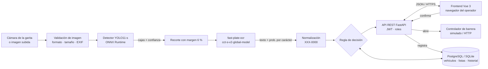
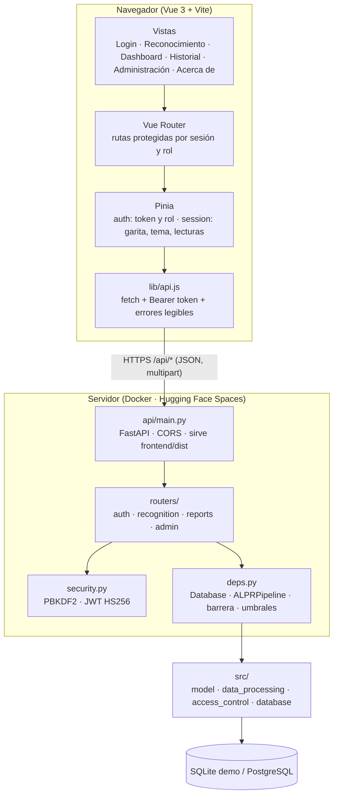
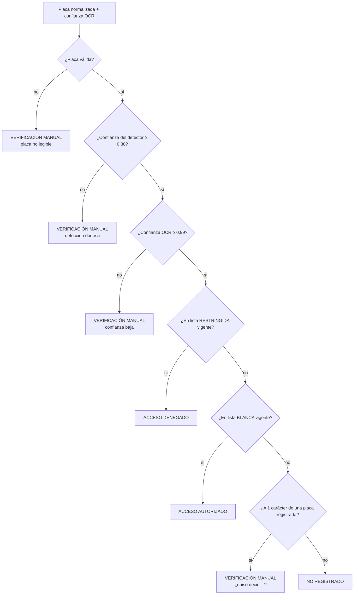
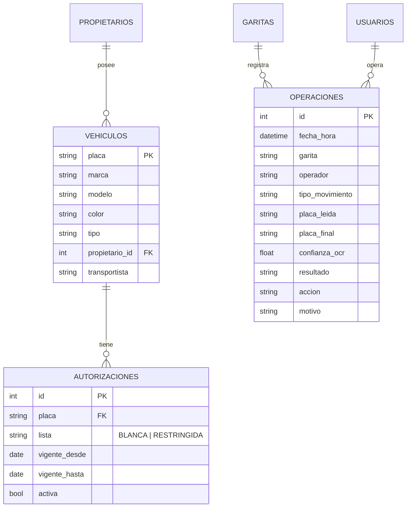

# Arquitectura – SIRAP 2 (FastAPI + Vue 3)

## 1. Visión general

### 1.1 Arquitectura web (cliente-servidor)

**Flujo de una lectura:** (1) el navegador envía la imagen a `POST /api/recognize`; (2) el servidor la valida, corre
YOLO11-s y el OCR, normaliza la placa y aplica la regla de decisión; (3) responde con placa, confianzas, caja,
recorte (JPEG en base64) y decisión, **sin registrar nada**; (4) el operador confirma con `POST /api/operations`;
(5) el servidor **vuelve a calcular la decisión** con la placa final: solo abre automáticamente si es AUTORIZADO y
exige motivo para la apertura manual; (6) registra la operación con el usuario de la sesión.

**Seguridad:** contraseñas con PBKDF2-SHA256 (240 000 iteraciones, sal aleatoria) en la tabla `api_credenciales`;
sesiones con JWT HS256 de 12 h firmadas con `SIRAP_JWT_SECRET`; permisos por rol en cada endpoint (operador,
supervisor, administrador); validación de entradas con Pydantic; mensajes de error sin trazas técnicas.

| Capa | Módulo | Responsabilidad |
|---|---|---|
| Presentación | `frontend/src/` (Vue 3) | Interfaz web de operador, supervisor y administrador (5 módulos + inicio de sesión) |
| API | `api/main.py`, `api/routers/`, `api/security.py`, `api/schemas.py` | Endpoints REST, autenticación, permisos y validación |
| Presentación alternativa | `app/app.py`, `app/ui.py`, `app/assets/style.css` | La misma funcionalidad en Streamlit |
| Dominio | `src/access_control.py` | Regla de decisión, barrera |
| Modelo | `src/model.py` | Detector, OCR, pipeline ALPR |
| Datos | `src/data_processing.py`, `src/database.py`, `sql/` | Validación, normalización, persistencia |
| Entrenamiento / evaluación | `src/train.py`, `src/evaluate.py`, `notebooks/` | Reproducir y medir el modelo |
| Configuración | `config/config.yaml`, secretos | Parámetros sin valores fijos en el código |

## 2. Modelo seleccionado y justificación

### 2.1 Detector: YOLO11-s

| Criterio | YOLO11-s | Por qué importa |
|---|---|---|
| Tamaño | ≈9,4 M parámetros, ≈22 GFLOPs a 640 px | Corre en CPU dentro de Streamlit Cloud tras exportarlo a ONNX |
| Tipo | Detector convolucional de una etapa con NMS | Inferencia rápida y madura; una sola clase |
| Ecosistema | Ultralytics 8.4.177 | Entrenamiento reanudable, exportación a ONNX, métricas estándar |
| Precisión en COCO | mAP@0.5:0.95 = 47,0 (reportado por Ultralytics) | Suficiente para una sola clase mucho más simple que las 80 de COCO |
| Resultado en el proyecto | mAP@0.5 = 0,972 y mAP@0.5:0.95 = 0,693 en *test*; 22 ms por imagen (GPU L4) | Supera la meta (≥ 0,85) con margen |

**Versiones anteriores** (ver `planificacion.md`, desviaciones): YOLOv8 / YOLOv8n y RF-DETR se usaron en etapas
previas; se adoptó YOLO11-s por su balance entre precisión, velocidad y facilidad de despliegue en CPU (ONNX).

### 2.2 OCR: fast-plate-ocr (`cct-s-v2-global-model`)

- Modelo de ≈5 MB entrenado **solo para placas** (alfabeto `0-9 A-Z`, 10 posiciones con relleno `_`).
- Lee cada placa en decenas de milisegundos en CPU; no necesita GPU.
- Entrega una **probabilidad por carácter**: la *confianza OCR* es la **menor** de ellas (el carácter menos
  seguro), igual que `plate_confidence` en el notebook.
- Reemplazó a GLM-OCR (un modelo de lenguaje-visión mucho más pesado); en las placas reales de SAVH Guayaquil
  ambos aciertan lo mismo dentro del margen de error (sección 5 del notebook).

### 2.3 Arquitectura de YOLO11-s (resumen)

| Bloque | Componentes | Salida |
|---|---|---|
| *Backbone* | Conv + bloques **C3k2** (CSP con convoluciones 3×3) + **SPPF** + **C2PSA** (atención espacial parcial) | Mapas de características a 3 escalas (P3/8, P4/16, P5/32) |
| *Neck* | FPN + PAN con C3k2 | Fusión de escalas (clave para placas pequeñas) |
| *Head* | Cabeza desacoplada sin anclas (regresión DFL + clasificación) | Por cada celda: caja (4) + puntaje de clase (1) |
| Postproceso | NMS (IoU 0,7) | Cajas finales |

Entrada: imagen RGB 640×640 (letterbox). Salida ONNX: tensor `(1, 5, 8400)` = 4 coordenadas + 1 puntaje para
8 400 posiciones (80² + 40² + 20²). `src/model.py` decodifica ese tensor, aplica NMS y devuelve las cajas a la
escala de la imagen original.

### 2.4 Hiperparámetros de entrenamiento (preset «completo»)

| Parámetro | Valor |
|---|---|
| Pesos iniciales | `yolo11s.pt` (COCO) |
| Épocas | 40 (paciencia 10, *early stopping* sobre mAP de *val*) |
| imgsz | 640 |
| batch | 16 (Ultralytics acumula gradientes hasta 64 imágenes por paso, `nbs=64`) |
| Optimizador | AdamW (elegido automáticamente por Ultralytics según el tamaño del dataset) |
| Semilla / determinismo | 0 / `deterministic=True` |
| Aumentos | Por defecto de Ultralytics (mosaic, HSV, escala, traslación, flip horizontal) |

## 3. Regla de decisión

Los umbrales (detector 0,30 calibrado en *val*; OCR 0,99 del estudio de confianza en SAVH) y la distancia (1)
están en `config/config.yaml` y `results/metrics/umbrales.json`. La decisión **nunca abre la barrera sola**: la
interfaz habilita «Registrar y Abrir Barrera» solo con *acceso autorizado* y una vez por captura.

## 4. Pipeline de datos (de la entrada a la salida)

| Paso | Función | Entrada → salida |
|---|---|---|
| 1 | `load_image` | bytes / PIL / ndarray → RGB `uint8`; rechaza vacíos, > 10 MB, < 160 px o no-imagen |
| 2 | `PlateDetector.detect` | RGB → hasta 5 cajas `(x1, y1, x2, y2, conf)` |
| 3 | `crop_with_margin` | caja → recorte con 6 % de margen |
| 4 | `PlateReader.read` | recorte → `(texto, conf. mínima por carácter, conf. media)` |
| 5 | `normalize_plate` | texto → `XXX-0000` o `None` |
| 6 | `ALPRPipeline.recognize` | elige la mejor lectura válida → `Recognition` (placa, confianzas, caja, tiempos) |
| 7 | `decide_access` | placa + confianza + base → `AccessDecision` |
| 8 | `Database.log_operation` | operación confirmada → fila en `operaciones` (solo inserción) |

En el **notebook** el pipeline de video añade seguimiento **OC-SORT** (cada camión se lee una sola vez, con los
recortes más grandes que tuvo la placa y voto de lecturas) y un **modo en vivo** sobre una cámara publicada con un
túnel de Cloudflare.

## 5. Modelo de datos

Esquemas: `sql/schema_postgres.sql` (producción) y `sql/schema_sqlite.sql` (demo). Todas las consultas son
parametrizadas.

## 6. Despliegue

| Entorno | Detector | Base | Barrera |
|---|---|---|---|
| **Hugging Face Spaces (demo pública, Docker)** | ONNX Runtime (CPU, 2 vCPU · 16 GB) | SQLite con datos ficticios | Simulada |
| Streamlit Community Cloud (interfaz alternativa, repo SIRAP) | ONNX Runtime (CPU) | SQLite con datos ficticios | Simulada |
| Garita (producción) | ONNX Runtime o Ultralytics con GPU | PostgreSQL (`PG_DSN`) | HTTP con token (`BARRERA_URL`) |
| Colab (investigación) | Ultralytics con GPU T4 | PostgreSQL instalado en la sesión | — |

**Publicación:** cada push a `main` ejecuta `.github/workflows/deploy-hf-space.yml`, que copia al Space solo lo que la
imagen necesita (≈37 MB) y Hugging Face construye el `Dockerfile` en dos etapas: (1) `node:22-slim` compila el
frontend (`npm ci && npm run build`); (2) `python:3.11-slim` instala `requirements.txt`, descarga el OCR, copia
`frontend/dist` y arranca `uvicorn api.main:app` en el puerto 7860 con usuario no root.

## 7. Tecnologías y versiones

| Librería | Versión | Uso |
|---|---|---|
| Python | 3.11+ | Lenguaje |
| ultralytics | 8.4.177 | Entrenamiento, validación y exportación de YOLO11 |
| onnxruntime | ≥ 1.20 (notebook: 1.31.0) | Inferencia del detector y del OCR en CPU |
| fast-plate-ocr | 1.1.0 | OCR de placas |
| opencv-python-headless | ≥ 4.10 | Procesamiento de imagen |
| supervision | 0.30.9 | Anotación de video y mAP por tamaño (notebook) |
| trackers | 2.6.1 | OC-SORT (notebook) |
| Levenshtein | ≥ 0.25 | Distancia entre placas, CER |
| psycopg[binary] | 3.3.6 | PostgreSQL |
| fastapi | 0.162.0 | API REST |
| uvicorn[standard] | 0.54.0 | Servidor ASGI |
| PyJWT | 2.15.0 | Tokens de sesión |
| python-multipart | 0.0.32 | Subida de imágenes |
| pydantic | 2.x (con FastAPI) | Validación de entradas y salidas |
| vue | 3.5.44 | Frontend |
| vite | 8.3.5 | Compilación y servidor de desarrollo |
| pinia | 4.1.0 | Estado (sesión, tema, lecturas) |
| vue-router | 5.4.0 | Rutas y permisos por rol |
| tailwindcss | 4.3.3 | Estilos y tema claro/oscuro |
| echarts / vue-echarts | 6.1.0 / 8.3.2 | Gráficos interactivos del Dashboard |
| streamlit | 1.66.1 | Interfaz alternativa |
| plotly | ≥ 6.0 | Gráficos de la interfaz alternativa |
| pandas / numpy / pillow / pyyaml | ver `requirements.txt` | Datos e imágenes |
| roboflow | 1.7.1 | Descarga del dataset |
