**SIRAP**

**MANUAL DE USUARIO**

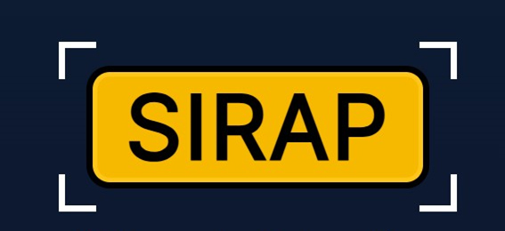
Sistema de Detección y Reconocimiento Automático de Placas

Guía práctica de operación, consulta y administración en computadora y dispositivos móviles.

| **VERSIÓN / REVISIÓN**                                          | **DESTINATARIOS**                          |
|-----------------------------------------------------------------|--------------------------------------------|
| Aplicación SIRAP 1.0 · Manual revisado el 28 de octubre de 2026 | Operadores, supervisores y administradores |

| **ALCANCE** Guía orientada a la interfaz mostrada en los documentos del proyecto. Algunas funciones, permisos y métricas dependen de la configuración de la instancia. |
|------------------------------------------------------------------------------------------------------------------------------------------------------------------------|

**Versionado:** la versión del producto SIRAP es **1.0**. API 2.0.0 y paquete frontend 2.0.0 son identificadores técnicos de componentes. El tag GitHub `v2.0` señala el corte de código asociado con FastAPI + Vue 3; no es la versión del producto.

**CRÉDITOS, PROPIEDAD INTELECTUAL Y ATRIBUCIONES DE SOFTWARE**

**SIRAP — Sistema de Detección y Reconocimiento Automático de Placas** \| Manual de usuario y documentación técnica

**Versión del software:** 1.0 **\| Fecha de publicación:** octubre de 2026

**Desarrollo de software e ingeniería**

**Eduardo Alejandro Ceballos Jijón** — Ingeniería de visión artificial y arquitectura de software

**Christian Xavier Valle Maridueña** — Ingeniería de visión artificial y arquitectura de software

**Documentación y redacción técnica**

**Eduardo Alejandro Ceballos Jijón** — Redacción técnica y diseño de contenido

**Christian Xavier Valle Maridueña** — Redacción técnica y diseño de contenido

**Dirección y asesoría académica**

**Gladys María Villegas Rugel** — Dirección y asesoría académica

**Aviso de propiedad intelectual**

**© 2026 Eduardo Alejandro Ceballos Jijón y Christian Xavier Valle Maridueña.** Todos los derechos reservados sobre los elementos de SIRAP cuyos derechos pertenezcan a sus titulares.

El código de SIRAP se distribuye bajo la Licencia MIT, que permite usar, copiar, modificar, distribuir, sublicenciar y vender el software, siempre que se conserven el aviso de copyright y el texto de la licencia en las copias o partes sustanciales. [<u>Open Source Initiative: Licencia MIT</u>](https://opensource.org/license/mit)

Los pesos entrenados con Ultralytics están sujetos a AGPL-3.0. Los componentes de terceros conservan sus respectivas licencias.

**Recursos del proyecto**

> • Código fuente: GitHub, repositorio [<u>eduardoceballos666/SIRAP_2</u>](https://github.com/eduardoceballos666/SIRAP_2)
>
> • Plataforma de despliegue: Hugging Face Spaces, [<u>eduardoceballos/SIRAP</u>](https://huggingface.co/spaces/eduardoceballos/SIRAP)
>
> • Aplicación en vivo: [<u>eduardoceballos-sirap.hf.space</u>](https://eduardoceballos-sirap.hf.space)

**Atribución de componentes de software**

SIRAP utiliza componentes de terceros para la detección y lectura de placas, el procesamiento de imágenes y datos, la API y la interfaz web. Sus marcas, derechos y licencias pertenecen a sus respectivos titulares.

> **• Ultralytics YOLO11:** entrenamiento del detector de placas.
>
> **• PyTorch:** framework de aprendizaje profundo utilizado en el entorno de entrenamiento; no es el motor de inferencia del despliegue web.
>
> **• ONNX Runtime:** ejecución del modelo exportado en la aplicación.
>
> **• fast-plate-ocr:** reconocimiento de los caracteres de las placas.
>
> **• OpenCV (`opencv-python-headless` 4.12.0.88):** redimensionado y codificación JPEG; no es el detector de placas. Licencia Apache 2.0.
>
> **• Pillow, NumPy y Pandas:** procesamiento de imágenes y datos.
>
> **• FastAPI y Uvicorn:** API y servidor de la aplicación.
>
> **• Vue 3, Vite, Pinia, Vue Router, ECharts, Vue ECharts y Tailwind CSS:** interfaz web.
>
> **• Playwright y Chromium:** consulta de información pública desde la aplicación.

**Entorno técnico de demostración**

La demostración se despliega en Hugging Face Spaces mediante una imagen Docker. Utiliza Python 3.11 para la aplicación y Node.js 22 para compilar la interfaz web. La instancia de demostración se describe con 2 vCPU y sin GPU dedicada. Los registros se almacenan en archivos CSV.

Como referencia para ejecución local: procesador Intel Core i7-8650U, 8 GB de RAM e Intel UHD Graphics 620, o equipo de características similares.

**Contacto y soporte técnico:** Administrador designado por la organización.

## Índice general

[**Cómo utilizar este manual**](#cómo-utilizar-este-manual) **4**

[**1. Presentación y funcionamiento**](#sirap_sec_200) **5**

[**2. Acceso, perfiles y seguridad**](#acceso-perfiles-y-seguridad) **5**

[**3. Reconocimiento y Acceso**](#reconocimiento-y-acceso) **6**

[**4. Capturar o cargar imágenes y videos**](#capturar-o-cargar-imágenes-y-videos) **7**

[4.1. Subir una fotografía](#subir-una-fotografía) 7

[4.2. Analizar un video](#analizar-un-video) 8

[4.3. Utilizar Cámara Local](#utilizar-cámara-local) 8

[4.4. Utilizar Cámara URL](#utilizar-cámara-url) 9

[**5. Interpretar los resultados de acceso**](#interpretar-los-resultados-de-acceso) **9**

[5.1. Vehículo no registrado](#vehículo-no-registrado) 10

[5.2. Sin autorización y denegado](#sin-autorización-y-denegado) 10

[5.3. Verificación manual](#section) 11

[5.4. Consultar los detalles del vehículo (SRI)](#consultar-los-detalles-del-vehículo-sri) 11

[5.5. Registrar camión nuevo](#registrar-camión-nuevo) 12

[**6. Registrar acciones y utilizar la barrera**](#registrar-acciones-y-utilizar-la-barrera) **13**

[6.1. Registro de acceso autorizado](#registro-de-acceso-autorizado) 13

[6.2. Registrar un rechazo o una operación sin apertura](#registrar-un-rechazo-o-una-operación-sin-apertura) 13

[6.3. Apertura manual por contingencia](#apertura-manual-por-contingencia) 13

[6.4. Lecturas recientes](#lecturas-recientes) 14

[**7. Historial de operaciones**](#historial-de-operaciones) **14**

[**8. Administración de datos maestros**](#administración-de-datos-maestros) **15**

[8.1. Vehículos](#vehículos) 16

[8.2. Listas blanca y restringida](#listas-blanca-y-restringida) 16

[8.3. Propietarios](#propietarios) 17

[8.4. Garitas](#garitas) 17

[8.5. Usuarios](#usuarios) 17

[**9. Dashboard y datos de demostración**](#dashboard-y-datos-de-demostración) **18**

[**10. Acerca del modelo y métricas**](#acerca-del-modelo-y-métricas) **19**

[**11. Uso multiplataforma: computadora, tableta y celular**](#uso-multiplataforma-computadora-tableta-y-celular) **20**

[11.1. Entrar desde un celular](#entrar-desde-un-celular) 20

[11.2. Reconocer una placa desde el teléfono](#reconocer-una-placa-desde-el-teléfono) 21

[11.3. Recomendaciones para la pantalla pequeña](#recomendaciones-para-la-pantalla-pequeña) 21

[11.4. Qué cambia y qué se mantiene](#qué-cambia-y-qué-se-mantiene) 22

[**12. Casos prácticos de uso**](#casos-prácticos-de-uso) **22**

[**13. Solución de problemas frecuentes**](#solución-de-problemas-frecuentes) **23**

[**14. Preguntas frecuentes**](#preguntas-frecuentes) **24**

[**15. Lista de comprobación del operador**](#lista-de-comprobación-del-operador) **25**

[**16. Glosario**](#glosario) **26**

# Cómo utilizar este manual

Este documento describe cada pantalla de SIRAP, indica qué hace cada control y muestra procedimientos de principio a fin. Está organizado para que una persona sin experiencia previa pueda comenzar por las tareas básicas y consultar después las funciones avanzadas.

## Contenido

01 Presentación y flujo de trabajo

02 Acceso, perfiles y seguridad

03 Reconocimiento y Acceso: pantalla principal

04 Cargar fotografías, videos y conectar cámaras

05 Resultados de acceso y verificación manual

06 Registro de operaciones y barrera

07 Historial y lecturas recientes

08 Administración: vehículos, listas, garitas y usuarios

09 Dashboard y datos de demostración

10 Acerca del modelo y métricas

11 SIRAP en celulares y otros dispositivos

12 Casos prácticos de uso

13 Solución de problemas frecuentes

14 Preguntas frecuentes

15 Lista de comprobación del operador

16 Glosario

## Ruta rápida: registrar una entrada

**01** Ingrese al aplicativo con su usuario y contraseña.

**02** Seleccione la garita y marque la operación Entrada.

**03** Suba una imagen, use la cámara local o seleccione una fuente compatible.

**04** Revise la placa detectada y el estado de autorización.

**05** Si la lectura es incorrecta, corríjala y pulse Verificar.

**06** Realice únicamente la acción habilitada y permitida por el procedimiento; compruebe el mensaje de registro.

**07** Consulte Historial para confirmar que la operación quedó registrada.

| **REGLA FUNDAMENTAL** Una placa reconocida no significa que el acceso esté autorizado. SIRAP debe consultar las listas vigentes y el operador debe verificar el resultado antes de actuar. |
|--------------------------------------------------------------------------------------------------------------------------------------------------------------------------------------------|

# 1. Presentación y funcionamiento

SIRAP es una aplicación web que ayuda a identificar placas vehiculares en imágenes o fotogramas de video, consultar permisos de acceso y dejar constancia de la decisión tomada por el operador. Utiliza detección de placas basada en YOLO11s y reconocimiento óptico de caracteres (OCR).

## Proceso de trabajo

| ETAPA              | QUÉ SUCEDE                                                     | RESPONSABLE            |
|--------------------|----------------------------------------------------------------|------------------------|
| 1\. Captura        | Se obtiene una imagen, video o fotograma de cámara.            | Operador / dispositivo |
| 2\. Identificación | El detector encuentra la placa; el OCR propone sus caracteres. | Modelo de IA           |
| 3\. Verificación   | Se consulta la autorización vigente y el estado de la placa.   | SIRAP                  |
| 4\. Decisión       | Se confirma, rechaza o solicita validación manual.             | Operador               |
| 5\. Registro       | La acción aceptada queda en Historial para consulta.           | Aplicación             |

*Tabla 1. Etapas del proceso de reconocimiento y control de acceso*

## Qué necesita

Navegador moderno con acceso a la dirección de la aplicación.

Usuario y contraseña habilitados por el administrador.

Imagen nítida o cámara disponible, según el método de captura.

Permisos y conectividad suficientes para acceder a la cámara o transmitir video.

| **MODO DE DEMOSTRACIÓN** Las imágenes de ejemplo y los datos DEMO ayudan a aprender. No constituyen evidencia de una operación real. La versión documentada puede usar una barrera simulada: registrar la orden no equivale a mover un dispositivo físico. Las capturas de pantalla de este manual contienen datos de demostración y no representan operaciones reales. |
|-------------------------------------------------------------------------------------------------------------------------------------------------------------------------------------------------------------------------------------------------------------------------------------------------------------------------------------------------------------------------|

# 2. Acceso, perfiles y seguridad

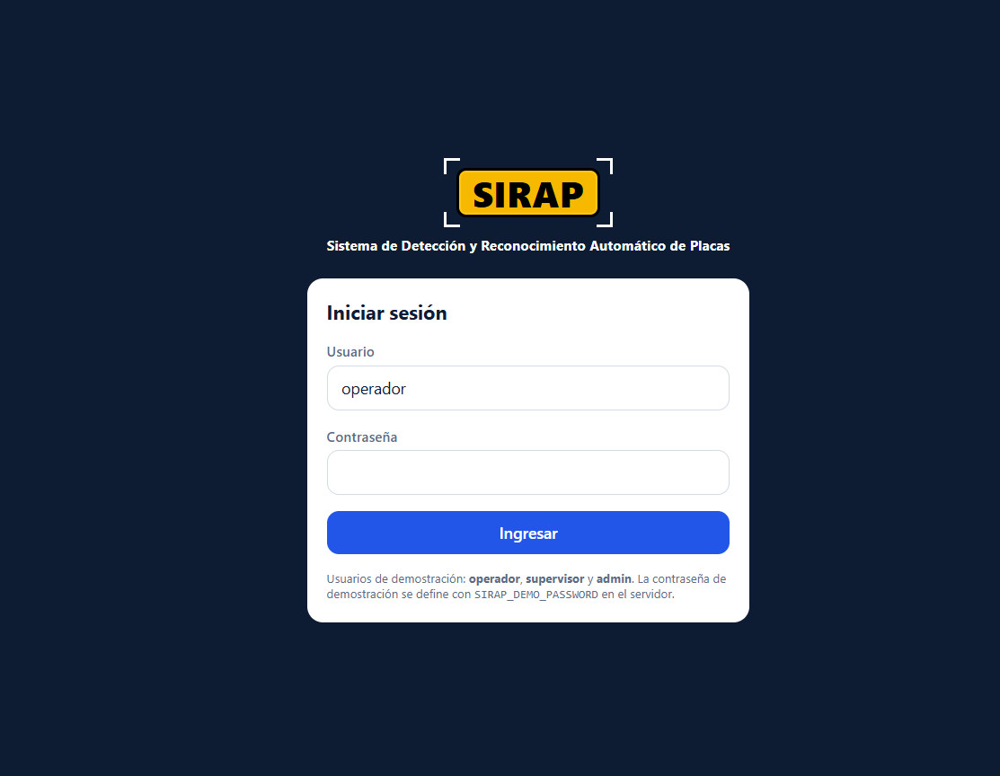

Figura 1. Pantalla de inicio de sesión SIRAP.

**01** Abra SIRAP desde el navegador autorizado de la organización.

**02** Escriba su nombre de usuario en el campo Usuario.

**03** Ingrese su contraseña personal.

**04** Pulse Ingresar y compruebe que aparece la pantalla principal.

## Perfiles disponibles

| PERFIL        | FUNCIONES DISPONIBLES                                                                                                                                                                                                                                                                                                    |
|---------------|--------------------------------------------------------------------------------------------------------------------------------------------------------------------------------------------------------------------------------------------------------------------------------------------------------------------------|
| Operador      | Captura y reconocimiento; verificación de placas; registro de acciones permitidas y consulta del Historial. Puede registrar camiones nuevos desde Reconocimiento y Acceso; al guardarlos, se agregan a la lista blanca.                                                                                                  |
| Supervisor    | Funciones operativas; consulta y exportación del Historial a CSV. Puede consultar Dashboard y Administración en modo de solo lectura. También puede registrar camiones nuevos desde Reconocimiento y Acceso; al guardarlos, se agregan a la lista blanca.                                                                |
| Administrador | Modifica la configuración y los datos del sistema. En Administración, es el único que crea o actualiza vehículos, gestiona sus autorizaciones, administra garitas y usuarios, y genera o borra operaciones DEMO. También puede registrar camiones nuevos desde Reconocimiento y Acceso; consulta y exporta el Historial. |

*Tabla 2. Perfiles de usuario y funciones disponibles*

El menú puede variar según el perfil. Si una opción aparece solo para consulta o está deshabilitada, solicite el permiso correspondiente; no utilice credenciales de otra persona.

| **BUENAS PRÁCTICAS** No comparta contraseñas. Cierre la sesión al terminar o al dejar el equipo sin supervisión. El registro de contingencias debe consignar siempre el motivo y la persona responsable. |
|----------------------------------------------------------------------------------------------------------------------------------------------------------------------------------------------------------|

# 3. Reconocimiento y Acceso

Esta es la pantalla que utiliza la garita durante una entrada o salida. En una misma vista reúne el contexto, la fuente de captura, la placa identificada, el resultado de autorización y las acciones disponibles.

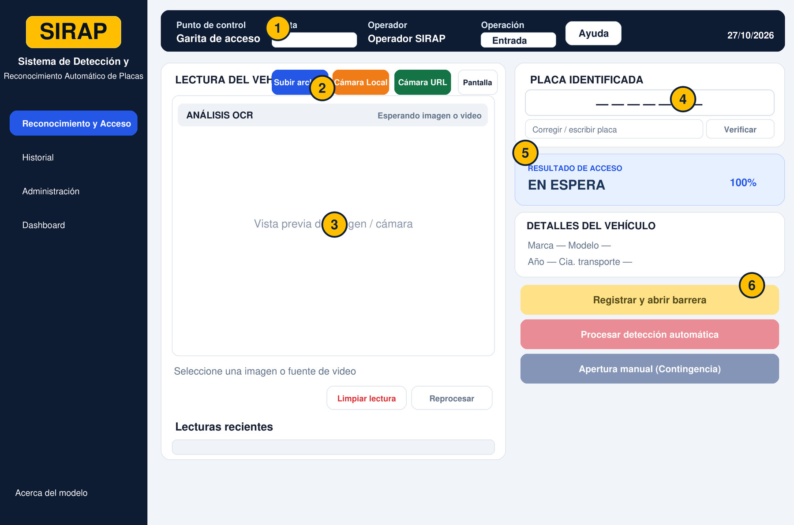

Figura 2. Pantalla principal con seis zonas identificadas.

| N.º | ZONA         | PARA QUÉ SIRVE                                                |
|-----|--------------|---------------------------------------------------------------|
| 1   | Contexto     | Elegir garita y movimiento; identificar al operador.          |
| 2   | Fuente       | Subir archivo, utilizar Cámara Local o Cámara URL.            |
| 3   | Vista previa | Mostrar imagen/video, análisis y lecturas recientes.          |
| 4   | Placa        | Revisar, corregir y verificar el texto reconocido.            |
| 5   | Resultado    | Ver autorización, rechazo, no registro o verificación manual. |
| 6   | Acciones     | Registrar ingreso, rechazo, reanalizar o contingencia.        |

*Tabla 3. Zonas y controles de la pantalla Reconocimiento y Acceso*

## Controles adicionales

Ayuda: abre instrucciones cortas sobre el flujo de acceso.

Pantalla completa: amplía el área de imagen para revisar detalles.

Limpiar lectura: borra la lectura que se está mostrando, sin borrar el historial consolidado.

Reprocesar: intenta nuevamente la lectura de la fuente seleccionada.

Verificar: consulta el estado de la placa final que se visualiza o que el usuario corrigió.

| **IMPORTANTE** El indicador visual «SIRAP en acción 100 %» no representa necesariamente la exactitud del OCR ni la probabilidad de autorización. La lectura de confianza y las listas de acceso deben revisarse por separado. |
|-------------------------------------------------------------------------------------------------------------------------------------------------------------------------------------------------------------------------------|

# 4. Capturar o cargar imágenes y videos

## 4.1. Subir una fotografía

**01** Confirme la garita y si se trata de Entrada o Salida.

**02** Pulse Subir archivo.

**03** Busque y seleccione una imagen compatible (JPG, JPEG, PNG o WEBP).

**04** Espere el análisis; revise la placa propuesta y el resultado.

**05** Si la lectura es correcta, continúe con la evaluación y el registro.

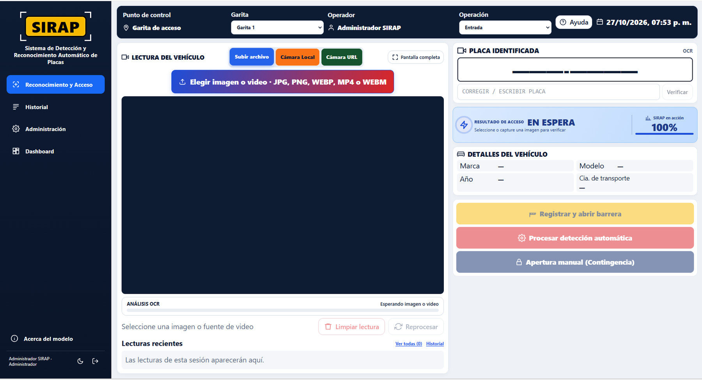

Figura 3. Botón Subir archivo y área de lectura.

## 4.2. Analizar un video

Seleccione un archivo de video compatible (por ejemplo MP4, WEBM, MOV o M4V). El sistema trabaja con fotogramas de la reproducción; no es obligatorio interpretar todos los FPS del archivo. Espere lecturas consistentes antes de aceptar una placa.

Figura 4. Ejemplo de un camión analizado desde un archivo de video.

## 4.3. Utilizar Cámara Local

**01** Conecte la cámara o utilice la cámara integrada del dispositivo.

**02** Elija Cámara Local en la sección de fuente.

**03** Autorice el acceso solicitado por el navegador, si corresponde.

**04** Coloque la placa dentro de la zona visible, con iluminación y enfoque adecuados.

**05** Pulse Capturar y reconocer y compruebe el resultado de lectura.

Figura 5. Reconocimiento mediante captura de cámara local.

## 4.4. Utilizar Cámara URL

Si cuenta con una cámara IP o una fuente de video web autorizada, seleccione Cámara URL, el tipo de transmisión admitido e introduzca la dirección. Las transmisiones RTSP normalmente necesitan un puente o servidor intermedio; no asuma que cualquier dirección funcionará directamente en el navegador.

## Calidad de captura

La placa debe aparecer completa y suficientemente grande.

Evite reflejos, contraluz, placas sucias y desenfoque por movimiento.

En SIRAP 1.0, para fotografías se recomienda que el lado menor tenga al menos 160 píxeles.

En SIRAP 1.0, el tamaño máximo documentado para las imágenes es de 200 MB, de acuerdo con las restricciones de compatibilidad de Hugging Face Spaces. Su infraestructura puede limitar el tamaño de las solicitudes HTTP a entre 100 y 200 MB, por lo que superar ese máximo podría generar un error. Para facilitar la carga y el procesamiento, se recomienda usar imágenes mucho más pequeñas.

En caso de duda, repita la toma y no utilice caracteres que no puedan comprobarse visualmente.

**Privacidad.** Las imágenes se procesan temporalmente para reconocer la placa y no se conservan como archivos permanentes en SIRAP.

# 5. Interpretar los resultados de acceso

| ESTADO              | SIGNIFICADO                                            | ACCIÓN SEGURA                                                                       |
|---------------------|--------------------------------------------------------|-------------------------------------------------------------------------------------|
| AUTORIZADO          | Placa reconocida con permiso vigente en lista blanca.  | Contrastar placa y vehículo, y registrar la acción normal si corresponde.           |
| DENEGADO            | Placa en una lista restringida vigente.                | Mantener el acceso cerrado y registrar el rechazo.                                  |
| NO REGISTRADO       | Vehículo sin registro o sin permiso activo.            | No abrir de forma normal; solicitar revisión y registrar la acción que corresponda. |
| VERIFICACIÓN MANUAL | Lectura dudosa, baja confianza o coincidencia similar. | Revisar la imagen y confirmar la placa antes de tomar una decisión.                 |

*Tabla 4. Estados de autorización y acciones del operador*

## 5.1. Vehículo no registrado

Cuando SIRAP informa «No registrado», no abra. Si registra el vehículo desde Reconocimiento y Acceso, SIRAP guarda la ficha y agrega la placa a la lista blanca; esto no abre la barrera por sí solo. Verifique el resultado final y revise que no exista una restricción vigente.

Figura 6. Ejemplo de un vehículo no registrado.

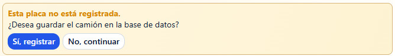

Figura 7. Confirmación para registrar o continuar sin registrar el vehículo.

## 5.2. Sin autorización y denegado

Si aparece «Sin autorización» o «Denegado», mantenga el acceso cerrado. La intervención manual solo debe seguir un procedimiento de contingencia autorizado y dejar constancia de la persona responsable.

Figura 8. Ejemplo de estado Denegado.

## 

## 5.3. Verificación manual

**01** Amplíe la imagen si es necesario.

**02** Compare cada carácter de la placa leída con la imagen original.

**03** Si la placa visible permite confirmarla, corrija el texto e indique Verificar.

**04** Espere la consulta actualizada de listas; no registre apertura usando el resultado anterior.

**05** Si persiste la duda, solicite autorización de acuerdo con el protocolo de garita.

| **EJEMPLO** La cámara devuelve PBA-890I, pero la imagen permite leer PBA-8901. El operador corrige únicamente el último carácter, pulsa Verificar y vuelve a consultar la decisión de acceso. |
|-----------------------------------------------------------------------------------------------------------------------------------------------------------------------------------------------|

## 5.4. Consultar los detalles del vehículo (SRI)

Después de identificar y verificar la placa, SIRAP presenta el panel «Detalles del vehículo». Cuando la consulta está disponible, puede completar automáticamente la marca, el modelo y el año con información obtenida del Servicio de Rentas Internas (SRI).

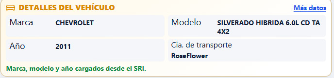

Detalle del vehículo. Ejemplo de datos del automotor consultados al SRI y de información complementaria mostrada en SIRAP.

**¿Cómo interpretar esta información?**

01 Confirme que la placa reconocida corresponde al vehículo que está frente a la garita.

02 Revise Marca, Modelo y Año. En la captura de ejemplo se muestran CHEVROLET, SILVERADO HÍBRIDA 6.0L y 2011; el mensaje verde confirma que estos datos se cargaron desde el SRI.

03 Consulte la Cía. de transporte que aparece en el mismo panel. Este dato complementa la identificación; no debe asumirse que proviene del SRI.

04 Si necesita ampliar la información disponible, seleccione «Más datos». Revise los campos que el aplicativo muestre para esa placa.

05 Compruebe siempre el estado de autorización antes de registrar una entrada o salida. Los datos descriptivos del vehículo no otorgan permiso de acceso por sí solos.

**Importante.** Si la consulta al SRI no devuelve información o presenta una diferencia con el vehículo observado, solicite revisión según el procedimiento de la garita. No invente ni modifique datos para forzar una autorización.

## 5.5. Registrar camión nuevo

Cuando SIRAP identifica una placa sin ficha, cualquiera de los tres perfiles autenticados (Operador, Supervisor o Administrador) puede seleccionar «Sí, registrar» desde Reconocimiento y Acceso para abrir el formulario. Al guardar, el sistema crea la ficha del camión y agrega automáticamente la placa a la lista blanca. Si se selecciona «No, continuar», no se crea el registro. Registrar el camión no abre por sí solo la barrera: revise el resultado de autorización antes de actuar.

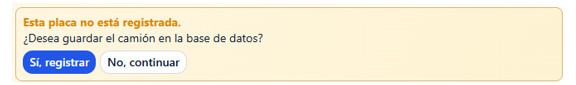

Figura 8A. Mensaje de confirmación que aparece al detectar una placa no registrada.

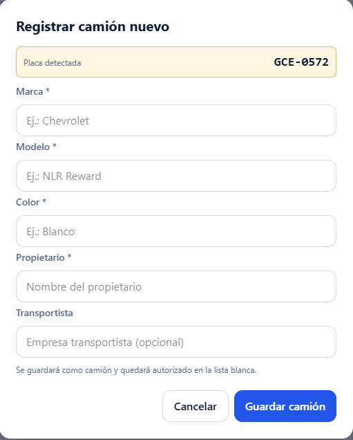

Figura 8B. Formulario «Registrar camión nuevo» para completar la información del vehículo.

¿Cómo utilizar esta ventana?

**01** En el panel de detalles del vehículo, pulse «Sí, registrar» si la placa no tiene ficha y ha confirmado que corresponde al vehículo presente.

02 Compruebe la Placa detectada que aparece en la parte superior de la ventana. Verifique que coincide con la lectura obtenida por SIRAP.

03 Complete los campos solicitados. Marca, Modelo, Color y Propietario son obligatorios; el campo Transportista es opcional.

04 Revise cuidadosamente la información antes de guardar. Cuando exista apoyo de otras fuentes, como la consulta al SRI o documentos del transportista, úselo para validar los datos digitados.

**05** Presione Guardar camión. SIRAP registra el vehículo y agrega automáticamente la placa a la lista blanca; esta opción está disponible para los tres perfiles autenticados desde Reconocimiento y Acceso.

06 Si el operador no desea crear el registro en ese momento, puede pulsar Cancelar para cerrar la ventana sin guardar cambios.

Nota operativa. Guardar el camión lo agrega automáticamente a la lista blanca. Verifique la identidad del vehículo antes de guardar. Los tres perfiles autenticados pueden hacerlo desde Reconocimiento y Acceso; crear o actualizar vehículos y sus autorizaciones desde Administración es exclusivo del Administrador. Una restricción vigente prevalece sobre la lista blanca. Si no corresponde registrarlo, seleccione «No, continuar» o «Cancelar».

# 6. Registrar acciones y utilizar la barrera

## 6.1. Registro de acceso autorizado

**01** Compruebe que la decisión final es AUTORIZADO.

**02** Verifique la garita, Entrada/Salida y la placa que está frente a usted.

**03** Pulse Registrar y abrir barrera, solo si el procedimiento local lo permite.

**04** Espere la confirmación y revise que la acción aparezca registrada.

## 6.2. Registrar un rechazo o una operación sin apertura

En un estado Denegado utilice Registrar rechazo. Si el procedimiento permite dejar constancia sin levantar la barrera, utilice Registrar sin abrir cuando la opción esté disponible. No intente usar acciones deshabilitadas por la evaluación.

## 6.3. Apertura manual por contingencia

**01** Solicite la autorización fuera del sistema conforme al procedimiento de seguridad.

**02** Seleccione Apertura manual (Contingencia).

**03** Escriba un motivo claro y concreto; la versión documentada solicita al menos 10 caracteres.

**04** Confirme la operación y compruebe que el usuario y el motivo quedaron registrados.

| **BARRERA SIMULADA** En la configuración documentada, una orden puede simularse. Un mensaje de registro exitoso no significa que una barrera física se haya abierto. La integración real requiere pruebas y autorización específicas. |
|---------------------------------------------------------------------------------------------------------------------------------------------------------------------------------------------------------------------------------------|

## 6.4. Lecturas recientes

La franja inferior de la pantalla permite consultar las últimas lecturas de la sesión. «Ver todas» amplía el detalle; estas lecturas no equivalen a operaciones registradas hasta que se confirma una acción.

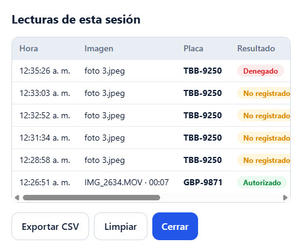

Figura 9. Lecturas de la sesión: hora, imagen, placa y resultado.

# 7. Historial de operaciones

El Historial permite buscar acciones previamente registradas y verificar fecha, garita, placa, resultado y responsable. Es la vista apropiada para consultar una operación ya cerrada.

**Exportar resultados a CSV:** Supervisor y Administrador pueden descargar las operaciones que coincidan con los filtros aplicados mediante el botón **Exportar CSV**. El archivo puede abrirse en una hoja de cálculo.

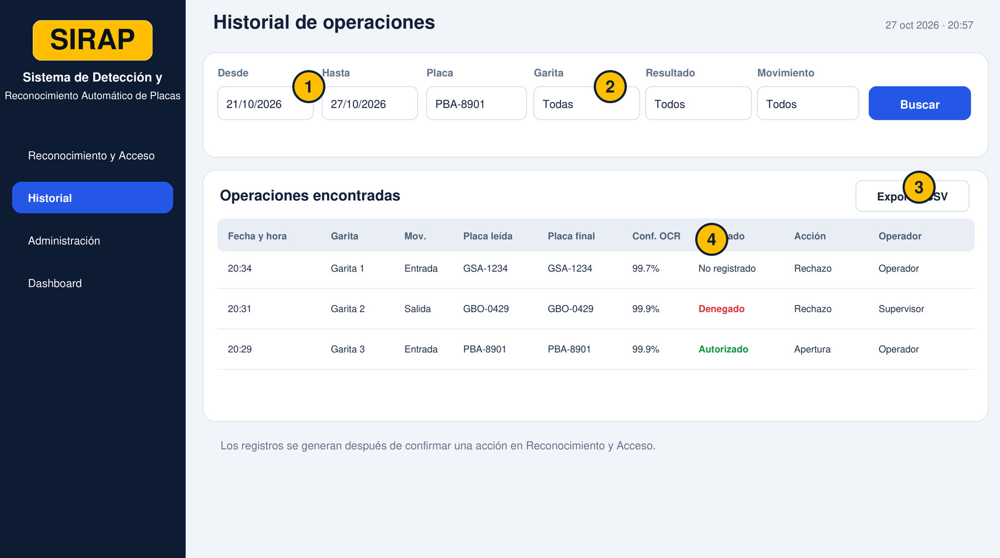

Figura 10. Historial y principales controles de búsqueda.

**01** Abra Historial desde el menú izquierdo.

**02** Elija Desde y Hasta para indicar el intervalo de consulta.

**03** Complete los filtros opcionales: placa, garita, resultado o movimiento.

**04** Pulse Buscar para actualizar el listado.

**05** Abra la fila o revise las columnas para confirmar la operación.

**06** Si su perfil es Supervisor o Administrador, utilice Exportar CSV para descargar los resultados filtrados.

**Protección de las exportaciones.** Guarde los CSV en una ubicación autorizada, compártalos solo con personas autorizadas y elimínelos según la política de la organización.

## Cómo interpretar las columnas

| COLUMNA           | SIGNIFICADO                                                   |
|-------------------|---------------------------------------------------------------|
| Placa leída       | Resultado que propuso inicialmente el OCR.                    |
| Placa final       | Texto que quedó confirmado, incluida una eventual corrección. |
| Confianza OCR     | Valor informado por el proceso de reconocimiento.             |
| Resultado         | Estado de autorización evaluado en ese momento.               |
| Acción / motivo   | Operación registrada y justificación, si hubo contingencia.   |
| Operador / origen | Usuario y tipo de fuente utilizada.                           |

*Tabla 5. Columnas del historial de operaciones*

| **CONSEJO** Para investigar una corrección de lectura, compare «Placa leída» y «Placa final». Para validar cifras de operación real, excluya registros DEMO. |
|--------------------------------------------------------------------------------------------------------------------------------------------------------------|

# 8. Administración de datos maestros

Administración reúne los datos que SIRAP necesita para identificar vehículos, asignar listas vigentes y administrar puntos de control. Solo el Administrador puede modificar estos datos; el Supervisor puede consultar las secciones en modo de solo lectura. La API aplica los mismos permisos. Los tres perfiles autenticados pueden registrar un camión nuevo desde Reconocimiento y Acceso; al guardarlo, se agrega automáticamente a la lista blanca.

## 8.1. Vehículos

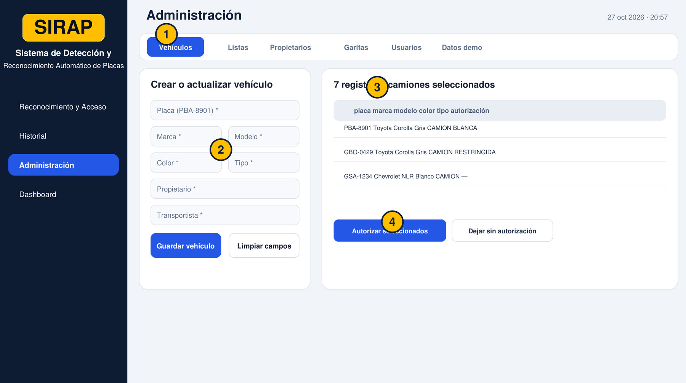

Figura 11. Formulario de vehículos con selección y autorización masiva.

**01** Entre en Administración y seleccione Vehículos. Solo el Administrador puede crear o actualizar registros; el Supervisor puede consultarlos en modo de solo lectura.

**02** Escriba la placa del vehículo. Si ya existe, cargue el registro antes de modificarlo.

**03** Complete marca, modelo, color, tipo, propietario y transportista.

**04** Pulse Guardar vehículo; si se trata de uno existente, confirme la actualización solo después de revisar los cambios.

**05** Para varios vehículos, seleccione las filas y use las opciones de autorización masiva cuando estén disponibles.

## 8.2. Listas blanca y restringida

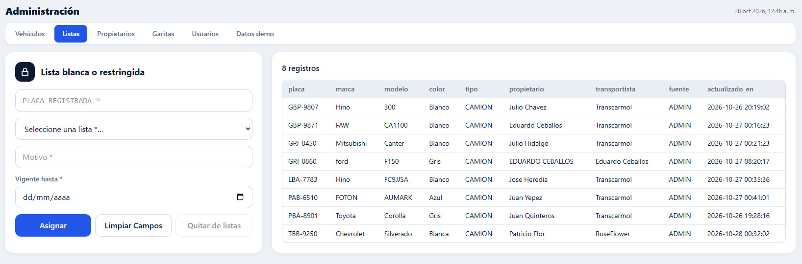

Figura 12. Pantalla de asignación de listas y vigencia.

**01** Abra la pestaña Listas. Solo el Administrador puede cambiar autorizaciones; el Supervisor puede consultarlas en modo de solo lectura.

**02** Indique la placa y seleccione Lista blanca o Lista restringida.

**03** Agregue motivo y fecha «Vigente hasta»; confirme que los datos son correctos.

**04** Pulse Asignar para guardar; revise las autorizaciones anteriores si hay una actualización.

**05** Para revocar una decisión, utilice Quitar de listas según el procedimiento.

| **PRIORIDAD DE SEGURIDAD** Una restricción vigente prevalece sobre una autorización de lista blanca. No considere autorizada una placa solo por encontrarla en una lista histórica. |
|-------------------------------------------------------------------------------------------------------------------------------------------------------------------------------------|

## 8.3. Propietarios

La pestaña Propietarios sirve principalmente para consultar registros asociados a los vehículos. No es una autorización de ingreso por sí sola.

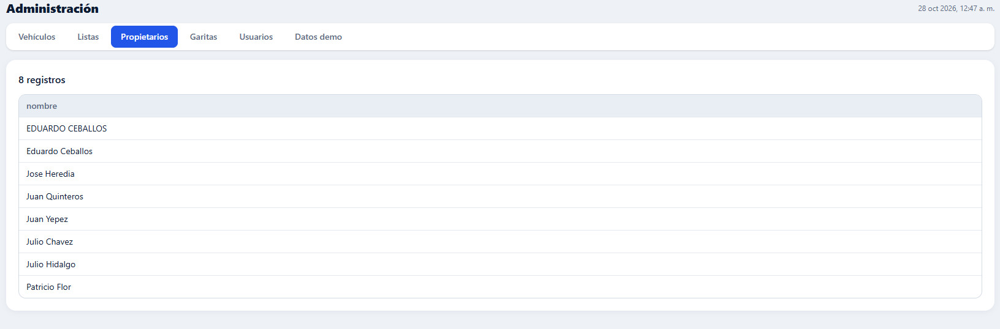

Figura 13. Consulta de propietarios.

## 8.4. Garitas

Solo el Administrador puede agregar garitas o cambiar su nombre, ubicación y estado (activo/inactivo). El Supervisor puede consultar los datos en modo de solo lectura. Una garita inactiva deja de utilizarse para nuevas operaciones cuando así lo determine la configuración.

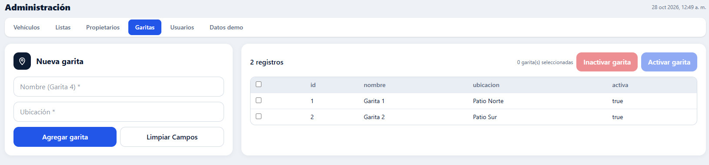

Figura 14. Administración de garitas.

## 8.5. Usuarios

Solo el Administrador puede crear usuarios, cambiar sus nombres y roles, restablecer contraseñas y activar o inactivar cuentas. El Supervisor puede consultar esta sección en modo de solo lectura. En SIRAP 1.0, los nombres de usuario deben tener entre 3 y 40 caracteres y las contraseñas iniciales al menos 8 caracteres.

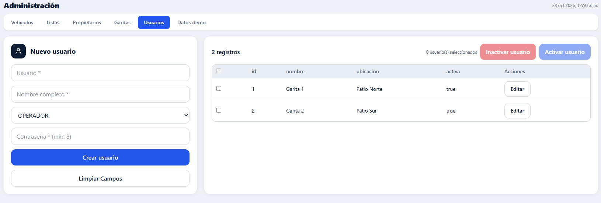

Figura 15. Creación y mantenimiento de usuarios.

# 9. Dashboard y datos de demostración

El Dashboard presenta indicadores y gráficos para conocer tendencias de las operaciones registradas. Puede mostrar ingresos, salidas, placas identificadas, alertas y movimientos por garita.

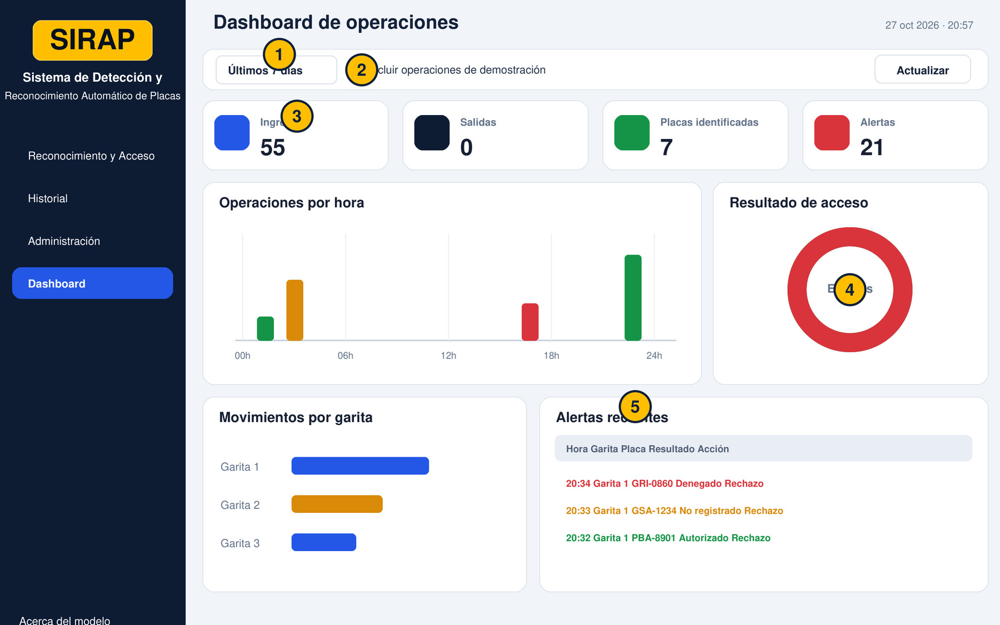

Figura 16. Dashboard: indicadores y gráficos de seguimiento.

## Cómo consultar los indicadores

**01** Abra Dashboard en el menú principal.

**02** Elija el periodo: hoy, últimos 7 días o últimos 30 días, según las opciones disponibles.

**03** Active o desactive «Incluir operaciones de demostración» según el objetivo de la consulta.

**04** Revise los indicadores principales y compare los gráficos por hora, resultado y garita.

**05** Use Actualizar para obtener nuevamente las cifras.

## Datos DEMO: qué son y cuándo utilizarlos

Los registros DEMO son operaciones ficticias para probar la visualización y el comportamiento de los paneles. Solo el Administrador puede generarlos o eliminarlos desde la pestaña Datos demo; el Supervisor puede consultar esa sección en modo de solo lectura. No son reconocimientos reales del modelo.

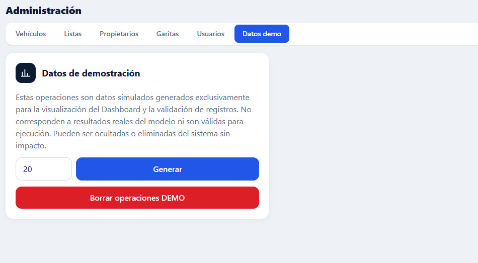

Figura 17. Controles para generar y borrar operaciones de demostración.

| **REGLA PARA INFORMES** Antes de presentar estadísticas operativas de la planta, desactive la inclusión de datos DEMO. Si un gráfico aparece vacío, revise primero el periodo y los filtros. |
|----------------------------------------------------------------------------------------------------------------------------------------------------------------------------------------------|

# 10. Acerca del modelo y métricas

La opción «Acerca del modelo» informa sobre la tecnología que interpreta las imágenes, sus resultados de evaluación y sus limitaciones. Su objetivo es dar transparencia, no sustituir la evaluación humana de cada acceso.

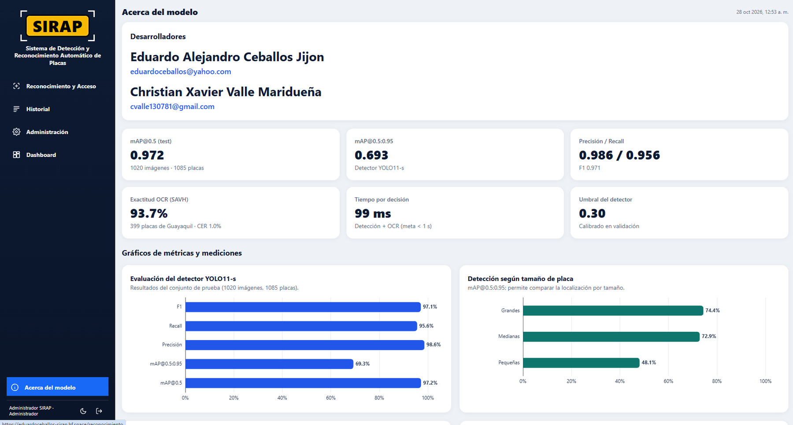

Figura 18. Pantalla de información del modelo y gráficos de desempeño.

## Indicadores incluidos

| INDICADOR             | QUÉ EXPLICA                                                                            |
|-----------------------|----------------------------------------------------------------------------------------|
| Precisión (Precision) | Entre las placas detectadas, proporción de detecciones correctas.                      |
| Recall                | De todas las placas presentes, proporción localizada por el detector.                  |
| mAP@0.5:0.95          | Calidad de localización en distintos umbrales de solapamiento.                         |
| Exactitud OCR         | Porcentaje de placas leídas completamente sin error.                                   |
| CER                   | Proporción de errores por carácter en el texto OCR.                                    |
| Tiempo por decisión   | Tiempo medido de detección y OCR bajo una configuración concreta.                      |
| mAP@0.5               | Precisión media con un umbral de intersección sobre unión (IoU) de 0,5.                |
| F1                    | Media armónica entre precisión y recall; resume el equilibrio entre ambos indicadores. |

*Tabla 6. Indicadores de rendimiento del modelo y su interpretación*

La evaluación de SIRAP versión 1.0, realizada el 27 de octubre de 2026, reportó como referencia: mAP@0.5 = 0,972; mAP@0.5:0.95 = 0,693; Precision/Recall/F1 = 0,986/0,956/0,971; exactitud OCR de 93,7 % sobre 399 placas; CER de 1,0 % y 99 ms promedio por decisión. Los resultados de detección se calcularon sobre 1.020 imágenes y 1.085 placas. Son valores de esa evaluación y pueden cambiar al actualizar el modelo, el conjunto de datos o el equipo de evaluación.

| **CÓMO LEER LAS MÉTRICAS** La confianza de una lectura individual no es lo mismo que la precisión general del modelo, y ninguna de las dos equivale a autorización de acceso. La autorización depende de la consulta de listas vigentes. |
|------------------------------------------------------------------------------------------------------------------------------------------------------------------------------------------------------------------------------------------|

## Limitaciones del reconocimiento

La luz deficiente, reflejos o placas parcialmente cubiertas pueden introducir errores.

Los modelos pueden tener menor precisión con placas muy pequeñas o lejanas.

No todas las imágenes representan las condiciones reales de una garita determinada.

El operador debe confirmar visualmente las correcciones de caracteres dudosos.

SIRAP no debe utilizarse para vigilancia indiscriminada ni para seguimiento ajeno al control de acceso.

# 11. Uso multiplataforma: computadora, tableta y celular

SIRAP es una aplicación web multiplataforma: puede consultarse desde un navegador compatible en computadora, tableta o teléfono móvil, siempre que exista conexión al servidor y el usuario cuente con permisos. La disposición de los elementos se adapta al espacio disponible: en pantallas pequeñas es normal que los controles se organicen verticalmente y que se requiera desplazamiento para ver todos los campos.

## 11.1. Entrar desde un celular

**01** Conecte el celular a Internet o a la red autorizada para acceder al aplicativo.

**02** Abra un navegador actualizado; SIRAP se ha probado con Chrome, Safari y Edge.

**03** Escriba la dirección del Space o enlace SIRAP proporcionado por el administrador.

**04** Inicie sesión con su usuario y contraseña individuales.

**05** Abra el menú de navegación para seleccionar Reconocimiento y Acceso, Historial, Administración o Dashboard según su rol.

## 11.2. Reconocer una placa desde el teléfono

Las siguientes capturas reales muestran el flujo de SIRAP desde un teléfono: primero se captura el vehículo y luego se revisa la placa identificada y la respuesta del sistema. No se requiere instalar una aplicación móvil independiente.

<table>
<colgroup>
<col style="width: 50%" />
<col style="width: 50%" />
</colgroup>
<thead>
<tr class="header">
<th>
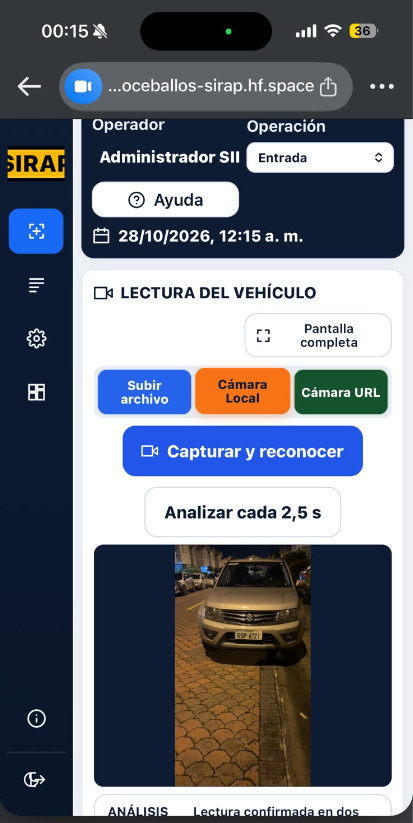

Figura 19A. Captura y reconocimiento desde Cámara Local: selección de fuente, vista de la imagen y botón «Capturar y reconocer».
</th>
<th>
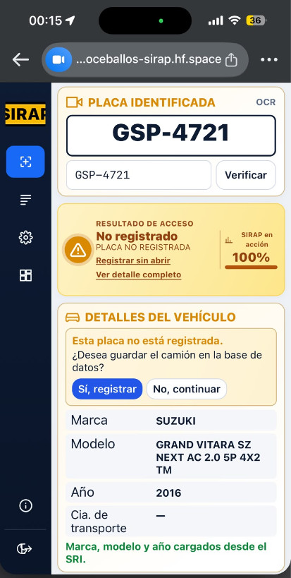

Figura 19B. Resultado desde el celular: placa leída, estado «No registrado», validación y datos complementarios del vehículo.
</th>
</tr>
</thead>
<tbody>
</tbody>
</table>

**01** Entre a Reconocimiento y Acceso y seleccione la garita y el movimiento.

**02** Use Subir archivo para tomar o seleccionar una fotografía almacenada, o Cámara Local si la versión y el navegador ofrecen esa opción.

**03** Conceda acceso a la cámara solo a la página autorizada.

**04** Coloque el teléfono de modo que se vea la placa completa, nítida y sin reflejos.

**05** Revise el texto OCR y la decisión de acceso. Si hay errores, corrija la placa y pulse Verificar.

**06** Registre únicamente la acción que autoricen los permisos y procedimientos.

## 11.3. Recomendaciones para la pantalla pequeña

Utilice el equipo en posición vertical para operar controles; gírelo a horizontal si necesita inspeccionar una imagen o tabla extensa.

Acerque la vista solamente cuando sea necesario y regrese al tamaño normal antes de pulsar una acción importante.

Desplácese hasta el resultado completo antes de autorizar o rechazar un acceso.

Evite registrar aperturas mientras se mueve o cuando el teléfono tenga conexión inestable.

No almacene fotografías de placas innecesariamente en el equipo y cierre sesión al finalizar.

## 11.4. Qué cambia y qué se mantiene

| EN COMPUTADORA                                                        | EN CELULAR                                                                             |
|-----------------------------------------------------------------------|----------------------------------------------------------------------------------------|
| Mayor espacio: panel de imagen y validación pueden verse lado a lado. | Controles y resultados pueden apilarse en columna.                                     |
| Carga desde carpeta local y cámaras conectadas.                       | Carga desde galería, archivos y, según permisos, cámara del teléfono.                  |
| Más cómodo para tablas amplias y administración masiva.               | Adecuado para consultas y capturas puntuales; algunas tablas necesitan desplazamiento. |
| La seguridad y los roles aplican igual.                               | La seguridad y los roles también aplican igual.                                        |

*Tabla 7. Comparación del uso de SIRAP en computadora y celular*

| **NOTA DE COMPATIBILIDAD** «Multiplataforma» no implica que todas las cámaras IP, formatos de video o funciones de barrera operen idénticamente en cualquier celular. Verifique permisos, red, navegador y funcionalidades habilitadas antes de una prueba real. |
|------------------------------------------------------------------------------------------------------------------------------------------------------------------------------------------------------------------------------------------------------------------|

# 12. Casos prácticos de uso

## Caso A. Camión autorizado

**01** El operador selecciona Garita 1 y Entrada.

**02** Carga una fotografía donde la placa puede verse claramente.

**03** SIRAP identifica la placa y encuentra autorización vigente.

**04** El operador contrasta que la placa coincide con el camión presente.

**05** Registra la acción permitida y confirma su aparición en Historial.

## Caso B. Camión sin registro

**01** Se carga una imagen y el sistema informa NO REGISTRADO.

**02** El operador no autoriza una apertura normal.

**03** Solicita la verificación del supervisor y, si procede, registra los datos del vehículo.

**04** El Administrador puede incorporar una autorización posterior, siempre con motivo y vigencia.

**05** Se registra la decisión tomada, sin asumir que crear el vehículo conceda acceso.

## Caso C. Lectura incorrecta por desenfoque

**01** El OCR muestra caracteres dudosos o solicita verificación manual.

**02** Se mejora la fotografía o se realiza una nueva toma.

**03** Si los caracteres son comprobables, se corrige el texto y se pulsa Verificar.

**04** Se revisa el nuevo resultado antes de realizar cualquier acción de control de acceso.

## Caso D. Consultar operaciones desde el celular

**01** Abra SIRAP en el navegador del teléfono e inicie sesión.

**02** Entre en Historial y defina un intervalo breve.

**03** Busque por placa y revise estado, garita y hora.

**04** Si su perfil es Supervisor o Administrador, exporte el CSV; de lo contrario, consulte la vista en pantalla.

# 13. Solución de problemas frecuentes

| SITUACIÓN                                | QUÉ REVISAR                                                                                                                                                                                                                                                     |
|------------------------------------------|-----------------------------------------------------------------------------------------------------------------------------------------------------------------------------------------------------------------------------------------------------------------|
| No puedo ingresar                        | Confirme usuario, contraseña y conectividad; contacte al Administrador designado por la organización.                                                                                                                                                           |
| La foto no carga                         | Compruebe formato, tamaño, nitidez y acceso al archivo.                                                                                                                                                                                                         |
| No reconoce la placa                     | Mejore luz y enfoque; evite reflejos; capture de nuevo.                                                                                                                                                                                                         |
| La lectura solicita revisión manual      | Compare los caracteres; corrija solo lo que pueda comprobar visualmente.                                                                                                                                                                                        |
| No funciona Cámara Local                 | Revise permisos de navegador, conexión y uso de la cámara por otra aplicación.                                                                                                                                                                                  |
| La cámara URL no reproduce               | Confirme tipo de señal, acceso HTTPS/red y compatibilidad con el navegador.                                                                                                                                                                                     |
| No encuentro el movimiento en Historial  | Ajuste los filtros y confirme que se registró una acción, no solo una lectura.                                                                                                                                                                                  |
| No aparece Exportar CSV                  | La función depende del rol Supervisor o Administrador.                                                                                                                                                                                                          |
| La barrera no se mueve                   | Compruebe si está en modo simulado; no repita aperturas sin revisar el procedimiento.                                                                                                                                                                           |
| No se ven registros en Dashboard         | Revise el periodo elegido y la inclusión/exclusión de registros DEMO.                                                                                                                                                                                           |
| SIRAP o la conexión no están disponibles | Mantenga cerrada la barrera hasta seguir el procedimiento de contingencia autorizado. Registre manualmente fecha y hora, garita, placa, motivo y responsable. Al restablecerse el servicio, compruebe si la operación ya fue registrada para evitar duplicados. |

*Tabla 8. Guía de solución de problemas frecuentes*

# 14. Preguntas frecuentes

## ¿Una placa reconocida queda autorizada?

No por el solo hecho de reconocerla. Compruebe la autorización vigente y el resultado de SIRAP antes de registrar una acción.

## ¿Qué hago si el OCR lee mal la placa?

Compare la lectura con la imagen. Corrija únicamente los caracteres que pueda confirmar; si persiste la duda, repita la captura o solicite verificación manual.

## ¿Registrar un camión nuevo desde Reconocimiento y Acceso autoriza su ingreso?

El formulario guarda el camión y lo agrega a la lista blanca. Revise el resultado y siga el procedimiento de registro; guardar el camión no abre por sí solo la barrera.

## ¿La barrera se abre automáticamente?

No. El operador inicia la acción de registro/apertura y el servidor valida la autorización. En la demostración, la barrera es simulada y su control corresponde al operador.

## ¿SIRAP conserva las imágenes y los videos?

Se procesan temporalmente para reconocer la placa y no se conservan como archivos permanentes en SIRAP. Las operaciones registradas sí pueden consultarse en Historial.

## ¿Quién puede exportar el Historial a CSV?

Los perfiles Supervisor y Administrador pueden exportarlo. El Operador puede consultar las operaciones según los permisos de la interfaz.

## ¿Qué hago si SIRAP o la conexión no están disponibles?

Mantenga cerrada la barrera y siga el procedimiento de contingencia autorizado. Registre manualmente la operación y compruebe el Historial al restablecerse el servicio para evitar duplicados.

# 15. Lista de comprobación del operador

□ Garita y operación (Entrada/Salida) correctas.

□ Imagen o video visible, con placa legible.

□ Placa OCR contrastada con la captura cuando corresponda.

□ Estado y vigencia de autorización revisados.

□ Acción seleccionada de acuerdo con el procedimiento.

□ Contingencia con motivo y responsable, si aplica.

□ Resultado guardado y consultable en Historial.

□ Sesión cerrada al finalizar, especialmente en dispositivos móviles.

# 16. Glosario

| TÉRMINO           | EXPLICACIÓN SENCILLA                                                           |
|-------------------|--------------------------------------------------------------------------------|
| OCR               | Tecnología que reconoce letras y números dentro de la imagen de una placa.     |
| YOLO11s           | Modelo de detección utilizado para ubicar la región de la placa.               |
| Lista blanca      | Relación de placas con autorización vigente.                                   |
| Lista restringida | Relación de placas cuyo acceso debe denegarse mientras esté vigente.           |
| Placa leída       | Texto propuesto inicialmente por el sistema.                                   |
| Placa final       | Texto revisado y confirmado antes del registro.                                |
| Confianza         | Estimación de calidad de una predicción, no de permiso de ingreso.             |
| CSV               | Formato tabular descargable y consultable en hojas de cálculo.                 |
| DEMO              | Evento simulado utilizado para pruebas y capacitación.                         |
| RTSP              | Protocolo habitual de cámaras IP; puede requerir un puente de transmisión web. |

*Tabla 9. Glosario de términos utilizados en SIRAP*

**SRI:** Servicio de Rentas Internas del Ecuador. SIRAP puede presentar marca, modelo y año obtenidos de esta fuente cuando la consulta está disponible.

## Referencia de acceso

Aplicación SIRAP, versión 1.0 (manual revisado el 28 de octubre de 2026):

En caso de diferencias entre las pantallas, valores o permisos de esta guía y la aplicación desplegada, debe prevalecer la configuración vigente verificada por el administrador del sistema.
