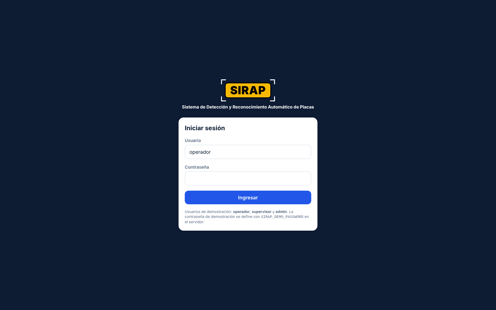
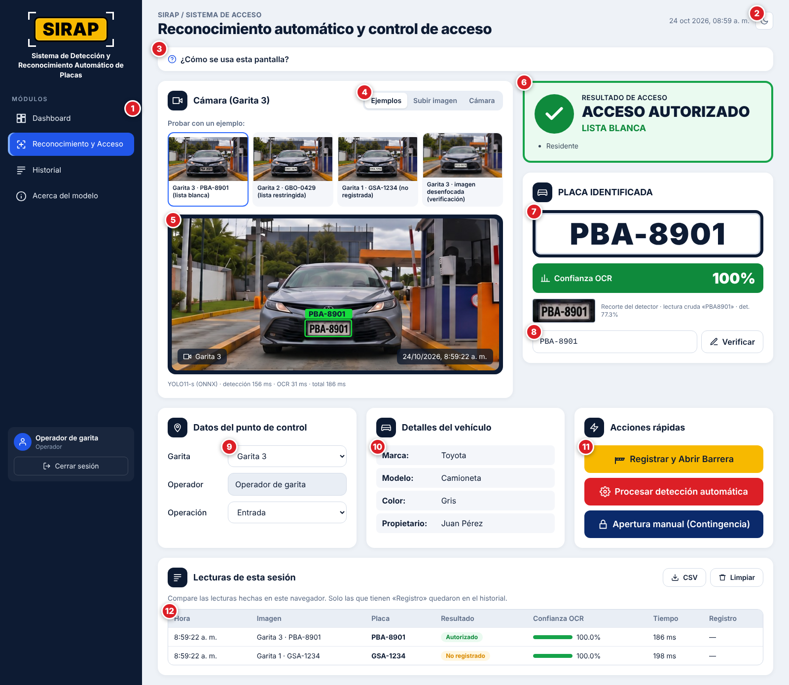
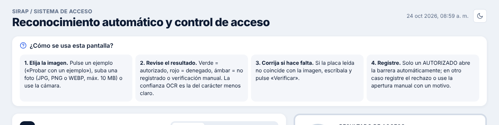
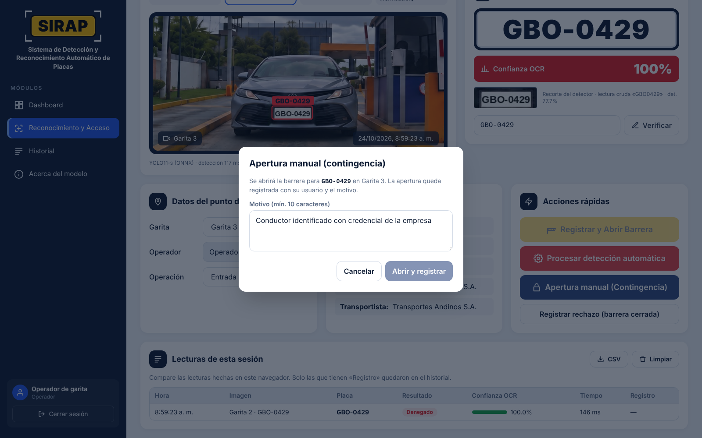
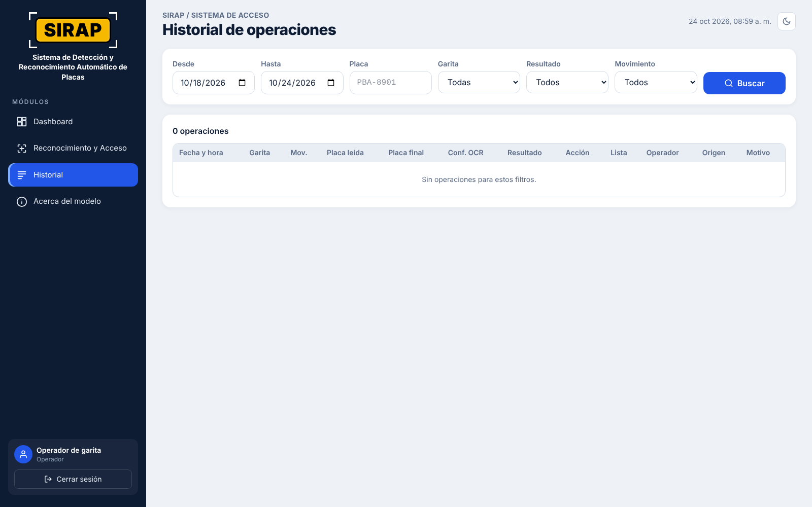
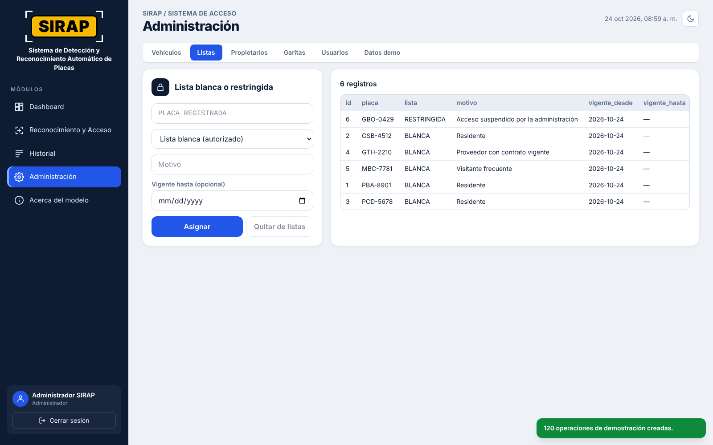
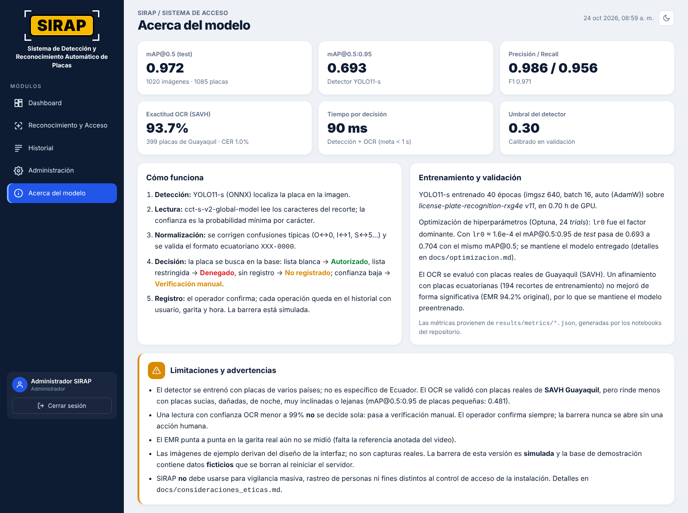

# Manual de usuario – SIRAP 2 (FastAPI + Vue)

**Aplicación:** https://eduardoceballos-sirap.hf.space · **Usuarios:** operadores de garita, supervisores y
administradores.

SIRAP lee la placa del vehículo que llega a la garita, la busca en la registro CSV y propone una decisión. **El
operador siempre confirma**: la barrera nunca se abre sola.

> **Demostración pública.** Usuarios `operador`, `supervisor` y `admin`; contraseña inicial `sirap2026` (salvo que
> el administrador del despliegue la haya cambiado mediante `SIRAP_DEMO_PASSWORD`). La base inicial contiene **datos
> ficticios** y la barrera es **simulada**. El Space tiene configurados los secretos para restaurar y respaldar las
> tablas CSV en el repositorio privado `SIRAP_datos_privados`.

---

## 1. Inicio rápido (2 minutos)

1. Abra la aplicación e **inicie sesión** con su usuario y contraseña.
2. Se abre **Reconocimiento y Acceso**. En **Datos del punto de control** elija la **garita** y la **operación**
   (Entrada/Salida). El operador es el usuario con el que inició sesión.
3. Pulse un ejemplo en **Probar con un ejemplo**, o use **Subir imagen** o **Cámara**.
4. Lea el **Resultado de acceso** (verde, rojo o ámbar) y la **placa identificada**.
5. Si es **ACCESO AUTORIZADO**, pulse **Registrar y Abrir Barrera**. En otro caso use **Registrar rechazo** /
   **Registrar sin abrir** o, si corresponde, la **Apertura manual (Contingencia)**.

## 2. Roles

| Rol | Puede |
|---|---|
| **Operador** | Reconocer placas, corregirlas, registrar operaciones, abrir la barrera, ver Dashboard, Historial y Acerca del modelo |
| **Supervisor** | Lo mismo que el operador, además **exportar el historial a CSV** y **consultar** Administración |
| **Administrador** | Todo lo anterior y **modificar** vehículos, listas, garitas, usuarios y datos de demostración |

Cada operación queda guardada con el nombre del usuario que la hizo. La sesión dura 12 horas; al vencer, la app
vuelve a pedir la contraseña.

## 3. Pantalla de Reconocimiento y Acceso

| # | Elemento | Para qué sirve |
|---|---|---|
| 1 | Menú de módulos | Cambiar entre Dashboard, Reconocimiento y Acceso, Historial, Administración (supervisor y administrador) y Acerca del modelo. Abajo: usuario, rol y **Cerrar sesión** |
| 2 | Tema claro / oscuro | Botón sol/luna; la elección se recuerda en el navegador |
| 3 | ¿Cómo se usa esta pantalla? | Ayuda en cuatro pasos. Se abre sola en la primera visita |
| 4 | Fuente de la imagen | **Ejemplos** (botones «Probar con un ejemplo»), **Subir imagen** (JPG/PNG/WEBP, máx. 10 MB) o **Cámara** del dispositivo |
| 5 | Imagen de la garita | Placa enmarcada con el color del resultado, garita y fecha/hora. Debajo: detector usado y tiempos de detección y OCR |
| 6 | Resultado de acceso | Decisión del sistema y motivo (p. ej. «Confianza OCR 30 % < umbral 94 %») y, si existe, «¿Quiso decir …?» |
| 7 | Placa identificada | Placa en formato `ABC-1234`, **confianza OCR**, recorte que leyó el OCR, lectura cruda y confianza del detector |
| 8 | Corregir o escribir la placa | Escriba la placa que ve en la imagen y pulse **Verificar** |
| 9 | Punto de control | Garita, operador (usuario de la sesión) y tipo de operación que se guardan con cada registro |
| 10 | Detalles del vehículo | Marca, modelo, color, propietario y transportista según la base |
| 11 | Acciones rápidas | Registrar y abrir, volver a procesar, apertura manual y registrar sin abrir |
| 12 | Lecturas de esta sesión | Tabla para **comparar** todas las lecturas hechas en este navegador, con barra de confianza y si se registraron. **CSV** las descarga; **Limpiar** las borra |

### 3.1 Significado de los resultados

| Color | Resultado | Qué hacer |
|---|---|---|
| 🟢 Verde | **ACCESO AUTORIZADO – LISTA BLANCA** | Verifique visualmente y pulse **Registrar y Abrir Barrera** |
| 🔴 Rojo | **ACCESO DENEGADO – LISTA RESTRINGIDA** | No abra. Pulse **Registrar rechazo (barrera cerrada)** y siga el protocolo de seguridad |
| 🟠 Ámbar | **NO REGISTRADO** | No abra. Consulte con el residente o la empresa, o regístrelo en Administración |
| 🟠 Ámbar | **VERIFICACIÓN MANUAL** | La lectura es dudosa: compare la placa con la imagen y corríjala (3.2) |

**Confianza OCR.** Es la seguridad del lector en el carácter **menos** claro de la placa. Por debajo de 94 % el sistema
no decide solo y pide verificación manual. **Registrar y Abrir Barrera** solo se habilita con **ACCESO AUTORIZADO**, y
el servidor lo vuelve a comprobar antes de abrir.

### 3.2 Corregir una placa

Escriba la placa en el campo **Corregir o escribir placa** (con o sin guion, mayúsculas o minúsculas) y pulse
**Verificar**. El resultado se recalcula con esa placa y la operación quedará con origen **MANUAL**. Si el formato no
es válido (3 letras y 3 o 4 dígitos), aparece un aviso.

### 3.2.1 Datos complementarios del vehículo

Al identificar o verificar una placa, la aplicación puede consultar el servicio público del **SRI** para completar
marca, modelo y año, y **EcuadorLegalOnline** para mostrar el nombre visible asociado públicamente a esa placa.
La consulta usa la placa y sirve para complementar la ficha; **no determina si se autoriza el acceso**. Si las
fuentes no responden, los controles del sitio impiden la consulta o no hay datos verificables, la aplicación informa
que no están disponibles y conserva los datos locales que existan. No consulta cédula, domicilio ni teléfono ni
intenta eludir CAPTCHA. Los datos públicos pueden ser incompletos o estar desactualizados; confirme la información
por los canales correspondientes antes de tomar decisiones administrativas.

### 3.3 Apertura manual (Contingencia)

Úsela solo si el sistema falla o la situación lo exige (ambulancia, falla de cámara, placa ilegible verificada con
documentos). Escriba un **motivo** de al menos 10 caracteres y pulse **Abrir y registrar**. Queda en el historial con
su usuario y el motivo.

## 4. Dashboard

Indicadores del periodo (hoy, 7 o 30 días): **ingresos**, **salidas**, **placas identificadas** y **alertas**
(denegados, no registrados y aperturas manuales). Gráficos interactivos por hora, por resultado y por garita (pase el
cursor para ver los valores) y la lista de las últimas alertas. La casilla **Incluir operaciones de demostración**
muestra u oculta los datos DEMO.

## 5. Historial y auditoría

Filtre por fechas, placa, garita, resultado y movimiento y pulse **Buscar**. Cada fila guarda fecha y hora, garita,
movimiento, lectura del OCR, placa final, confianza, resultado, acción, lista, operador, origen y motivo. **Exportar
CSV** (supervisor y administrador) descarga lo filtrado. El historial no se puede editar ni borrar desde la app.

## 6. Administración

Visible para supervisores (solo consulta) y administradores (consulta y cambios).

| Pestaña | Acciones (administrador) |
|---|---|
| Vehículos | Crear o actualizar placa, marca, modelo, color, tipo, propietario y transportista |
| Listas | Poner una placa registrada en lista **BLANCA** o **RESTRINGIDA** con motivo y vigencia, o **Quitar de listas** |
| Propietarios | Consultar propietarios |
| Garitas | Agregar puntos de control |
| Usuarios | Crear usuarios con rol y contraseña (mínimo 8 caracteres) |
| Datos demo | Generar o borrar operaciones ficticias (origen DEMO) para mostrar el Dashboard |

## 7. Acerca del modelo

Explica cómo funciona SIRAP (detección, lectura, normalización, decisión y registro), muestra las métricas del modelo
(mAP, precisión, recall, exactitud del OCR, tiempo por decisión, umbral), el entrenamiento, la optimización de
hiperparámetros y las **limitaciones y advertencias**.

## 8. En el celular

La interfaz se adapta a pantallas pequeñas: las tarjetas se apilan y el menú se abre con el botón ☰ arriba a la
izquierda. La opción **Cámara** usa la cámara del teléfono (el navegador pide permiso).

## 9. Solución de problemas

| Problema | Causa probable | Solución |
|---|---|---|
| «Usuario o contraseña incorrectos» | Datos mal escritos | Revise mayúsculas; en la demo use `operador` / `sirap2026` |
| La app vuelve a la pantalla de inicio de sesión | La sesión venció (12 h) o el servidor se reinició | Inicie sesión otra vez |
| La página tarda en abrir o muestra «Building» / «Sleeping» | El Space de Hugging Face estaba dormido o se está actualizando | Espere 1–2 minutos y recargue |
| «No se pudo conectar con la API de SIRAP» | Sin internet o servidor caído | Revise la conexión y recargue |
| «El archivo no es una imagen válida (JPG, PNG o WEBP)» | Formato no admitido o archivo dañado | Use JPG, PNG o WEBP |
| «La imagen supera 10 MB» / «La imagen es muy pequeña» | Foto muy pesada o lado menor < 160 px | Reduzca la resolución o acérquese |
| «Formato inválido: use 3 letras y 3 o 4 dígitos» | Placa escrita mal | Escriba, por ejemplo, `PBA8901` o `PBA-8901` |
| Siempre VERIFICACIÓN MANUAL | Placa sucia, lejana, inclinada o de noche | Limpie el lente, acerque el punto de captura, mejore la iluminación |
| «Registrar y Abrir Barrera» deshabilitado | El resultado no es AUTORIZADO o esa lectura ya se registró | Revise el resultado; para otra captura cambie la imagen |
| «No se puede abrir automáticamente…» | El servidor recalculó y el resultado no es AUTORIZADO | Use **Registrar rechazo** o la apertura manual con motivo |
| «Su rol no tiene permiso para esta acción» | Acción de supervisor o administrador | Pida la acción a un usuario con ese rol |
| La cámara no funciona | Permiso denegado o sin cámara | Permita la cámara en el navegador o use **Subir imagen** |
| Los datos desaparecieron | Falló la sincronización con el repositorio privado | Revise `SIRAP_DATA_GITHUB_TOKEN`, los permisos de `SIRAP_datos_privados` y los logs de la ejecución del Space |

## 10. Preguntas frecuentes

**¿La barrera se abre sola?** No. El sistema propone; el operador confirma, y el servidor vuelve a comprobar la
decisión antes de abrir.

**¿Se guardan las fotos?** No. La imagen se procesa en memoria y no se conserva como archivo. Al confirmar una
operación se guardan placa, hora, garita, usuario y resultado. Las «Lecturas de esta sesión» viven en el navegador.
Las tablas CSV del Space se restauran y sincronizan con el repositorio privado de datos, cuyos secretos ya están
configurados. La aplicación está alojada en Hugging Face Spaces con Docker; fue necesario pagar a Hugging Face para
que la aplicación pudiera ejecutarse en el Space, ya que sin ese pago no corría.

**¿Funciona con motos o placas extranjeras?** No está validado para ellas; úselas con verificación manual.

**¿Puedo usar la API desde otro sistema?** Sí: la documentación interactiva está en
https://eduardoceballos-sirap.hf.space/docs (requiere iniciar sesión con `POST /api/auth/login`).

**¿Puedo usar la app en la garita real?** La versión publicada es una demostración (datos ficticios, barrera
simulada). Para producción hay que configurar almacenamiento persistente, la cámara IP y el controlador de la barrera (ver
`docs/arquitectura.md`).

## 11. Soporte

- Eduardo Alejandro Ceballos Jijón
- Christian Xavier Valle Maridueña
- Reporte errores en https://github.com/eduardoceballos666/SIRAP_2/issues
