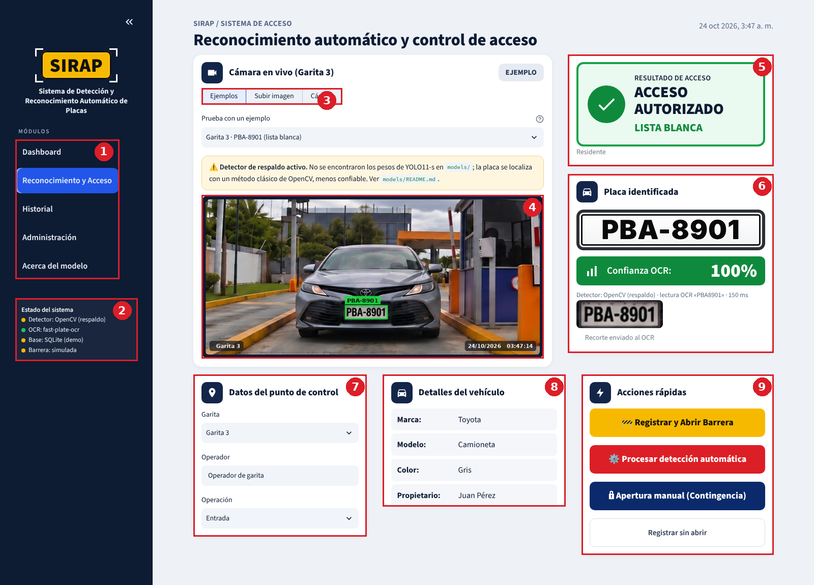
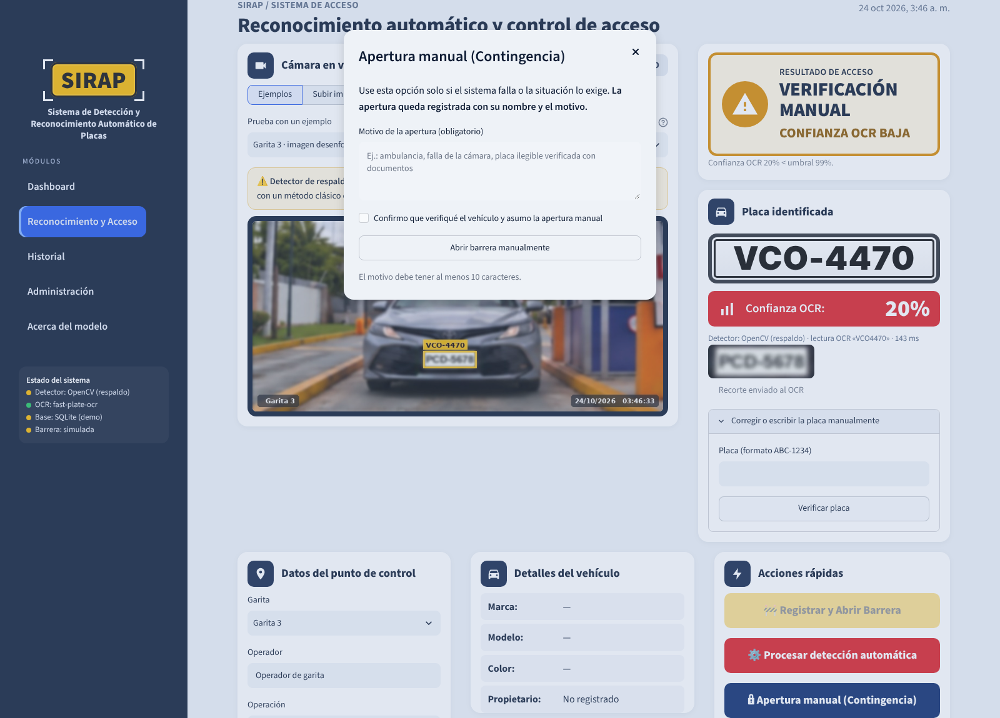
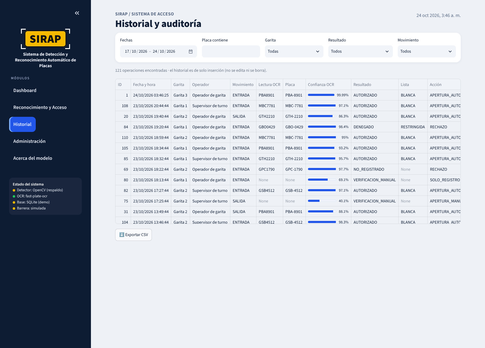
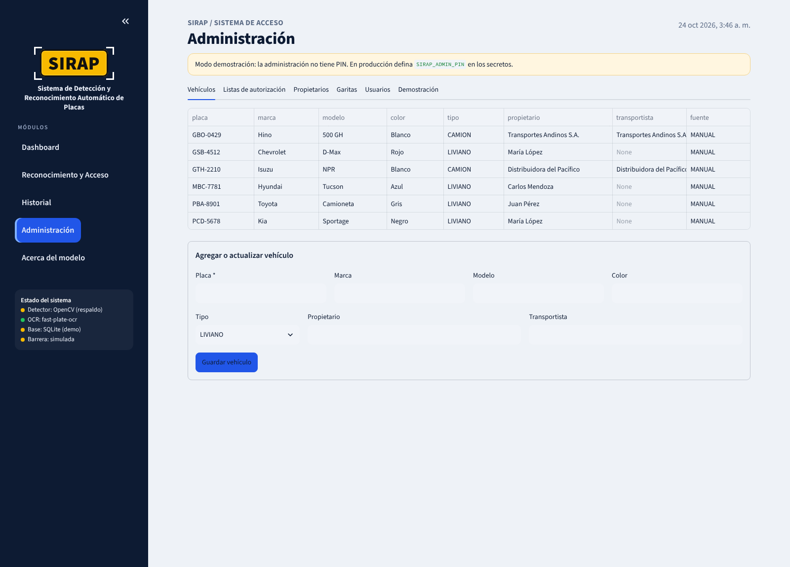
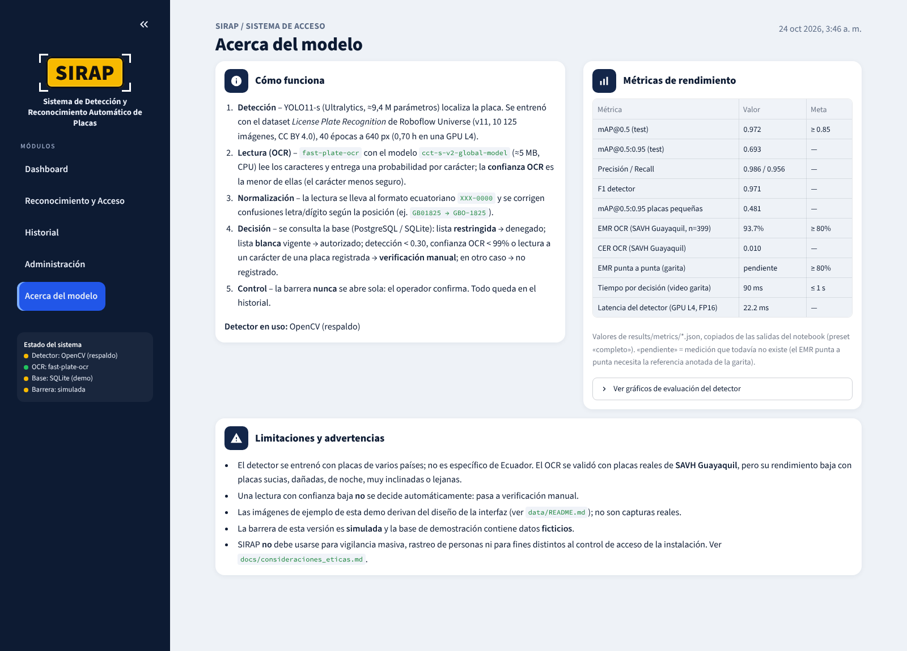

# Manual de usuario – SIRAP

**Aplicación:** https://sirapapp.streamlit.app/ · **Usuarios:** operadores de garita, supervisores y administradores.

SIRAP lee la placa del vehículo que llega a la garita, la busca en la base de datos y propone una decisión. **El
operador siempre confirma**: la barrera nunca se abre sola.

---

## 1. Inicio rápido (2 minutos)

1. Abra la app. Se muestra el módulo **Reconocimiento y Acceso** con un ejemplo cargado.
2. En **Datos del punto de control** elija la **garita**, escriba su **nombre** de operador y la **operación**
   (Entrada/Salida).
3. Elija la fuente de la imagen: **Ejemplos**, **Subir imagen** o **Cámara**.
4. Lea el **Resultado de acceso** (verde, rojo, gris o ámbar) y la **placa identificada**.
5. Si es **ACCESO AUTORIZADO**, pulse **Registrar y Abrir Barrera**. En otro caso, use **Registrar rechazo** o, si
   corresponde, la **Apertura manual (Contingencia)**.

## 2. Pantalla de Reconocimiento y Acceso

| # | Elemento | Para qué sirve |
|---|---|---|
| 1 | Menú de módulos | Cambiar entre Dashboard, Reconocimiento y Acceso, Historial, Administración y Acerca del modelo |
| 2 | Estado del sistema | Detector en uso, OCR, base de datos (PostgreSQL o demo) y barrera (simulada o conectada) |
| 3 | Fuente de la imagen | Ejemplos precargados, subir una foto (JPG/PNG/WEBP, máx. 10 MB) o tomarla con la cámara del dispositivo |
| 4 | Cámara | Imagen con la placa enmarcada (el color sigue al resultado), la garita y la fecha/hora de la captura |
| 5 | Resultado de acceso | Decisión del sistema y motivo (por ejemplo, «Confianza OCR 48 % < umbral 99 %») |
| 6 | Placa identificada | Placa en formato `ABC-1234`, **confianza OCR** y el recorte que leyó el OCR |
| 7 | Punto de control | Garita, operador y tipo de operación que se guardan con cada registro |
| 8 | Detalles del vehículo | Marca, modelo, color y propietario según la base |
| 9 | Acciones rápidas | Registrar y abrir, volver a procesar, apertura manual y registrar sin abrir |

### 2.1 Significado de los resultados

| Color | Resultado | Qué hacer |
|---|---|---|
| 🟢 Verde | **ACCESO AUTORIZADO – LISTA BLANCA** | Verifique visualmente y pulse **Registrar y Abrir Barrera** |
| 🔴 Rojo | **ACCESO DENEGADO – LISTA RESTRINGIDA** | No abra. Pulse **Registrar rechazo** y siga el protocolo de seguridad |
| ⚪ Gris | **NO REGISTRADO** | No abra. Consulte con el residente/empresa o regístrelo en Administración |
| 🟠 Ámbar | **VERIFICACIÓN MANUAL** | La lectura es dudosa: compare la placa con la imagen y corríjala (2.2) |

**Confianza OCR.** Es la seguridad del lector en el carácter **menos** claro de la placa. Verde ≥ 99 %, ámbar
60–99 %, rojo < 60 %. Por debajo de 99 % el sistema no decide solo.

### 2.2 Corregir una placa

Cuando el resultado no es *autorizado* aparece **Corregir o escribir la placa manualmente**. Escriba la placa que ve
en la imagen (con o sin guion) y pulse **Verificar placa**. Si el sistema detectó una placa parecida, la propone
(«¿Quiso decir PBA-8901?»). La operación queda registrada con origen **MANUAL**.

### 2.3 Apertura manual (Contingencia)

Úsela solo si el sistema falla o la situación lo exige (ambulancia, falla de cámara, placa ilegible verificada con
documentos). Debe escribir un **motivo** (mínimo 10 caracteres) y **confirmar**. Queda en el historial con su nombre.

## 3. Dashboard

Indicadores del periodo (hoy, 7 o 30 días): **ingresos**, **salidas**, **vehículos identificados** y **alertas**
(denegados, no registrados y aperturas manuales), con gráficos por hora, por resultado y por garita, y la lista de
las últimas alertas. El interruptor **Incluir operaciones de demostración** muestra u oculta los datos DEMO.

## 4. Historial y auditoría

Filtre por fechas, placa, garita, resultado y movimiento. Cada fila guarda fecha y hora, garita, operador, lectura
del OCR, placa final, confianza, resultado, lista, acción, motivo y origen. **Exportar CSV** descarga lo filtrado. El
historial es de solo inserción: no se puede editar ni borrar desde la app.

## 5. Administración

Protegida con PIN cuando se configura `SIRAP_ADMIN_PIN` (en la demo pública está abierta).

| Pestaña | Acciones |
|---|---|
| Vehículos | Ver y agregar/actualizar placa, marca, modelo, color, tipo, propietario y transportista |
| Listas de autorización | Poner una placa en lista **BLANCA** o **RESTRINGIDA** con motivo y vigencia, o quitarla de las listas |
| Propietarios | Consultar propietarios (solo nombre y un contacto) |
| Garitas | Agregar puntos de control |
| Usuarios | Agregar operadores, supervisores y administradores |
| Demostración | Generar o borrar operaciones ficticias (origen DEMO) para mostrar el Dashboard |

## 6. Acerca del modelo

Explica cómo funciona SIRAP, muestra las métricas del modelo (mAP, precisión, recall, EMR del OCR, tiempos) con sus
metas, los gráficos de evaluación y las limitaciones.

## 7. En el celular

La interfaz se adapta a pantallas pequeñas: las tarjetas se apilan y el menú se abre con el botón «›» arriba a la
izquierda. La opción **Cámara** usa la cámara del teléfono.

## 8. Solución de problemas

| Problema | Causa probable | Solución |
|---|---|---|
| Aviso «Detector de respaldo activo» | No están los pesos de YOLO11-s en `models/` | Copiar `best_model.onnx` (ver `models/README.md`). Mientras tanto, verifique cada lectura |
| «El archivo no es una imagen válida» | Formato no admitido o archivo dañado | Use JPG, PNG o WEBP |
| «La imagen es muy pequeña» | Lado menor < 160 px | Acérquese o use mayor resolución |
| «La imagen supera 10 MB» | Foto muy pesada | Reduzca la resolución |
| Siempre VERIFICACIÓN MANUAL | Placa sucia, lejana, inclinada o de noche | Limpie el lente, acerque el punto de captura, mejore la iluminación |
| La placa aparece sin guion o rara | Lectura fuera del formato ecuatoriano | Corríjala manualmente (2.2) |
| «Registrar y Abrir Barrera» deshabilitado | El resultado no es AUTORIZADO o ya se registró esa captura | Revise el resultado; para otra captura cambie la imagen |
| «La barrera no confirmó la apertura» | Controlador desconectado | Use la apertura manual y avise a soporte |
| La primera carga tarda | La app descarga el OCR (≈5 MB) al iniciar | Espere unos segundos |
| Los datos desaparecieron | La demo pública reinicia su base SQLite al redeployar | En producción configure PostgreSQL (`PG_DSN`) |

## 9. Preguntas frecuentes

**¿La barrera se abre sola?** No. El sistema propone; el operador confirma.

**¿Se guardan las fotos?** No. Solo se guarda el registro de la operación (placa, hora, garita, operador, resultado).

**¿Funciona con motos o placas extranjeras?** No está validado para ellas; úselas con verificación manual.

**¿Qué significa «Detector: OpenCV (respaldo)»?** Que la app no encontró el modelo entrenado y usa un método clásico
menos confiable. Ver la tabla de problemas.

**¿Puedo usar la app en la garita real?** La versión publicada es una demostración (datos ficticios, barrera
simulada). Para producción hay que conectar PostgreSQL, el controlador de la barrera y autenticación (ver
`docs/arquitectura.md`).

## 10. Soporte

- Eduardo Alejandro Ceballos Jijón
- Christian Xavier Valle Maridueña
- Reporte errores en https://github.com/eduardoceballos666/SIRAP/issues
