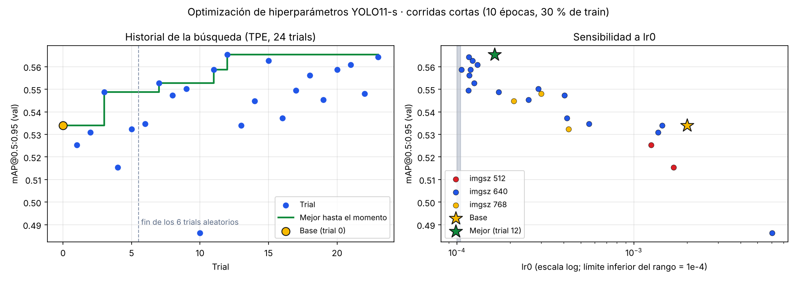
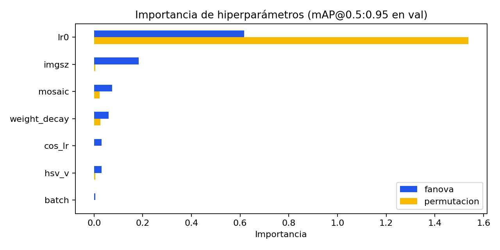
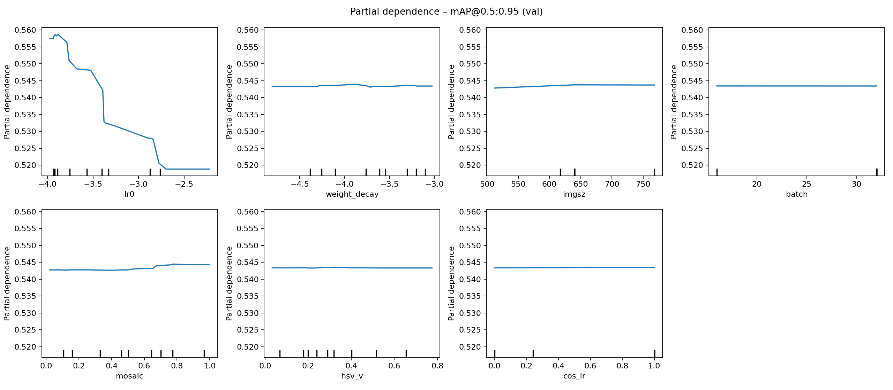
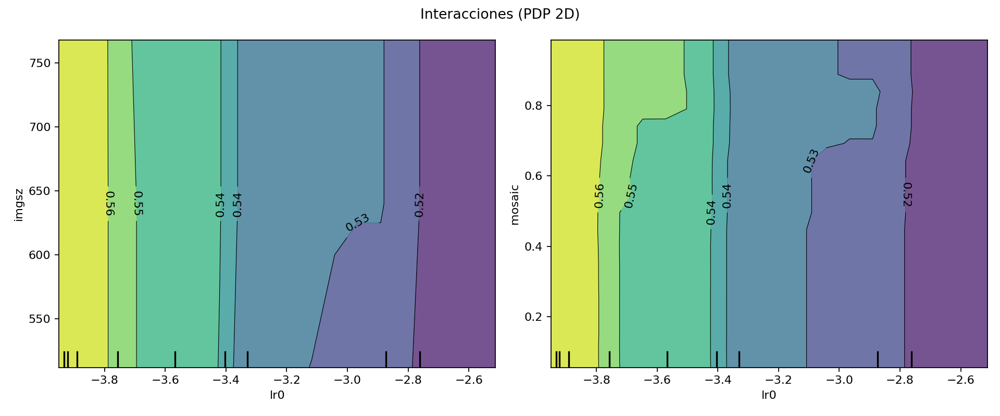
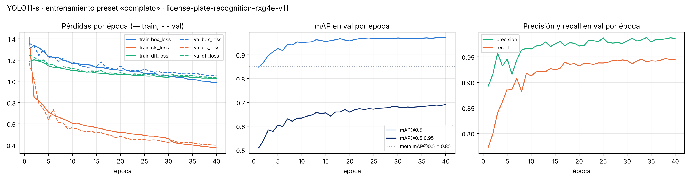
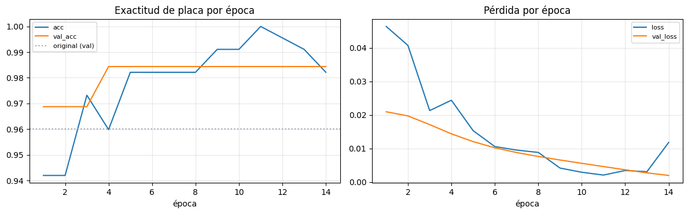

# Optimización de modelos y umbrales – SIRAP

Este documento reúne la búsqueda de hiperparámetros del detector, la comparación de configuraciones completas, la validación con varias semillas, la calibración de umbrales y el experimento independiente de afinamiento del OCR. Cada resultado se identifica por su conjunto y protocolo para no confundir experimentos distintos.

- Notebook de optimización: [04_optimizacion.ipynb](../notebooks/04_optimizacion.ipynb)
- Notebook de afinamiento OCR: [06_afinamiento_ocr.ipynb](../notebooks/06_afinamiento_ocr.ipynb)
- Métricas: `results/metrics/optimizacion_*.csv|json`
- Figuras: `results/figures/opt_*.png`

## Contenido

1. [Objetivo y protocolo](#1-objetivo-y-protocolo)
2. [Configuración base y espacio de búsqueda](#2-configuración-base-y-espacio-de-búsqueda)
3. [Resultados y sensibilidad](#3-resultados-y-sensibilidad)
4. [Comparación completa y decisión sobre el detector](#4-comparación-completa-y-decisión-sobre-el-detector)
5. [Validación multisemilla](#5-validación-multisemilla)
6. [Umbrales y decisión operativa](#6-umbrales-y-decisión-operativa)
7. [Afinamiento del OCR](#7-afinamiento-del-ocr)
8. [Conclusiones y límites](#8-conclusiones-y-límites)
9. [Relación con la aplicación y el repositorio](#9-relación-con-la-aplicación-y-el-repositorio)

## 1. Objetivo y protocolo

El estudio principal optimiza el detector **YOLO11-s**. La métrica objetivo es mAP@0.5:0.95 en validación, porque evalúa con mayor exigencia la localización de la placa que mAP@0.5. También se registra mAP@0.5.

La búsqueda utilizó **Optuna con TPE bayesiano**, 24 trials y 6 inicializaciones aleatorias. Cada trial corto se ejecutó durante 10 épocas, con 30 % del conjunto de entrenamiento, validación completa, semilla 0 y `deterministic=True` (aprox. 3,2 horas en GPU T4 para toda la búsqueda). La configuración mejor clasificada se volvió a entrenar con 40 épocas y 100 % del conjunto de entrenamiento.

Se fijó `optimizer="AdamW"` explícitamente: con `optimizer="auto"`, Ultralytics puede seleccionar la tasa de aprendizaje automáticamente e ignorar el `lr0` propuesto, lo que impediría comparar correctamente ese hiperparámetro.

## 2. Configuración base y espacio de búsqueda

### Configuración base

| Hiperparámetro | Valor |
|---|---:|
| `lr0` | 0,002 |
| `weight_decay` | 0,0005 |
| `imgsz` | 640 |
| `batch` | 16 |
| `mosaic` | 1,0 |
| `hsv_v` | 0,4 |
| `cos_lr` | False |
| Épocas / paciencia | 40 / 10 |

### Espacio explorado

| Hiperparámetro | Rango / valores | Escala | Motivo |
|---|---|---|---|
| `lr0` | 1e-4–1e-2 | Logarítmica | Controla la convergencia al ajustar el detector preentrenado |
| `weight_decay` | 1e-5–1e-3 | Logarítmica | Regularización |
| `imgsz` | 512, 640, 768 | Categórica | Evaluar el efecto del tamaño de las placas |
| `batch` | 8, 16, 32 | Categórica | Evaluar el ruido del gradiente |
| `mosaic` | 0–1 | Lineal | Variar el aumento de datos y los contextos |
| `hsv_v` | 0–0,8 | Lineal | Variar la robustez a cambios de iluminación |
| `cos_lr` | True / False | Categórica | Comparar el scheduler de tasa de aprendizaje |

Con `nbs=64`, Ultralytics acumula gradientes para mantener un lote efectivo de 64; por ello, distintos valores de `batch` pueden producir un efecto reducido.

## 3. Resultados y sensibilidad

### Trials principales

| Configuración | Trial | `lr0` | `weight_decay` | `imgsz` | `batch` | `mosaic` | `hsv_v` | `cos_lr` | mAP@0.5:0.95 val | mAP@0.5 val |
|---|---:|---:|---:|---:|---:|---:|---:|---:|---:|---:|
| Base | 0 | 0,002 | 5,0e-4 | 640 | 16 | 1,00 | 0,40 | False | 0,534 | 0,923 |
| **Mejor** | **12** | **1,6e-4** | **9,3e-4** | **640** | **32** | **0,78** | **0,29** | **True** | **0,565** | 0,945 |
| Segundo | 23 | 1,2e-4 | 4,9e-4 | 640 | 32 | 0,88 | 0,32 | True | 0,564 | 0,951 |
| Tercero | 15 | 1,2e-4 | 1,3e-4 | 640 | 32 | 0,21 | 0,16 | True | 0,563 | 0,948 |
| Peor | 10 | 6,0e-3 | 4,9e-5 | 640 | 32 | 0,25 | 0,28 | True | 0,486 | 0,862 |

En los trials cortos, la mejor configuración superó a la base en **0,031 mAP@0.5:0.95** (5,9 % relativo). Los 10 trials con `lr0` ≤ 2e-4 promediaron 0,558 (rango 0,549–0,565); los 6 con `lr0` > 1e-3 promediaron 0,521 (rango 0,486–0,534). El archivo con todos los trials está en [optimizacion_trials.csv](../results/metrics/optimizacion_trials.csv).

### Importancia de los hiperparámetros

La importancia se estimó con fANOVA y se contrastó con permutación de un Random Forest sustituto.

| Orden fANOVA | Hiperparámetro | fANOVA | Permutación (RF) |
|---:|---|---:|---:|
| 1 | `lr0` | **0,616** | **1,538** |
| 2 | `imgsz` | 0,183 | 0,005 |
| 3 | `mosaic` | 0,074 | 0,023 |
| 4 | `weight_decay` | 0,060 | 0,027 |
| 5 | `cos_lr` | 0,031 | ≈0 |
| 6 | `hsv_v` | 0,031 | 0,005 |
| 7 | `batch` | 0,005 | ≈0 |

fANOVA distribuye la varianza explicada (la suma es 1). La importancia por permutación mide la caída del R² del modelo sustituto al desordenar una variable y puede superar 1.

**Hallazgos principales:**

- `lr0` domina en ambos métodos. En esta búsqueda, la correlación entre log10(`lr0`) y mAP fue −0,91. La tasa base de 0,002 fue demasiado alta para este ajuste; los mejores trials se ubicaron cerca de 1–2e-4.
- El segundo lugar de `imgsz` en fANOVA no es concluyente: la permutación lo estima casi en cero y su PDP es plano. Solo dos trials usaron 512 px, ambos con `lr0` alto, por lo que las variables están confundidas. 768 px no superó a 640 px en los trials cortos.
- `mosaic`, `weight_decay`, `hsv_v`, `cos_lr` y `batch` muestran efectos pequeños en los PDP (menos de 0,01 mAP en la región explorada).
- TPE concentró la búsqueda: 20 de 24 trials usaron batch 32; 19 usaron 640 px y 19 usaron `cos_lr`. Por ello, las importancias de esos parámetros son orientativas.

### Partial dependence e interacciones

El PDP de `lr0` cae casi monótonamente de aproximadamente 0,558 en 1e-4 a 0,519 desde 2e-3. El mejor valor se acerca al límite inferior del rango explorado; valores inferiores requerirían otro estudio. `mosaic` presenta una mejora leve por encima de aproximadamente 0,6; las demás curvas son relativamente planas.

Se analizaron `lr0 × imgsz` y `lr0 × mosaic`. Las curvas son casi verticales: el mAP cambia principalmente con `lr0`, sin interacciones relevantes visibles con la otra variable en la región observada.

## 4. Comparación completa y decisión sobre el detector

La configuración del trial 12 se reentrenó con el protocolo completo: 40 épocas, todo el conjunto de entrenamiento, paciencia 10 y semilla 0. Se comparó con los pesos base entregados en el mismo test (1.020 imágenes y 1.085 placas).

| Configuración | mAP@0.5 test | mAP@0.5:0.95 test | Precisión | Recall | mAP@0.5:0.95 val | Tiempo por época |
|---|---:|---:|---:|---:|---:|---:|
| Base, pesos entregados | 0,972 | 0,693 | 0,987 | 0,952 | 0,691 | ≈63 s (L4) |
| Optimizada, trial 12 | 0,973 | **0,704** | 0,988 | 0,946 | 0,699 | ≈107 s (T4) |
| Diferencia | +0,001 | **+0,011** (+1,6 %) | +0,002 | −0,006 | +0,008 | GPU distinta |

La precisión y el recall usan el umbral de máximo F1 de Ultralytics. El mAP de placas pequeñas no se midió para la configuración optimizada. El entrenamiento completo llegó a las 40 épocas sin activar *early stopping*.

**Decisión:** se mantienen los pesos entregados (`models/best_model.pt` y `models/best_model.onnx`). La configuración optimizada mejora mAP@0.5:0.95, pero apenas cambia mAP@0.5 y reduce ligeramente el recall. Como SIRAP recorta la placa antes del OCR, una caja más ajustada no implica necesariamente una mejora práctica de lectura. Cambiar los pesos también requeriría exportar ONNX, recalibrar el umbral del detector y repetir las evaluaciones de la aplicación.

Para un próximo reentrenamiento se recomienda probar la configuración del trial 12, en especial `lr0≈1,6e-4`, `optimizer="AdamW"` y `cos_lr=True`; los valores están en [optimizacion_resumen.json](../results/metrics/optimizacion_resumen.json).

## 5. Validación multisemilla

Para medir la variación entre corridas, las configuraciones base y optimizada se entrenaron independientemente con AdamW, 40 épocas previstas, paciencia 10 y semillas 0, 1 y 2.

| Semilla | mAP@0.5:0.95 base | Optimizada | Diferencia (pp) | Recall base | Optimizada | Diferencia (pp) |
|---:|---:|---:|---:|---:|---:|---:|
| 0 | 69,3573 % | 70,0945 % | +0,7372 | 95,0693 % | 95,0230 % | −0,0463 |
| 1 | 69,4552 % | 69,6736 % | +0,2184 | 95,1152 % | 96,0369 % | +0,9217 |
| 2 | 69,5956 % | 69,7629 % | +0,1673 | 94,9309 % | 94,9607 % | +0,0298 |

La mejora media pareada de mAP@0.5:0.95 fue **+0,3743 puntos porcentuales**, con desviación estándar muestral de **0,3153 puntos** (n=3). El recall medio pareado cambió aproximadamente **+0,3017 puntos**. Las tres semillas mejoraron mAP@0.5:0.95; el tamaño de la mejora varía y el recall baja levemente en una semilla. Es evidencia descriptiva de estabilidad limitada, no una prueba de significación estadística ni de mejora punta a punta en video.

### Métricas complementarias

| Semilla | mAP@0.5 base | Optimizada | Diferencia (pp) | Precisión base | Optimizada | Diferencia (pp) |
|---:|---:|---:|---:|---:|---:|---:|
| 0 | 97,3401 % | 97,3779 % | +0,0378 | 99,2304 % | 98,8982 % | −0,3322 |
| 1 | 97,0963 % | 97,3800 % | +0,2838 | 98,3629 % | 98,6651 % | +0,3022 |
| 2 | 97,0954 % | 97,2518 % | +0,1564 | 98,8563 % | 99,3252 % | +0,4689 |

La diferencia media pareada fue **+0,1593 pp** en mAP@0.5 (DE muestral 0,1230 pp) y **+0,1463 pp** en precisión (DE 0,4227 pp). La precisión disminuyó en una semilla; la mejora no es uniforme en todas las métricas.

La evidencia completa está en [comparación CSV](../results/metrics/validacion_multisemilla_comparacion.csv), [resumen JSON](../results/metrics/validacion_multisemilla_resumen.json), [protocolo JSON](../results/metrics/validacion_multisemilla_protocolo.json) y los archivos individuales de [semillas](../results/metrics/validacion_multisemilla_individuales/base_semilla_0.json). Esta validación no cambia los pesos publicados ni demuestra por sí sola mejoras del OCR o de la aplicación completa.

## 6. Umbrales y decisión operativa

La búsqueda de hiperparámetros se complementa con la calibración de umbrales y tamaño de inferencia.

| Parámetro | Método documentado | Valor / resultado |
|---|---|---|
| Umbral de seguimiento del detector (`conf_track`) | Calibrado en validación para maximizar F1 | 0,30 |
| Umbral de decisión del detector (`conf_decision`) | Menor umbral con precisión ≥95 %, con piso 0,10 | 0,30; F1 máximo en validación 0,967 |
| Confianza OCR para el flujo de video | Comparación offline; se solicita revisión si la lectura no cumple el criterio | 0,94 en el flujo documentado del notebook |
| Resolución de inferencia | Comparación para conservar placas pequeñas | 1.280 px en video de garita; 640 px en imagen estática |

La aplicación y el notebook tienen flujos distintos; esta tabla describe los valores de la evaluación documentada, no garantiza que cada componente desplegado use idéntica regla.

### Evaluación offline de umbrales OCR en SAVH

El recálculo más reciente usa salidas OCR guardadas y 398 recortes únicos evaluables, condicionados a las respuestas de revisión:

| Umbral | Aceptadas | Exactas entre aceptadas | Erróneas aceptadas | Para revisión manual |
|---:|---:|---:|---:|---:|
| 0,94 | 362 | 359 | 3 | 36 |
| 0,99 | 346 | 343 | 3 | 52 |

El EMR global de ese conjunto fue **388/398 = 97,49 %** y el CER medio **0,00365**. Algunas sugerencias OCR estuvieron visibles durante la revisión; por eso estos resultados no constituyen evaluación ciega independiente ni prueban que el modelo haya mejorado. No hubo reentrenamiento OCR ni nueva inferencia. Véase el [resumen de métricas condicionadas](../results/metrics/ocr_savh_aprobaciones_398.json) y el [protocolo de validación SAVH](validacion_savh_multisemilla.md).

### Escenario de regla de autorización con lista simulada

Un análisis anterior sobre una muestra de 399 recortes y una lista simulada reportó 0 falsas autorizaciones entre 202 lecturas, 1 rechazo indebido entre 197 autorizadas y distintos porcentajes de revisión manual:

| Escenario offline | Falsas autorizaciones | Rechazos indebidos | A revisión manual |
|---|---:|---:|---:|
| Sin umbral OCR | 0/202 | 1/197 | 4,0 % |
| Umbral 0,99 | 0/202 | 1/197 | 15,5 % |
| Umbral 0,94 | 0/202 | 1/197 | 12,0 % |

Es una simulación condicionada a una lista ficticia y a un corte anterior de las referencias; no representa el rendimiento actual de la aplicación ni una evaluación completa de video. No se debe combinar con las cifras de 398 recortes de la tabla previa.

El modelo base superó mAP@0.5=0,85 en validación desde la segunda época y mAP@0.5:0.95 continuó subiendo hasta 0,691 en la época 40; no se activó *early stopping*. La configuración optimizada tampoco activó la paciencia. Más épocas podrían mejorar la métrica estricta, pero requieren un experimento separado.

## 7. Afinamiento del OCR

El experimento de [06_afinamiento_ocr.ipynb](../notebooks/06_afinamiento_ocr.ipynb) evaluó si adaptar `cct-s-v2-global-model` a placas ecuatorianas mejoraba la lectura. Se partió de los pesos del modelo y se separaron los datos **por placa** para evitar que una misma placa apareciera en entrenamiento y prueba.

| Decisión | Motivo |
|---|---|
| División 60/15/25 % por placa | Evitar filtración de matrículas entre train y test |
| `INCLUDE_UNCONFIRMED=False` | Evitar entrenar o evaluar con etiquetas sin confirmar |
| Tasa de aprendizaje 3e-4, weight decay 5e-4, sin label smoothing | Ajustes pequeños a un OCR preentrenado |
| 40 épocas con early stopping (paciencia 10) | Controlar el sobreajuste |
| Aumentos suaves de rotación, brillo, desenfoque, ruido y compresión | Representar variaciones de cámara |
| EMR, CER y confianza OCR | Medir lectura exacta, errores por carácter y efecto del umbral |
| Adopción condicionada a McNemar p<0,05 y sin más errores aceptados | Evitar reemplazar el modelo por una diferencia casual |

El subconjunto usado tenía 330 recortes con referencia de cámara de formato válido, 297 placas distintas y 194/50/86 imágenes en train/val/test. Estas etiquetas no equivalen a una verificación humana independiente completa.

El entrenamiento elevó la exactitud por placa en validación de 0,969 a 0,984 en la mejor época; el early stopping detuvo la corrida en la época 14. El modelo original tuvo 0,960 en esa partición de validación.

### Comparación en test separado por placa

| Modelo | EMR | IC 95 % Wilson | CER | Aceptadas con confianza ≥0,99 | Equivocadas aceptadas |
|---|---:|---:|---:|---:|---:|
| Original | **94,2 %** | 87,1–97,5 % | 0,013 | 90,7 % | 1 |
| Afinado | **94,2 %** | 87,1–97,5 % | 0,013 | 89,5 % | 1 |

Ambos modelos tuvieron aciertos y errores en exactamente las mismas imágenes; no hubo placas leídas correctamente por uno solo de los modelos (McNemar p=1,0). La mejora de validación no se repitió en test.

**Decisión:** se conserva el OCR original. Con 194 imágenes de entrenamiento no hubo evidencia de que el afinamiento mejore la generalización. Para repetir el experimento se requieren más datos con etiquetas revisadas independientemente. Las métricas completas están en [ocr_afinamiento.json](../results/metrics/ocr_afinamiento.json).

## 8. Conclusiones y límites

- `lr0` fue el hiperparámetro más influyente en la búsqueda; la tasa automática base resultó alta para el ajuste del detector preentrenado.
- La búsqueda corta indicó una diferencia mayor que el reentrenamiento completo; se debe usar la comparación completa y la multisemilla para valorar el cambio.
- Las tres semillas mejoraron mAP@0.5:0.95, pero la magnitud varió y las métricas complementarias no subieron todas de manera uniforme.
- El detector optimizado y el OCR afinado no sustituyen los pesos publicados: la decisión fue conservar el detector y el OCR originales.
- La evaluación OCR de SAVH es offline y está condicionada a una revisión en la que algunas sugerencias del modelo fueron visibles. No es una evaluación ciega.
- Estos experimentos no acreditan la evaluación integral del video, la regla temporal de dos cuadros ni el funcionamiento de la barrera.
- No se deben presentar las métricas de una lista simulada como prueba de autorización real.

## 9. Relación con la aplicación y el repositorio

Los experimentos documentan partes del modelo; sus resultados no garantizan el comportamiento de la aplicación para toda cámara o condición de iluminación.

- [Aplicación SIRAP](https://eduardoceballos-sirap.hf.space) · [Hugging Face Space](https://huggingface.co/spaces/eduardoceballos/SIRAP)
- [Repositorio SIRAP_2](https://github.com/eduardoceballos666/SIRAP_2) · [API interactiva](https://eduardoceballos-sirap.hf.space/docs)
- La interfaz de la aplicación está disponible en español e inglés.
