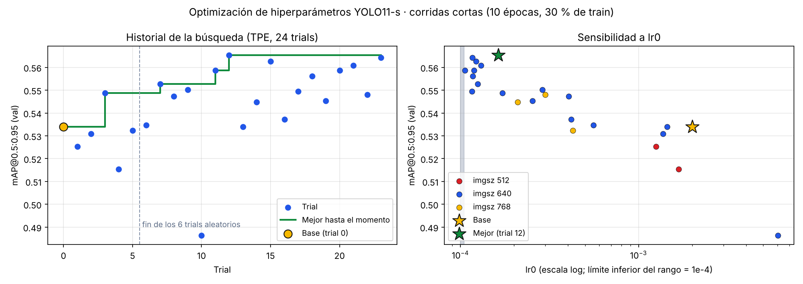
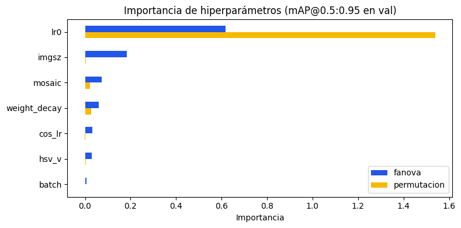
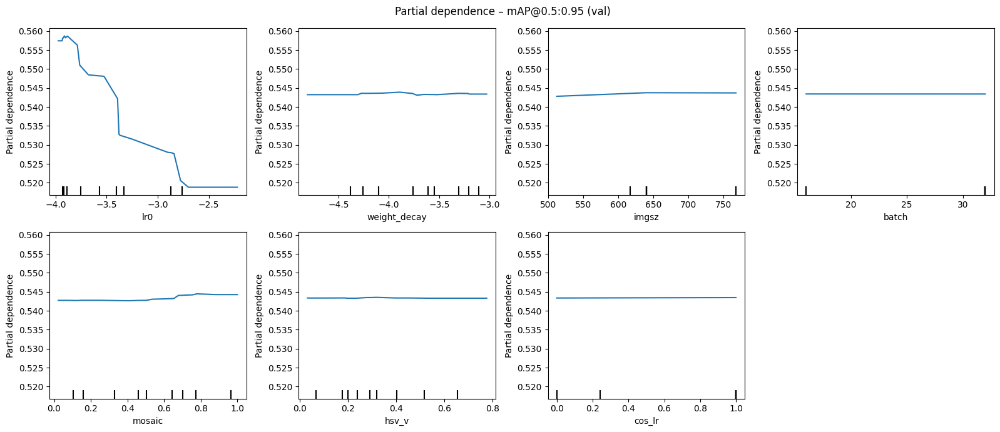
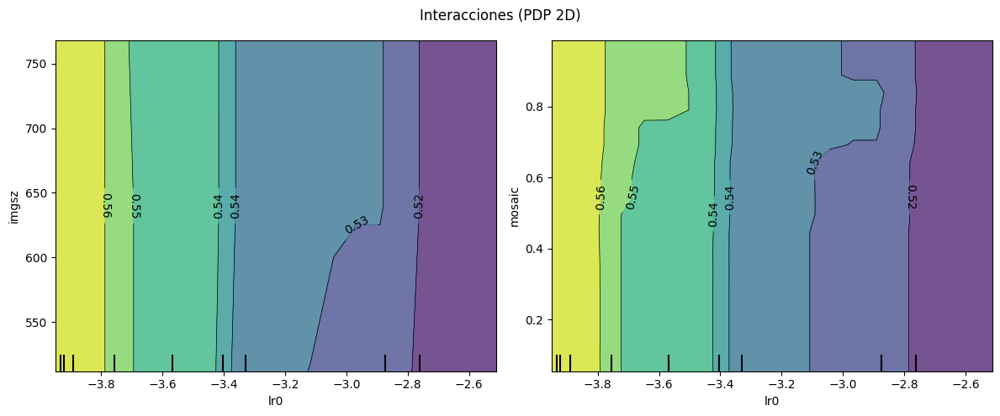
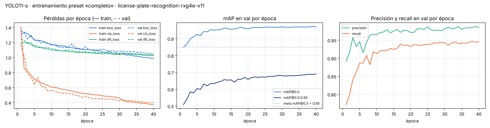
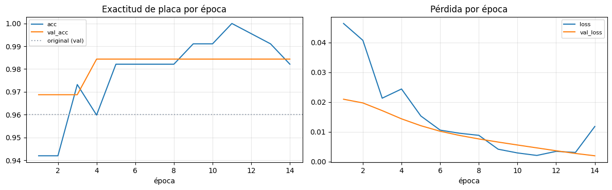

# Optimización de hiperparámetros – SIRAP (Workshop S5)

Notebook: `notebooks/04_optimizacion.ipynb` · Resultados: `results/metrics/optimizacion_*.csv|json` ·
Figuras: `results/figures/opt_*.png`

> **Estado (24/10/2026).** Estudio ejecutado en Colab (GPU T4): 24 corridas cortas (≈3,2 h) y el reentrenamiento
> de la mejor configuración con el protocolo completo (40 épocas, 1,19 h). Todas las cifras de este documento salen
> de esa corrida (`results/metrics/optimizacion_*.csv|json`). **Resultado:** `lr0` explica la mayor parte de la
> variación; la configuración optimizada sube el mAP@0.5:0.95 de *test* de 0,693 a 0,704 con el mismo mAP@0.5.
> El modelo entregado **se mantiene** (sección 5).

---

## 1. Qué se optimiza y con qué métrica

- **Modelo:** detector YOLO11-s (el OCR es un modelo preentrenado; su único «hiperparámetro» operativo es el
  umbral de confianza, que se trata en la sección 6).
- **Métrica objetivo:** mAP@0.5:0.95 en *val* (más exigente que mAP@0.5 con la localización, lo que importa para
  recortar bien la placa antes del OCR). Se reporta también mAP@0.5.
- **Presupuesto:** 24 corridas cortas (10 épocas, 30 % de *train*, validación con el *val* completo, semilla 0,
  `deterministic=True`), ≈3,2 h en una T4 (≈8 min por *trial*). La mejor configuración se reentrena luego con el protocolo
  completo (40 épocas, 100 % de los datos) y se compara con la base **en *test***.

## 2. Configuración base (antes de optimizar)

| Hiperparámetro | Valor base |
|---|---|
| `lr0` (tasa de aprendizaje inicial) | 0,002 (AdamW automático de Ultralytics) |
| `weight_decay` | 0,0005 |
| `imgsz` | 640 |
| `batch` | 16 |
| `mosaic` | 1,0 |
| `hsv_v` (brillo) | 0,4 |
| `cos_lr` | False |
| `epochs` / `patience` | 40 / 10 |

## 3. Espacio de búsqueda

| Hiperparámetro | Rango / valores | Escala | Por qué |
|---|---|---|---|
| `lr0` | 1e-4 – 1e-2 | logarítmica | Es el hiperparámetro que más suele mover la convergencia |
| `weight_decay` | 1e-5 – 1e-3 | logarítmica | Regularización; dataset de una clase propenso a sobreajuste |
| `imgsz` | 512, 640, 768 | categórica | Placas pequeñas (17,6 % del *test*) necesitan resolución |
| `batch` | 8, 16, 32 | categórica | Ruido del gradiente (con `nbs=64` el lote efectivo es fijo) |
| `mosaic` | 0 – 1 | lineal | Aumento que crea objetos pequeños y contextos variados |
| `hsv_v` | 0 – 0,8 | lineal | Robustez a iluminación (día, noche, sombra de la garita) |
| `cos_lr` | True / False | categórica | Forma del *scheduler* |

**Método:** búsqueda **bayesiana TPE** (Optuna, 24 *trials*, 6 aleatorios iniciales). El optimizador se fija en
`AdamW` de forma explícita: con `optimizer="auto"` Ultralytics ignora `lr0` y lo recalcula, y el estudio no mediría nada. Se eligió TPE frente a *grid search* porque 7 dimensiones × 3 valores serían 2 187
combinaciones.

## 4. Análisis de sensibilidad

El notebook produce, a partir de la tabla de *trials*:

1. **Ranking de importancia** con **fANOVA** (`optuna.importance.FanovaImportanceEvaluator`): qué fracción de la
   varianza del mAP explica cada hiperparámetro. Se contrasta con la importancia por permutación de un
   *random forest* sustituto (para no depender de un solo método).
2. **Partial dependence plots (PDP)** 1D: efecto promedio de cada hiperparámetro sobre el mAP predicho por el
   sustituto, manteniendo los demás en su distribución observada.
3. **Interacciones**: PDP 2D de los dos pares formados por los tres hiperparámetros más importantes.
4. **Historial de la búsqueda y sensibilidad a `lr0`**: mAP de cada *trial* y su relación con el hiperparámetro
   dominante (figura generada a partir de `optimizacion_trials.csv`).

### 4.0 Resultados de la búsqueda

| | Trial | `lr0` | `weight_decay` | `imgsz` | `batch` | `mosaic` | `hsv_v` | `cos_lr` | mAP@0.5:0.95 *val* | mAP@0.5 *val* |
|---|---|---|---|---|---|---|---|---|---|---|
| Base | 0 | 0,002 | 5,0e-4 | 640 | 16 | 1,00 | 0,40 | False | 0,534 | 0,923 |
| **Mejor** | **12** | **1,6e-4** | **9,3e-4** | **640** | **32** | **0,78** | **0,29** | **True** | **0,565** | 0,945 |
| 2.º | 23 | 1,2e-4 | 4,9e-4 | 640 | 32 | 0,88 | 0,32 | True | 0,564 | 0,951 |
| 3.º | 15 | 1,2e-4 | 1,3e-4 | 640 | 32 | 0,21 | 0,16 | True | 0,563 | 0,948 |
| Peor | 10 | 6,0e-3 | 4,9e-5 | 640 | 32 | 0,25 | 0,28 | True | 0,486 | 0,862 |

Con el protocolo corto, la mejor configuración supera a la base en **+0,031** de mAP@0.5:0.95 (+5,9 % relativo).
Los 10 *trials* con `lr0` ≤ 2e-4 promedian 0,558 (rango 0,549–0,565); los 6 con `lr0` > 1e-3, 0,521 (0,486–0,534).
Tabla completa: `results/metrics/optimizacion_trials.csv`.

### 4.1 Ranking de importancia

| # | Hiperparámetro | Importancia fANOVA | Importancia por permutación (RF) |
|---|---|---|---|
| 1 | `lr0` | **0,616** | **1,538** |
| 2 | `imgsz` | 0,183 | 0,005 |
| 3 | `mosaic` | 0,074 | 0,023 |
| 4 | `weight_decay` | 0,060 | 0,027 |
| 5 | `cos_lr` | 0,031 | ≈0 |
| 6 | `hsv_v` | 0,031 | 0,005 |
| 7 | `batch` | 0,005 | ≈0 |

fANOVA reparte la varianza del mAP (suma 1). La importancia por permutación es la caída del R² del *random forest*
sustituto al desordenar cada columna, por eso puede pasar de 1.

**Lectura.**
- **`lr0` domina en los dos métodos** (62 % de la varianza; correlación entre log10 `lr0` y mAP = −0,91). La base usa
  `lr0` = 0,002, el valor que elige el optimizador automático de Ultralytics; para afinar YOLO11-s preentrenado en
  COCO funciona mejor una tasa **≈10 veces menor** (1–2e-4).
- **`imgsz` no es confiable como 2.º lugar:** fANOVA le da 0,18, pero la permutación casi 0 y el PDP es plano. Solo
  2 *trials* usaron 512 px y los dos tenían `lr0` alto, así que fANOVA le atribuye parte del efecto de `lr0`
  (variables confundidas). 768 px no mejoró a 640 px en las corridas cortas.
- **`mosaic`, `weight_decay`, `hsv_v`, `cos_lr` y `batch` mueven poco el mAP** (< 0,01 en el PDP). Con `nbs=64`
  Ultralytics acumula gradientes hasta un lote efectivo de 64, lo que explica que `batch` casi no importe.
- **Limitación:** TPE concentró la búsqueda en la zona buena (20 de 24 *trials* con `batch` 32, 19 con 640 px y 19
  con `cos_lr`), así que esos hiperparámetros quedaron poco explorados; sus importancias son orientativas.

### 4.2 Partial dependence plots

- `lr0` (eje en log10): el mAP predicho cae de forma casi monótona de ≈0,558 en 1e-4 a ≈0,519 desde 2e-3. El
  óptimo está en el **borde inferior del rango** buscado (1e-4), así que valores aún menores podrían rendir igual o
  mejor; queda para un estudio futuro.
- `mosaic`: leve mejora por encima de ≈0,6 (+0,002). Las demás curvas son planas.

### 4.3 Interacciones

Pares analizados: `lr0 × imgsz` y `lr0 × mosaic`. Las curvas de nivel son casi verticales: el mAP depende de `lr0`
y prácticamente no de la otra variable, es decir, **no hay interacciones relevantes**. Basta con fijar bien `lr0`.

## 5. Configuración final y comparación antes / después

La mejor configuración (trial 12) se reentrenó con el protocolo completo: 40 épocas, 100 % de *train*, paciencia 10,
semilla 0. La base se evaluó con sus pesos ya entregados (no se reentrenó). Ambas en el mismo *test* (1 020 imágenes,
1 085 placas).

| Configuración | mAP@0.5 *test* | mAP@0.5:0.95 *test* | Precisión | Recall | mAP@0.5:0.95 *val* | Tiempo/época |
|---|---|---|---|---|---|---|
| Base (preset «completo», entregada) | 0,972 | 0,693 | 0,987 | 0,952 | 0,691 | ≈63 s (GPU L4) |
| Optimizada (trial 12) | 0,973 | **0,704** | 0,988 | 0,946 | 0,699 | ≈107 s (GPU T4) |
| Diferencia | +0,001 | **+0,011** (+1,6 %) | +0,002 | −0,006 | +0,008 | GPU distinta, no comparable |

Precisión y recall son los de Ultralytics (umbral de máximo F1). El mAP de placas pequeñas de la configuración
optimizada no se midió. La corrida completa terminó las 40 épocas sin que actuara el *early stopping*.

**Decisión: se mantiene el modelo entregado.**
- La mejora está en **mAP@0.5:0.95** (cajas más ajustadas), no en **encontrar** placas: el mAP@0.5 es el mismo
  (0,972 frente a 0,973) y el recall baja levemente (−0,006, ≈7 de 1 085 placas). SIRAP recorta la placa con un
  margen antes del OCR, así que una caja algo más ajustada casi no cambia la lectura.
- El criterio fijado de antemano pedía que la mejora superara la variación entre semillas. El notebook entrenó una
  sola semilla por configuración, así que +0,011 no se puede separar de esa variación; queda pendiente repetir con 2–3
  semillas.
- Cambiar el modelo obligaría a volver a exportar el ONNX, recalibrar el umbral del detector y repetir las
  evaluaciones de la app.

**Recomendación** para el próximo reentrenamiento: usar la configuración del trial 12, en especial `lr0` ≈ 1,6e-4
con `optimizer="AdamW"` y `cos_lr=True` (`results/metrics/optimizacion_resumen.json`).

## 6. Optimización de umbrales (ya aplicada)

Además de los hiperparámetros de entrenamiento, el sistema tiene dos umbrales de operación:

| Umbral | Cómo se fija | Valor |
|---|---|---|
| Confianza del detector | Calibrado **en *val*** (sección 4.1 del notebook): máx. F1 para seguir (`conf_track`) y menor umbral con precisión ≥ 95 % para decidir (`conf_decision`), con piso 0,10 | **0,30** y **0,30** (F1 máx. en val = 0,967) |
| Confianza OCR para decidir sin verificación manual | Estudio de confianza en SAVH (sección 4.3): se compararon umbrales 0,5–0,99 | En el estudio, **0,99** produjo 13 % a verificación manual y redujo las lecturas equivocadas aceptadas de 25 a 12; la aplicación publicada usa **0,94** |
| Tamaño de inferencia en video | Comparación 640 vs 1280 px en el video de la garita (sección 6.8 del notebook) | 1280 px en video, 640 px en imágenes |

### 6.1 Efecto de la regla de decisión optimizada (SAVH, lista simulada, 399 imágenes)

| Configuración | Falsos autorizados | Rechazos indebidos | A verificación manual |
|---|---|---|---|
| Sin umbral OCR | 0 de 202 | 1 de 197 | 4,0 % |
| Umbral OCR 0,99 (escenario medido en SAVH; no es el activo en la app) | 0 de 202 | 1 de 197 | 15,5 % |

En la evaluación SAVH, 0,99 baja el **peor caso** estimado de vehículos no autorizados que entrarían como
autorizados de 6,3 % a 3,0 % (sección 5.5 del notebook), a costa de más verificaciones manuales. El Space usa
0,94 por decisión del proyecto; por tanto, los resultados de este escenario no deben interpretarse como métricas
directas del umbral activo. Para comparar ambas configuraciones se requiere recalcular las métricas con 0,94.

### 6.2 Curvas del entrenamiento base

El mAP@0.5 de validación supera la meta (0,85) desde la época 2 y el mAP@0.5:0.95 sigue subiendo hasta la época 40
(0,691): el *early stopping* (paciencia 10) no se activó, lo que sugiere que más épocas podrían aportar algo en la
métrica estricta. Lo mismo ocurrió con la configuración optimizada (sección 5), así que `epochs` sigue siendo un
candidato para un estudio futuro.

## 7. Lecciones

- Los cambios de arquitectura (YOLOv8 → RF-DETR → YOLOv8n → YOLO11-s) y la elección de fast-plate-ocr, un OCR de
  5 MB hecho para placas que corre en CPU con 93,7 % de EMR en SAVH, tuvieron más impacto en el sistema que cualquier
  hiperparámetro.
- La resolución de inferencia (`imgsz`) fue decisiva para las placas pequeñas del video real.
- Entre los hiperparámetros de entrenamiento, **solo `lr0` importó de verdad**: el valor automático (0,002) era
  ≈10 veces alto para afinar un modelo preentrenado. Con el protocolo completo, corregirlo sube el mAP@0.5:0.95 en
  ≈0,01 y no cambia el mAP@0.5; los demás hiperparámetros mueven el mAP menos de 0,01.
- Las corridas cortas (10 épocas, 30 % de los datos) exageran las diferencias: +0,031 en la búsqueda frente a
  +0,011 con el protocolo completo.

## 8. Afinamiento del OCR con placas ecuatorianas (`notebooks/06_afinamiento_ocr.ipynb`)

`cct-s-v2-global-model` no incluye Ecuador entre sus regiones, aunque ya logra 93,7 % de EMR en SAVH Guayaquil.
El notebook 06 prueba si afinarlo mejora ese resultado sin sesgar la evaluación:

| Decisión | Por qué |
|---|---|
| Separación **por placa** (60 / 15 / 25 %) | Una placa repetida en *train* y *test* inflaría el EMR |
| Solo referencias confirmadas (`INCLUDE_UNCONFIRMED = False`) | Una etiqueta sin confirmar podría enseñar un error y además premiarlo en la evaluación |
| Partir de `cct_s_v2_global.keras` (pesos publicados por el autor) | Afinar, no entrenar desde cero: pocos cientos de ejemplos |
| *lr* 3e-4, *weight decay* 5e-4, sin *label smoothing*, 40 épocas con *early stopping* (10) | Cambios pequeños sobre un modelo que ya funciona |
| Aumentos suaves (±8°, brillo, desenfoque, ruido, compresión) | La garita varía más en luz y foco que en geometría |
| Misma métrica de OCR (EMR tras normalizar y CER); análisis de confianza con umbral 0,99 | Comparar el OCR y documentar el escenario evaluado |
| Se adopta solo si mejora el EMR con **McNemar p < 0,05** y no aumenta las lecturas equivocadas aceptadas | Con ≈100 imágenes de *test*, cada acierto vale ≈1 punto de EMR |

### 8.1 Resultados (corrida del 24/10/2026, Colab)

**Datos:** 330 recortes legibles de SAVH con referencia confirmada (las 69 sugerencias sin confirmar quedaron
fuera), 297 placas distintas, repartidas por placa en 194 / 50 / 86 imágenes (*train* / *val* / *test*).

**Entrenamiento:** partió de `cct_s_v2_global.keras`; la exactitud de placa en *val* subió de 0,969 (época 1) a
**0,984** en la época 4 y el *early stopping* lo detuvo en la época 14. El modelo original obtiene 0,960 en el mismo
*val*.

**Comparación en *test* (86 imágenes de placas que el modelo no vio):**

| Modelo | EMR | IC 95 % (Wilson) | CER | Aceptadas con confianza ≥ 0,99 | Equivocadas aceptadas |
|---|---|---|---|---|---|
| Original (`cct-s-v2-global-model`) | **94,2 %** | 87,1 % – 97,5 % | 0,013 | 90,7 % | 1 |
| Afinado con placas ecuatorianas | **94,2 %** | 87,1 % – 97,5 % | 0,013 | 89,5 % | 1 |

Los dos modelos aciertan y fallan **exactamente en las mismas imágenes** (0 placas que solo uno lee bien;
McNemar *p* = 1,0).

**Decisión: se mantiene el modelo original.** La mejora que se ve en *val* (0,960 → 0,984, una o dos imágenes) no se
repite en *test*: era ajuste al conjunto usado para elegir la época. El afinado además acepta un poco menos de
lecturas sin verificación manual (89,5 % frente a 90,7 %) sin reducir los errores aceptados.

**Interpretación.**
- El modelo general ya generaliza bien a placas ecuatorianas de una fila: los errores que quedan (≈5 de 86) son
  difíciles para ambos modelos (placas borrosas o con caracteres ambiguos como O/Q), no un problema de «región».
- Con 194 imágenes de entrenamiento no hay señal suficiente para mover un modelo entrenado con más de 85 000 placas.
- Vale la pena repetir el experimento cuando haya **más y mejores datos**: la hoja de revisión confirmada
  (`INCLUDE_UNCONFIRMED = True`, +69 imágenes difíciles) y recortes reales de la garita hechos por YOLO11-s
  (sección 7 del notebook de backend), que además permitirían medir el EMR punta a punta.

Resultados completos en `results/metrics/ocr_afinamiento.json`.
