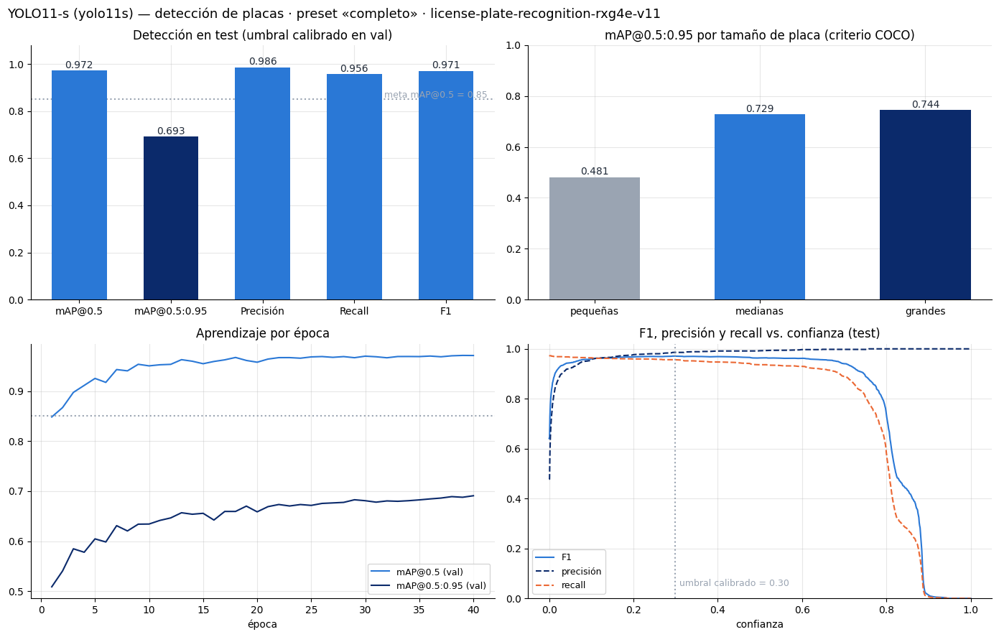

# Resultados de `SIRAP_backend.ipynb`

Este informe organiza por tema las métricas de la corrida guardada y las evaluaciones posteriores. Se distinguen los resultados originales de las reevaluaciones con referencias corregidas o nuevas imágenes. Las métricas de detector, OCR, video y garita tienen alcances diferentes y no deben combinarse como una sola medida de exactitud.

## Resumen de resultados

| Componente | Resultado vigente | Alcance |
|---|---:|---|
| Detector en test | mAP@0.5: 0,972; mAP@0.5:0.95: 0,693; precisión/recall/F1: 0,986/0,956/0,971 | Métricas del detector; no miden el OCR ni la operación completa |
| Placas pequeñas | mAP@0.5:0.95: 0,481 | Es el tamaño más difícil en la evaluación del detector |
| OCR SAVH, corrida guardada | EMR: 93,7 %; CER: 0,010 | 399 referencias; 69 eran sugerencias sin confirmar |
| OCR SAVH, recálculo posterior | EMR: 388/398 (97,49 %); CER: 0,003649 | Offline, condicionado a respuestas no ciegas; no equivale a validación independiente |
| Video, puntos de referencia corregidos | EMR: 11/18 (61,1 %); recall en puntos: 9/16 (56,25 %) | Muestra puntual, no cobertura completa de pasadas |
| Imágenes completas de garita | EMR: 8/21 (38,1 %) | Sección 7.3 ejecutada en una evaluación posterior; por debajo de la meta de 80 % |
| Entrenamiento de la corrida guardada | 40 épocas; 0,70 h; GPU NVIDIA L4 | Duración y equipo de esa corrida |
| Video, rendimiento | 65,7 FPS reportados por el notebook | Medición de la corrida guardada; no mezclar con tiempos de otras ejecuciones |

## 1. Detector y entrenamiento

En el conjunto de test, el detector obtuvo mAP@0.5 de **0,972**, mAP@0.5:0.95 de **0,693**, precisión de **0,986**, recall de **0,956** y F1 de **0,971**. La meta documentada para mAP@0.5 es 0,850. En placas pequeñas, el mAP@0.5:0.95 fue **0,481**, lo que indica que ese tamaño presenta mayor dificultad.

La corrida guardada entrenó durante 40 épocas y aproximadamente 0,70 horas en una GPU NVIDIA L4. La latencia de inferencia registrada fue de 13,0 ms de promedio y 15,1 ms en el percentil 95. Estas cifras corresponden a la medición del notebook y no deben interpretarse como latencia completa de una decisión de acceso.

## 2. OCR en el conjunto SAVH

### Resultado de la corrida guardada

El notebook registró EMR de **93,7 %** y CER de **0,010** sobre 399 recortes. En ese conjunto, 69 etiquetas eran sugerencias sin confirmar. Por ello, el resultado es una métrica offline del conjunto disponible y no debe presentarse como una evaluación con todas las referencias verificadas. Aunque el valor numérico supera la meta de EMR del 80 %, la calidad de las etiquetas limita esa conclusión.

La fuente de esta corrida es [ocr_savh.json](../../results/metrics/ocr_savh.json).

### Recálculo posterior con respuestas registradas

Un recálculo offline posterior excluyó una imagen ilegible y usó 398 recortes evaluables. Obtuvo **388/398 coincidencias exactas (97,49 %)** y CER medio por imagen de **0,003649**. No se ejecutó una inferencia nueva.

Esta métrica está condicionada a las respuestas de revisión registradas. En algunos desacuerdos, las sugerencias OCR estaban visibles para quien revisó las etiquetas, por lo que puede existir sesgo de confirmación. No es una evaluación ciega ni independiente, y no demuestra que el modelo haya mejorado. Mantenerla separada del resultado original evita mezclar diferentes referencias y denominadores.

Con umbral offline de 0,94, se aceptaron 362 resultados: 359 exactos y 3 erróneos; 36 pasarían a revisión manual. Con umbral 0,99, se aceptaron 346: 343 exactos y 3 erróneos; 52 pasarían a revisión. Estas cifras se calcularon sobre predicciones guardadas y no prueban por sí solas el comportamiento integral del backend.

Fuente agregada: [ocr_savh_aprobaciones_398.json](../../results/metrics/ocr_savh_aprobaciones_398.json). Las matrículas, imágenes y filas individuales no se incluyen en este informe.

## 3. Video operativo y referencia puntual

### Métricas de procesamiento

La corrida guardada procesó **18.115 cuadros** y reportó **52 placas leídas** y **65,7 FPS de pipeline**. Esos conteos y la velocidad describen procesamiento; sin una referencia exhaustiva e independiente no permiten calcular exactitud o recall para todos los vehículos.

En otro resumen operativo se informa un rendimiento de **61,77 FPS** y un tiempo total de **409,6 segundos** que incluye la escritura de salida. Como las salidas publicadas no especifican de forma suficiente el alcance temporal de ambas mediciones ni permiten reconciliar directamente 65,7 con 61,77 FPS, se conservan como mediciones separadas. No deben promediarse ni compararse como si provinieran del mismo cronómetro. Los valores internos registrados fueron 14,51 ms por cuadro para el detector, 0,45 ms para seguimiento, 225 llamadas OCR y 91,99 ms de detección más OCR por decisión.

### Evaluación puntual más reciente

La referencia corregida comprende **18 cuadros puntuales** y **16 placas distintas**. En esa reevaluación, 11 de 18 lecturas coincidieron exactamente (**61,1 %**) y se recuperaron 9 de 16 placas en los puntos (**56,25 %**). Se reportaron 7 falsas autorizaciones entre 52 lecturas (**13,46 %**); las 34 lecturas fuera de los cuadros anotados no se clasifican automáticamente como falsas, porque la referencia es dispersa.

La corrida guardada había reportado **55,6 %** de EMR y cero falsas autorizaciones en la referencia disponible. Ese resultado pertenece a la corrida y referencias anteriores. La reevaluación posterior corrigió las lecturas de los cuadros 208 y 660 y debe usarse al describir la referencia puntual actual.

Los 18 puntos no representan intervalos completos ni un censo de vehículos. No permiten afirmar la exactitud integral del video, medir el recall de todas las pasadas ni clasificar todas las lecturas fuera de referencia. La anotación completa por pasada y una segunda revisión humana independiente siguen pendientes.

Fuentes: [reporte de puntos provisionales](../../results/metrics/video_e2e_puntos_provisionales_20261101.md) y [revisión de la referencia](../../blind_eval/video_ground_truth_review.md).

## 4. Evaluación punta a punta con imágenes completas de garita

La sección 7.3 **se omitió en la corrida guardada** porque en ese momento no estaba disponible `garita/ground_truth.csv`. Posteriormente se proporcionaron 21 imágenes y su referencia privada, y la evaluación se ejecutó.

| Métrica | Resultado |
|---|---:|
| Imágenes evaluadas | 21 |
| Imágenes con detección de placa | 19/21 (90,5 %) |
| Coincidencia exacta de placa (EMR) | 8/21 (38,1 %) |
| Salidas con formato ecuatoriano válido | 16/21 (76,2 %) |
| Latencia media por imagen | 37,69 ms |
| Latencia p95 por imagen | 37,78 ms |
| Detección media | 20,18 ms |
| Falsas autorizaciones reportadas | 0 |

El EMR usa las 21 imágenes como denominador: la falta de detección o una transcripción distinta cuenta como error. El resultado de exactitud queda por debajo de la meta del proyecto de **80 %**. Como `authorized_plates.csv` estaba vacío, cero falsas autorizaciones no demuestra cómo se comportaría la autorización con una lista poblada.

Esta prueba cubre imágenes individuales: no evalúa seguimiento temporal ni sustituye la evaluación completa del video. La referencia fila por fila y el registro con predicciones permanecen privados. Los datos agregados están en [garita_imagenes_e2e](../../results/metrics/garita_imagenes_e2e_20261101.md).

## 5. Secciones omitidas y resultados no concluyentes

- **Modo en vivo:** se omitió porque no estaban configuradas las variables `CAMARA_URL` y `CAMARA_TOKEN`. La corrida no verifica la conexión a una cámara real.
- **Consultas de propietarios:** no produjeron registros. El log disponible muestra errores `TargetClosedError` al cerrar el navegador; por tanto, no se obtuvo un resultado concluyente de esas consultas.
- **Autorización con lista poblada:** no queda evaluada en la prueba de garita, porque la lista de placas autorizadas estaba vacía.
- **Evaluación integral del video:** sigue pendiente completar una referencia por pasada con intervalos inclusivos, incluir vehículos que el detector no encontró y obtener una segunda revisión independiente.

La corrida guardada reportó **cero falsas autorizaciones** frente a su referencia limitada. La evaluación puntual posterior reportó **7/52**. Son resultados de referencias y evaluaciones distintas; para describir el estado actual de la muestra puntual debe usarse el resultado posterior, sin generalizarlo a todo el video.

## 6. Videos y archivos pesados

El notebook no incrusta los videos ni las imágenes de diagnóstico grandes, para mantener compacto el archivo `.ipynb`. El video fuente de la garita, de 459,3 MB, se publica como asset del Release [`datos-garita-v1`](https://github.com/eduardoceballos666/SIRAP_2/releases/tag/datos-garita-v1), desde donde el notebook lo descarga.

Los videos de salida se conservan en Drive mediante estos enlaces:

- [Video anotado YOLO11 (65,2 MB)](https://drive.google.com/file/d/17Zn3Ceqx_nJ1lZJvQ8AxvBtd6qphjtzG/view)
- [Vista comprimida YOLO11 (41,7 MB)](https://drive.google.com/file/d/1Z7LIIIgbh4pn3y2NTDqWq-qrdGBtzRra/view)
- [Video original de garita (459,3 MB)](https://drive.google.com/file/d/1coC-FcoUtMCmTtq6K3C2Y9z7W7SfC5XC/view)

Los enlaces de Drive requieren que el usuario tenga acceso a esos archivos. Las métricas agregadas y gráficos pequeños se conservan en el repositorio; los videos de salida no están incluidos en este archivo Markdown.

## 7. Aplicación, repositorio y presentación

- [Aplicación desplegada](https://eduardoceballos-sirap.hf.space) · [Hugging Face Space](https://huggingface.co/spaces/eduardoceballos/SIRAP)
- [Repositorio SIRAP_2](https://github.com/eduardoceballos666/SIRAP_2) · [Documentación interactiva de la API](https://eduardoceballos-sirap.hf.space/docs)
- La interfaz publicada está disponible en español e inglés. Los videos de presentación y preguntas están enlazados al final del [README principal](../../README.md).
